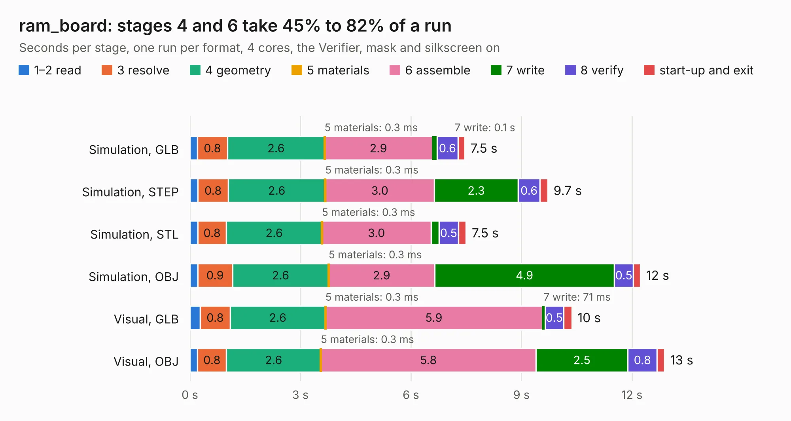

# 1613. ram_board

Board 1,613 of the 3,132 of [Corpus Testing](../Corpus-Testing.md), on [Corpus Page 15](../CorpusTestingPages/Corpus-Testing-15.md#1613-ram_board).

| Mode and format | 1–2 read | 3 resolve | 4 geometry | 5 materials | 6 assemble | 7 write | 8 verify | start-up and exit | Total |
|---|---:|---:|---:|---:|---:|---:|---:|---:|---:|
| Simulation, GLB | 0.2 | 0.8 | 2.6 | 0.3&nbsp;ms | 2.9 | 0.1 | 0.6 | 0.2 | 7.5 |
| Simulation, STEP | 0.2 | 0.8 | 2.6 | 0.3&nbsp;ms | 3.0 | 2.3 | 0.6 | 0.2 | 9.7 |
| Simulation, STL | 0.2 | 0.8 | 2.6 | 0.3&nbsp;ms | 3.0 | 0.2 | 0.5 | 0.2 | 7.5 |
| Simulation, OBJ | 0.2 | 0.9 | 2.6 | 0.3&nbsp;ms | 2.9 | 4.9 | 0.5 | 0.2 | 12.2 |
| Visual, GLB | 0.3 | 0.8 | 2.6 | 0.3&nbsp;ms | 5.9 | 71&nbsp;ms | 0.5 | 0.2 | 10.4 |
| Visual, OBJ | 0.2 | 0.8 | 2.6 | 0.3&nbsp;ms | 5.8 | 2.5 | 0.8 | 0.2 | 12.9 |

<table align="center"><tr><td valign="top">

| Board | Repo: [marqs85/ossc_pro_hw](https://github.com/marqs85/ossc_pro_hw) Board: `ram_board.kicad_pcb` |
|---|---|
| Folder | expansions / ram_board |
| Complexity | 254&nbsp;/&nbsp;1000 (size&nbsp;169, features&nbsp;85) |
| KESE&nbsp;features | through vias, slotted holes, rounded, trapezoid or chamfered pads, filled zones, stack-up, dielectric εr and tanδ |
| Tested | 9th November 2026 |
| Copper&nbsp;layers | 4 |
| File&nbsp;format | KiCad 6 (20211014) |
| Parts,&nbsp;tracks,&nbsp;vias | 11, 288, 153 |
| Triangles,&nbsp;simulation | 938,910 in 64 parts |
| Verifier | PASS in all six runs |

</td><td valign="top">

<table>
<tr><th>File type</th><th>File size</th><th>Peak memory used</th></tr>
<tr><th colspan="3" align="left">Simulation</th></tr>
<tr><td>GLB</td><td align="right">31&nbsp;MB</td><td align="right">439&nbsp;MB</td></tr>
<tr><td>STEP</td><td align="right">104&nbsp;MB</td><td align="right">509&nbsp;MB</td></tr>
<tr><td>STL</td><td align="right">47&nbsp;MB</td><td align="right">465&nbsp;MB</td></tr>
<tr><td>OBJ</td><td align="right">94&nbsp;MB</td><td align="right">644&nbsp;MB</td></tr>
<tr><th colspan="3" align="left">Visual</th></tr>
<tr><td>GLB</td><td align="right">17&nbsp;MB</td><td align="right">494&nbsp;MB</td></tr>
<tr><td>OBJ</td><td align="right">52&nbsp;MB</td><td align="right">448&nbsp;MB</td></tr>
</table>

</td></tr></table>

| Previous | Next |
|:---|---:|
| [1612. legacy_av_in](b1612b_ossc-pro-hw_legacy-av-in.md) | [1614. ossc_pro](b1614b_ossc-pro-hw_ossc-pro.md) |
