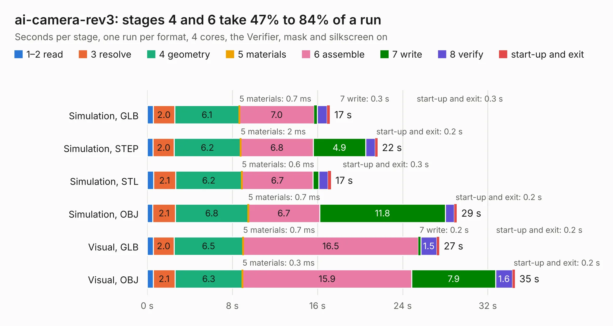

# 1616. ai-camera-rev3

Board 1,616 of the 3,102 of [Corpus Testing](../Corpus-Testing.md), on [Corpus Page 15](../CorpusTestingPages/Corpus-Testing-15.md#1616-ai-camera-rev3).

| Mode and format | 1–2 read | 3 resolve | 4 geometry | 5 materials | 6 assemble | 7 write | 8 verify | start-up and exit | Total |
|---|---:|---:|---:|---:|---:|---:|---:|---:|---:|
| Simulation, GLB | 0.6 | 2.0 | 6.1 | 0.7&nbsp;ms | 7.0 | 0.3 | 0.9 | 0.3 | 17.2 |
| Simulation, STEP | 0.6 | 2.0 | 6.2 | 2&nbsp;ms | 6.8 | 4.9 | 0.9 | 0.2 | 21.6 |
| Simulation, STL | 0.6 | 2.1 | 6.2 | 0.6&nbsp;ms | 6.7 | 0.5 | 0.9 | 0.3 | 17.3 |
| Simulation, OBJ | 0.5 | 2.1 | 6.8 | 0.7&nbsp;ms | 6.7 | 11.8 | 0.8 | 0.2 | 29.1 |
| Visual, GLB | 0.6 | 2.0 | 6.5 | 0.7&nbsp;ms | 16.5 | 0.2 | 1.5 | 0.2 | 27.5 |
| Visual, OBJ | 0.6 | 2.1 | 6.3 | 0.3&nbsp;ms | 15.9 | 7.9 | 1.6 | 0.2 | 34.5 |

<table align="center"><tr><td valign="top">

| Board | Repo: [maxlab-io/tokay-lite-pcb](https://github.com/maxlab-io/tokay-lite-pcb) Board: `ai-camera-rev3.kicad_pcb` |
|---|---|
| Folder | ai-camera-rev3 |
| Complexity | 314&nbsp;/&nbsp;1000 (size&nbsp;214, features&nbsp;100) |
| KESE&nbsp;features | through vias, slotted holes, rounded, trapezoid or chamfered pads, filled zones, curved board outline, stack-up, dielectric εr and tanδ, mask and silkscreen colours |
| Tested | 9th November 2026 |
| Copper&nbsp;layers | 4 |
| File&nbsp;format | KiCad 7 (20221018) |
| Parts,&nbsp;tracks,&nbsp;vias | 153, 1,215, 330 |
| Triangles,&nbsp;simulation | 2,090,940 in 113 parts |
| Verifier | PASS in all six runs |

</td><td valign="top">

<table>
<tr><th>File type</th><th>File size</th><th>Peak memory used</th></tr>
<tr><th colspan="3" align="left">Simulation</th></tr>
<tr><td>GLB</td><td align="right">70&nbsp;MB</td><td align="right">807&nbsp;MB</td></tr>
<tr><td>STEP</td><td align="right">293&nbsp;MB</td><td align="right">903&nbsp;MB</td></tr>
<tr><td>STL</td><td align="right">105&nbsp;MB</td><td align="right">790&nbsp;MB</td></tr>
<tr><td>OBJ</td><td align="right">218&nbsp;MB</td><td align="right">1.4&nbsp;GB</td></tr>
<tr><th colspan="3" align="left">Visual</th></tr>
<tr><td>GLB</td><td align="right">51&nbsp;MB</td><td align="right">1.1&nbsp;GB</td></tr>
<tr><td>OBJ</td><td align="right">156&nbsp;MB</td><td align="right">1.1&nbsp;GB</td></tr>
</table>

</td></tr></table>

| Previous | Next |
|:---|---:|
| [1615. ai-camera-rev3.2](b1615b_tokay-lite-pcb_ai-camera-rev3-2.md) | [1617. CM4_NAS](b1617b_CM4-NAS_CM4-NAS.md) |
