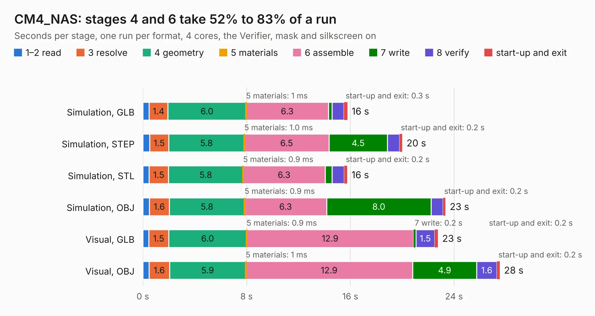

# 1617. CM4_NAS

Board 1,617 of the 3,102 of [Corpus Testing](../Corpus-Testing.md), on [Corpus Page 15](../CorpusTestingPages/Corpus-Testing-15.md#1617-cm4_nas).

| Mode and format | 1–2 read | 3 resolve | 4 geometry | 5 materials | 6 assemble | 7 write | 8 verify | start-up and exit | Total |
|---|---:|---:|---:|---:|---:|---:|---:|---:|---:|
| Simulation, GLB | 0.5 | 1.4 | 6.0 | 1&nbsp;ms | 6.3 | 0.3 | 0.9 | 0.3 | 15.8 |
| Simulation, STEP | 0.5 | 1.5 | 5.8 | 1.0&nbsp;ms | 6.5 | 4.5 | 0.9 | 0.2 | 20.0 |
| Simulation, STL | 0.5 | 1.5 | 5.8 | 0.9&nbsp;ms | 6.3 | 0.5 | 0.9 | 0.2 | 15.8 |
| Simulation, OBJ | 0.5 | 1.6 | 5.8 | 0.9&nbsp;ms | 6.3 | 8.0 | 0.9 | 0.2 | 23.3 |
| Visual, GLB | 0.5 | 1.5 | 6.0 | 0.9&nbsp;ms | 12.9 | 0.2 | 1.5 | 0.2 | 22.8 |
| Visual, OBJ | 0.5 | 1.6 | 5.9 | 1&nbsp;ms | 12.9 | 4.9 | 1.6 | 0.2 | 27.5 |

<table align="center"><tr><td valign="top">

| Board | Repo: [mebs/CM4-NAS](https://github.com/mebs/CM4-NAS) Board: `CM4_NAS.kicad_pcb` |
|---|---|
| Complexity | 297&nbsp;/&nbsp;1000 (size&nbsp;197, features&nbsp;100) |
| KESE&nbsp;features | through vias, slotted holes, rounded, trapezoid or chamfered pads, filled zones, curved board outline, stack-up, dielectric εr and tanδ, mask and silkscreen colours |
| Tested | 9th November 2026 |
| Copper&nbsp;layers | 4 |
| File&nbsp;format | KiCad 6 (20201002) |
| Parts,&nbsp;tracks,&nbsp;vias | 32, 1,776, 141 |
| Triangles,&nbsp;simulation | 1,943,028 in 179 parts |
| Verifier | PASS in all six runs |

</td><td valign="top">

<table>
<tr><th>File type</th><th>File size</th><th>Peak memory used</th></tr>
<tr><th colspan="3" align="left">Simulation</th></tr>
<tr><td>GLB</td><td align="right">66&nbsp;MB</td><td align="right">675&nbsp;MB</td></tr>
<tr><td>STEP</td><td align="right">306&nbsp;MB</td><td align="right">880&nbsp;MB</td></tr>
<tr><td>STL</td><td align="right">97&nbsp;MB</td><td align="right">675&nbsp;MB</td></tr>
<tr><td>OBJ</td><td align="right">202&nbsp;MB</td><td align="right">1.3&nbsp;GB</td></tr>
<tr><th colspan="3" align="left">Visual</th></tr>
<tr><td>GLB</td><td align="right">41&nbsp;MB</td><td align="right">866&nbsp;MB</td></tr>
<tr><td>OBJ</td><td align="right">125&nbsp;MB</td><td align="right">934&nbsp;MB</td></tr>
</table>

</td></tr></table>

| Previous | Next |
|:---|---:|
| [1616. ai-camera-rev3](b1616b_tokay-lite-pcb_ai-camera-rev3.md) | [1618. ecp5-dev-board](b1618b_ecp5-dev-board_ecp5-dev-board.md) |
