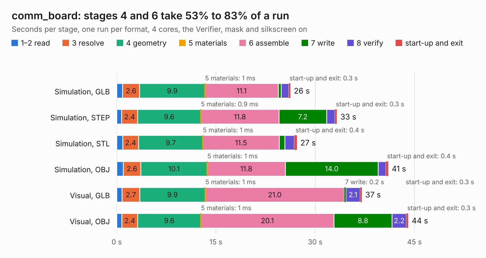

# 1617. comm_board

Board 1,617 of the 3,131 of [Corpus Testing](../Corpus-Testing.md), on [Corpus Page 15](../CorpusTestingPages/Corpus-Testing-15.md#1617-comm_board).

| Mode and format | 1–2 read | 3 resolve | 4 geometry | 5 materials | 6 assemble | 7 write | 8 verify | start-up and exit | Total |
|---|---:|---:|---:|---:|---:|---:|---:|---:|---:|
| Simulation, GLB | 0.9 | 2.6 | 9.9 | 1&nbsp;ms | 11.1 | 0.5 | 1.1 | 0.3 | 26.3 |
| Simulation, STEP | 0.8 | 2.4 | 9.6 | 0.9&nbsp;ms | 11.8 | 7.2 | 1.2 | 0.3 | 33.3 |
| Simulation, STL | 0.9 | 2.4 | 9.7 | 1&nbsp;ms | 11.5 | 0.8 | 1.5 | 0.4 | 27.2 |
| Simulation, OBJ | 1.0 | 2.6 | 10.1 | 1&nbsp;ms | 11.8 | 14.0 | 1.2 | 0.4 | 41.0 |
| Visual, GLB | 0.8 | 2.7 | 9.9 | 1&nbsp;ms | 21.0 | 0.2 | 2.1 | 0.3 | 37.1 |
| Visual, OBJ | 0.8 | 2.4 | 9.6 | 1&nbsp;ms | 20.1 | 8.8 | 2.2 | 0.3 | 44.1 |

<table align="center"><tr><td valign="top">

| Board | Repo: [matthiasgeorgimhof/hardware_csat](https://github.com/matthiasgeorgimhof/hardware_csat) Board: `comm_board.kicad_pcb` |
|---|---|
| Folder | comm_board |
| Complexity | 365&nbsp;/&nbsp;1000 (size&nbsp;260, features&nbsp;105) |
| KESE&nbsp;features | through vias, slotted holes, rounded, trapezoid or chamfered pads, drill offsets, filled zones, curved board outline, stack-up, dielectric εr and tanδ |
| Tested | 9th November 2026 |
| Copper&nbsp;layers | 4 |
| File&nbsp;format | KiCad 9 (20241229) |
| Parts,&nbsp;tracks,&nbsp;vias | 178, 1,254, 204 |
| Triangles,&nbsp;simulation | 2,325,158 in 222 parts |
| Verifier | PASS in all six runs |

</td><td valign="top">

<table>
<tr><th>File type</th><th>File size</th><th>Peak memory used</th></tr>
<tr><th colspan="3" align="left">Simulation</th></tr>
<tr><td>GLB</td><td align="right">78&nbsp;MB</td><td align="right">811&nbsp;MB</td></tr>
<tr><td>STEP</td><td align="right">326&nbsp;MB</td><td align="right">973&nbsp;MB</td></tr>
<tr><td>STL</td><td align="right">116&nbsp;MB</td><td align="right">822&nbsp;MB</td></tr>
<tr><td>OBJ</td><td align="right">243&nbsp;MB</td><td align="right">1.5&nbsp;GB</td></tr>
<tr><th colspan="3" align="left">Visual</th></tr>
<tr><td>GLB</td><td align="right">51&nbsp;MB</td><td align="right">1.1&nbsp;GB</td></tr>
<tr><td>OBJ</td><td align="right">158&nbsp;MB</td><td align="right">1.1&nbsp;GB</td></tr>
</table>

</td></tr></table>

| Previous | Next |
|:---|---:|
| [1616. AVIONICS_BOARD](b1616b_hardware-csat_AVIONICS-BOARD.md) | [1618. EPS](b1618b_hardware-csat_EPS.md) |
