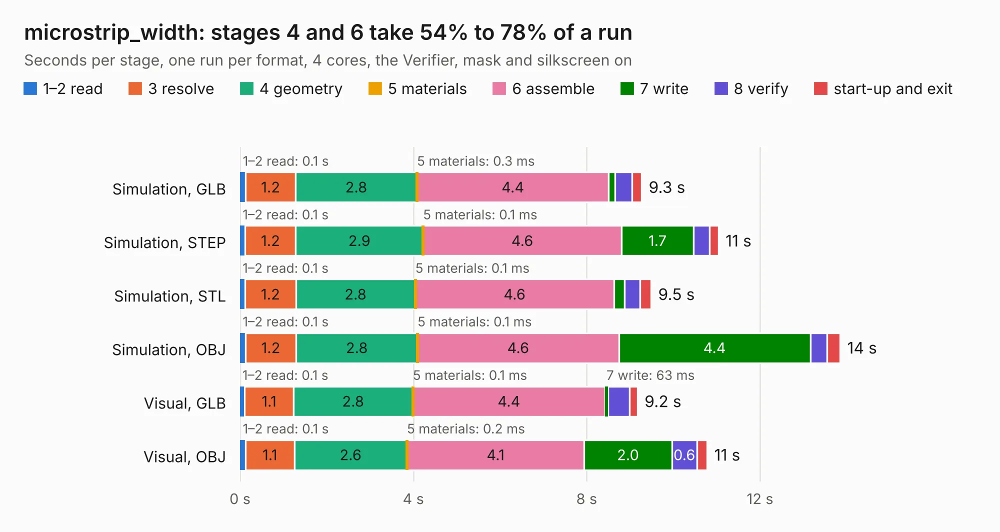

# 1618. microstrip_width

Board 1,618 of the 3,112 of [Corpus Testing](../Corpus-Testing.md), on [Corpus Page 15](../CorpusTestingPages/Corpus-Testing-15.md#1618-microstrip_width).

| Mode and format | 1–2 read | 3 resolve | 4 geometry | 5 materials | 6 assemble | 7 write | 8 verify | start-up and exit | Total |
|---|---:|---:|---:|---:|---:|---:|---:|---:|---:|
| Simulation, GLB | 0.1 | 1.2 | 2.8 | 0.3&nbsp;ms | 4.4 | 0.2 | 0.4 | 0.2 | 9.3 |
| Simulation, STEP | 0.1 | 1.2 | 2.9 | 0.1&nbsp;ms | 4.6 | 1.7 | 0.4 | 0.2 | 11.0 |
| Simulation, STL | 0.1 | 1.2 | 2.8 | 0.1&nbsp;ms | 4.6 | 0.2 | 0.4 | 0.3 | 9.5 |
| Simulation, OBJ | 0.1 | 1.2 | 2.8 | 0.1&nbsp;ms | 4.6 | 4.4 | 0.4 | 0.3 | 13.8 |
| Visual, GLB | 0.1 | 1.1 | 2.8 | 0.1&nbsp;ms | 4.4 | 63&nbsp;ms | 0.5 | 0.2 | 9.2 |
| Visual, OBJ | 0.1 | 1.1 | 2.6 | 0.2&nbsp;ms | 4.1 | 2.0 | 0.6 | 0.2 | 10.8 |

<table align="center"><tr><td valign="top">

| Board | Repo: [matthuszagh/fmcw](https://github.com/matthuszagh/fmcw) Board: `microstrip_width.kicad_pcb` |
|---|---|
| Folder | hardware / prototypes / microstrip_width |
| Complexity | 207&nbsp;/&nbsp;1000 (size&nbsp;172, features&nbsp;35) |
| KESE&nbsp;features | through vias, filled zones |
| Tested | 9th November 2026 |
| Copper&nbsp;layers | 4 |
| File&nbsp;format | KiCad 5 (20171130) |
| Parts,&nbsp;tracks,&nbsp;vias | 6, 3, 421 |
| Triangles,&nbsp;simulation | 947,684 in 16 parts |
| Verifier | PASS in all six runs |

</td><td valign="top">

<table>
<tr><th>File type</th><th>File size</th><th>Peak memory used</th></tr>
<tr><th colspan="3" align="left">Simulation</th></tr>
<tr><td>GLB</td><td align="right">30&nbsp;MB</td><td align="right">519&nbsp;MB</td></tr>
<tr><td>STEP</td><td align="right">49&nbsp;MB</td><td align="right">571&nbsp;MB</td></tr>
<tr><td>STL</td><td align="right">47&nbsp;MB</td><td align="right">510&nbsp;MB</td></tr>
<tr><td>OBJ</td><td align="right">95&nbsp;MB</td><td align="right">675&nbsp;MB</td></tr>
<tr><th colspan="3" align="left">Visual</th></tr>
<tr><td>GLB</td><td align="right">15&nbsp;MB</td><td align="right">428&nbsp;MB</td></tr>
<tr><td>OBJ</td><td align="right">45&nbsp;MB</td><td align="right">424&nbsp;MB</td></tr>
</table>

</td></tr></table>

| Previous | Next |
|:---|---:|
| [1617. coupler_nightly](b1617b_fmcw_coupler-nightly.md) | [1619. microstrip_width_nightly](b1619b_fmcw_microstrip-width-nightly.md) |
