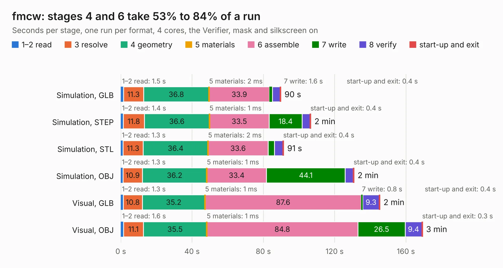

# 1619. fmcw

Board 1,619 of the 3,121 of [Corpus Testing](../Corpus-Testing.md), on [Corpus Page 15](../CorpusTestingPages/Corpus-Testing-15.md#1619-fmcw).

| Mode and format | 1–2 read | 3 resolve | 4 geometry | 5 materials | 6 assemble | 7 write | 8 verify | start-up and exit | Total |
|---|---:|---:|---:|---:|---:|---:|---:|---:|---:|
| Simulation, GLB | 1.5 | 11.3 | 36.8 | 2&nbsp;ms | 33.9 | 1.6 | 4.4 | 0.4 | 89.9 |
| Simulation, STEP | 1.4 | 11.8 | 36.6 | 1&nbsp;ms | 33.5 | 18.4 | 4.5 | 0.4 | 106.7 |
| Simulation, STL | 1.3 | 11.3 | 36.4 | 2&nbsp;ms | 33.6 | 3.6 | 4.7 | 0.4 | 91.4 |
| Simulation, OBJ | 1.3 | 10.9 | 36.2 | 1&nbsp;ms | 33.4 | 44.1 | 4.5 | 0.4 | 130.9 |
| Visual, GLB | 1.3 | 10.8 | 35.2 | 1&nbsp;ms | 87.6 | 0.8 | 9.3 | 0.4 | 145.4 |
| Visual, OBJ | 1.6 | 11.1 | 35.5 | 1&nbsp;ms | 84.8 | 26.5 | 9.4 | 0.3 | 169.4 |

<table align="center"><tr><td valign="top">

| Board | Repo: [matthuszagh/fmcw](https://github.com/matthuszagh/fmcw) Board: `fmcw.kicad_pcb` |
|---|---|
| Folder | hardware / boards / rev2b |
| Complexity | 406&nbsp;/&nbsp;1000 (size&nbsp;316, features&nbsp;90) |
| KESE&nbsp;features | through vias, slotted holes, custom pads, rounded, trapezoid or chamfered pads, filled zones, copper drawings, curved board outline |
| Tested | 9th November 2026 |
| Copper&nbsp;layers | 4 |
| File&nbsp;format | KiCad 5 (20171130) |
| Parts,&nbsp;tracks,&nbsp;vias | 436, 4,693, 1,437 |
| Triangles,&nbsp;simulation | 7,841,176 in 279 parts |
| Verifier | PASS in all six runs |

</td><td valign="top">

<table>
<tr><th>File type</th><th>File size</th><th>Peak memory used</th></tr>
<tr><th colspan="3" align="left">Simulation</th></tr>
<tr><td>GLB</td><td align="right">269&nbsp;MB</td><td align="right">2.8&nbsp;GB</td></tr>
<tr><td>STEP</td><td align="right">1.1&nbsp;GB</td><td align="right">2.9&nbsp;GB</td></tr>
<tr><td>STL</td><td align="right">392&nbsp;MB</td><td align="right">2.6&nbsp;GB</td></tr>
<tr><td>OBJ</td><td align="right">860&nbsp;MB</td><td align="right">5.0&nbsp;GB</td></tr>
<tr><th colspan="3" align="left">Visual</th></tr>
<tr><td>GLB</td><td align="right">170&nbsp;MB</td><td align="right">2.7&nbsp;GB</td></tr>
<tr><td>OBJ</td><td align="right">554&nbsp;MB</td><td align="right">3.5&nbsp;GB</td></tr>
</table>

</td></tr></table>

| Previous | Next |
|:---|---:|
| [1618. fmcw](b1618b_fmcw_hardware-boards-rev2a_fmcw.md) | [1620. fmcw_nightly](b1620b_fmcw_fmcw-nightly.md) |
