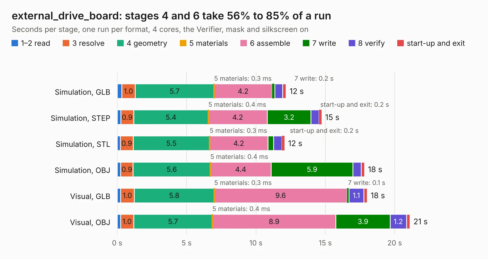

# 1619. external_drive_board

Board 1,619 of the 3,100 of [Corpus Testing](../Corpus-Testing.md), on [Corpus Page 15](../CorpusTestingPages/Corpus-Testing-15.md#1619-external_drive_board).

| Mode and format | 1–2 read | 3 resolve | 4 geometry | 5 materials | 6 assemble | 7 write | 8 verify | start-up and exit | Total |
|---|---:|---:|---:|---:|---:|---:|---:|---:|---:|
| Simulation, GLB | 0.3 | 1.0 | 5.7 | 0.3&nbsp;ms | 4.2 | 0.2 | 0.6 | 0.2 | 12.2 |
| Simulation, STEP | 0.3 | 0.9 | 5.4 | 0.4&nbsp;ms | 4.2 | 3.2 | 0.6 | 0.2 | 14.7 |
| Simulation, STL | 0.2 | 0.9 | 5.5 | 0.3&nbsp;ms | 4.2 | 0.4 | 0.6 | 0.2 | 12.1 |
| Simulation, OBJ | 0.3 | 0.9 | 5.6 | 0.4&nbsp;ms | 4.4 | 5.9 | 0.6 | 0.2 | 17.8 |
| Visual, GLB | 0.2 | 1.0 | 5.8 | 0.3&nbsp;ms | 9.6 | 0.1 | 1.1 | 0.2 | 18.0 |
| Visual, OBJ | 0.2 | 1.0 | 5.7 | 0.4&nbsp;ms | 8.9 | 3.9 | 1.2 | 0.2 | 21.1 |

<table align="center"><tr><td valign="top">

| Board | Repo: [MEGA65/mega65-r3-expansion-board](https://github.com/MEGA65/mega65-r3-expansion-board) Board: `external_drive_board.kicad_pcb` |
|---|---|
| Folder | external_drive_board |
| Complexity | 208&nbsp;/&nbsp;1000 (size&nbsp;163, features&nbsp;45) |
| KESE&nbsp;features | through vias, slotted holes, filled zones |
| Tested | 9th November 2026 |
| Copper&nbsp;layers | 2 |
| File&nbsp;format | KiCad 7 (20221018) |
| Parts,&nbsp;tracks,&nbsp;vias | 30, 578, 60 |
| Triangles,&nbsp;simulation | 1,447,024 in 69 parts |
| Verifier | PASS in all six runs |

</td><td valign="top">

<table>
<tr><th>File type</th><th>File size</th><th>Peak memory used</th></tr>
<tr><th colspan="3" align="left">Simulation</th></tr>
<tr><td>GLB</td><td align="right">49&nbsp;MB</td><td align="right">612&nbsp;MB</td></tr>
<tr><td>STEP</td><td align="right">221&nbsp;MB</td><td align="right">666&nbsp;MB</td></tr>
<tr><td>STL</td><td align="right">72&nbsp;MB</td><td align="right">678&nbsp;MB</td></tr>
<tr><td>OBJ</td><td align="right">148&nbsp;MB</td><td align="right">971&nbsp;MB</td></tr>
<tr><th colspan="3" align="left">Visual</th></tr>
<tr><td>GLB</td><td align="right">33&nbsp;MB</td><td align="right">712&nbsp;MB</td></tr>
<tr><td>OBJ</td><td align="right">98&nbsp;MB</td><td align="right">773&nbsp;MB</td></tr>
</table>

</td></tr></table>

| Previous | Next |
|:---|---:|
| [1618. expansion_connector_board](b1618b_mega65-r3-expansion-board_expansion-connector-board.md) | [1620. jtag_base_board](b1620b_mega65-r3-expansion-board_jtag-base-board.md) |
