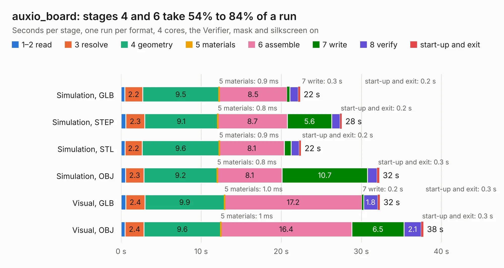

# 1620. auxio_board

Board 1,620 of the 3,138 of [Corpus Testing](../Corpus-Testing.md), on [Corpus Page 15](../CorpusTestingPages/Corpus-Testing-15.md#1620-auxio_board).

| Mode and format | 1–2 read | 3 resolve | 4 geometry | 5 materials | 6 assemble | 7 write | 8 verify | start-up and exit | Total |
|---|---:|---:|---:|---:|---:|---:|---:|---:|---:|
| Simulation, GLB | 0.5 | 2.2 | 9.5 | 0.9&nbsp;ms | 8.5 | 0.3 | 1.1 | 0.2 | 22.4 |
| Simulation, STEP | 0.6 | 2.3 | 9.1 | 0.8&nbsp;ms | 8.7 | 5.6 | 1.0 | 0.2 | 27.6 |
| Simulation, STL | 0.5 | 2.2 | 9.6 | 0.9&nbsp;ms | 8.1 | 0.9 | 1.0 | 0.2 | 22.5 |
| Simulation, OBJ | 0.6 | 2.3 | 9.2 | 0.8&nbsp;ms | 8.1 | 10.7 | 1.2 | 0.3 | 32.2 |
| Visual, GLB | 0.6 | 2.4 | 9.9 | 1.0&nbsp;ms | 17.2 | 0.2 | 1.8 | 0.3 | 32.3 |
| Visual, OBJ | 0.5 | 2.4 | 9.6 | 1&nbsp;ms | 16.4 | 6.5 | 2.1 | 0.3 | 37.8 |

<table align="center"><tr><td valign="top">

| Board | Repo: [matthiasgeorgimhof/hardware_csat](https://github.com/matthiasgeorgimhof/hardware_csat) Board: `auxio_board.kicad_pcb` |
|---|---|
| Folder | auxio_board |
| Complexity | 351&nbsp;/&nbsp;1000 (size&nbsp;246, features&nbsp;105) |
| KESE&nbsp;features | through vias, slotted holes, rounded, trapezoid or chamfered pads, drill offsets, filled zones, curved board outline, stack-up, dielectric εr and tanδ |
| Tested | 9th November 2026 |
| Copper&nbsp;layers | 4 |
| File&nbsp;format | KiCad 9 (20241229) |
| Parts,&nbsp;tracks,&nbsp;vias | 128, 942, 204 |
| Triangles,&nbsp;simulation | 2,361,290 in 180 parts |
| Verifier | PASS in all six runs |

</td><td valign="top">

<table>
<tr><th>File type</th><th>File size</th><th>Peak memory used</th></tr>
<tr><th colspan="3" align="left">Simulation</th></tr>
<tr><td>GLB</td><td align="right">79&nbsp;MB</td><td align="right">766&nbsp;MB</td></tr>
<tr><td>STEP</td><td align="right">292&nbsp;MB</td><td align="right">986&nbsp;MB</td></tr>
<tr><td>STL</td><td align="right">118&nbsp;MB</td><td align="right">758&nbsp;MB</td></tr>
<tr><td>OBJ</td><td align="right">246&nbsp;MB</td><td align="right">1.6&nbsp;GB</td></tr>
<tr><th colspan="3" align="left">Visual</th></tr>
<tr><td>GLB</td><td align="right">47&nbsp;MB</td><td align="right">995&nbsp;MB</td></tr>
<tr><td>OBJ</td><td align="right">143&nbsp;MB</td><td align="right">1.0&nbsp;GB</td></tr>
</table>

</td></tr></table>

| Previous | Next |
|:---|---:|
| [1619. aux_board](b1619b_hardware-csat_aux-board.md) | [1621. AVIONICS_BOARD](b1621b_hardware-csat_AVIONICS-BOARD.md) |
