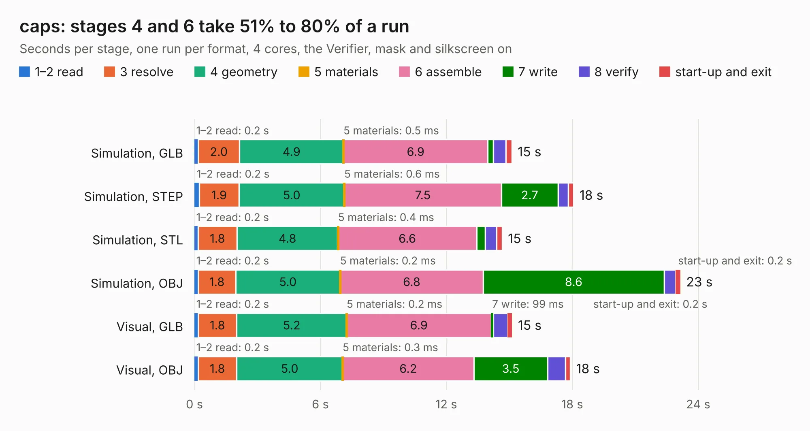

# 1621. caps

Board 1,621 of the 3,121 of [Corpus Testing](../Corpus-Testing.md), on [Corpus Page 16](../CorpusTestingPages/Corpus-Testing-16.md#1621-caps).

| Mode and format | 1–2 read | 3 resolve | 4 geometry | 5 materials | 6 assemble | 7 write | 8 verify | start-up and exit | Total |
|---|---:|---:|---:|---:|---:|---:|---:|---:|---:|
| Simulation, GLB | 0.2 | 2.0 | 4.9 | 0.5&nbsp;ms | 6.9 | 0.3 | 0.6 | 0.3 | 15.1 |
| Simulation, STEP | 0.2 | 1.9 | 5.0 | 0.6&nbsp;ms | 7.5 | 2.7 | 0.5 | 0.3 | 18.1 |
| Simulation, STL | 0.2 | 1.8 | 4.8 | 0.4&nbsp;ms | 6.6 | 0.4 | 0.5 | 0.3 | 14.7 |
| Simulation, OBJ | 0.2 | 1.8 | 5.0 | 0.2&nbsp;ms | 6.8 | 8.6 | 0.6 | 0.2 | 23.2 |
| Visual, GLB | 0.2 | 1.8 | 5.2 | 0.2&nbsp;ms | 6.9 | 99&nbsp;ms | 0.7 | 0.2 | 15.1 |
| Visual, OBJ | 0.2 | 1.8 | 5.0 | 0.3&nbsp;ms | 6.2 | 3.5 | 0.8 | 0.2 | 17.9 |

<table align="center"><tr><td valign="top">

| Board | Repo: [matthuszagh/fmcw](https://github.com/matthuszagh/fmcw) Board: `caps.kicad_pcb` |
|---|---|
| Folder | hardware / prototypes / caps |
| Complexity | 225&nbsp;/&nbsp;1000 (size&nbsp;180, features&nbsp;45) |
| KESE&nbsp;features | through vias, rounded, trapezoid or chamfered pads, filled zones |
| Tested | 9th November 2026 |
| Copper&nbsp;layers | 4 |
| File&nbsp;format | KiCad 5 (20171130) |
| Parts,&nbsp;tracks,&nbsp;vias | 11, 10, 492 |
| Triangles,&nbsp;simulation | 1,512,272 in 19 parts |
| Verifier | PASS in all six runs |

</td><td valign="top">

<table>
<tr><th>File type</th><th>File size</th><th>Peak memory used</th></tr>
<tr><th colspan="3" align="left">Simulation</th></tr>
<tr><td>GLB</td><td align="right">48&nbsp;MB</td><td align="right">646&nbsp;MB</td></tr>
<tr><td>STEP</td><td align="right">113&nbsp;MB</td><td align="right">753&nbsp;MB</td></tr>
<tr><td>STL</td><td align="right">76&nbsp;MB</td><td align="right">682&nbsp;MB</td></tr>
<tr><td>OBJ</td><td align="right">154&nbsp;MB</td><td align="right">992&nbsp;MB</td></tr>
<tr><th colspan="3" align="left">Visual</th></tr>
<tr><td>GLB</td><td align="right">21&nbsp;MB</td><td align="right">615&nbsp;MB</td></tr>
<tr><td>OBJ</td><td align="right">65&nbsp;MB</td><td align="right">663&nbsp;MB</td></tr>
</table>

</td></tr></table>

| Previous | Next |
|:---|---:|
| [1620. fmcw_nightly](b1620b_fmcw_fmcw-nightly.md) | [1622. caps_nightly](b1622b_fmcw_caps-nightly.md) |
