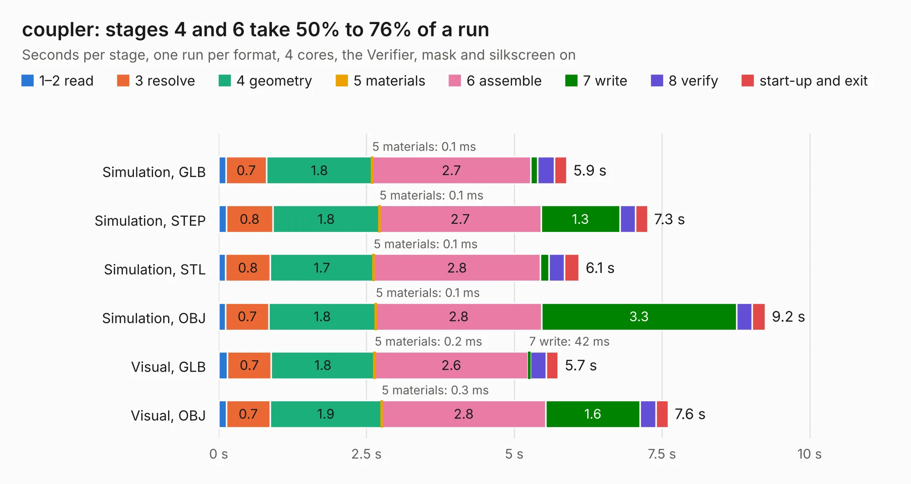

# 1622. coupler

Board 1,622 of the 3,119 of [Corpus Testing](../Corpus-Testing.md), on [Corpus Page 16](../CorpusTestingPages/Corpus-Testing-16.md#1622-coupler).

| Mode and format | 1–2 read | 3 resolve | 4 geometry | 5 materials | 6 assemble | 7 write | 8 verify | start-up and exit | Total |
|---|---:|---:|---:|---:|---:|---:|---:|---:|---:|
| Simulation, GLB | 0.1 | 0.7 | 1.8 | 0.1&nbsp;ms | 2.7 | 0.1 | 0.3 | 0.2 | 5.9 |
| Simulation, STEP | 0.1 | 0.8 | 1.8 | 0.1&nbsp;ms | 2.7 | 1.3 | 0.3 | 0.2 | 7.3 |
| Simulation, STL | 0.1 | 0.8 | 1.7 | 0.1&nbsp;ms | 2.8 | 0.1 | 0.3 | 0.2 | 6.1 |
| Simulation, OBJ | 0.1 | 0.7 | 1.8 | 0.1&nbsp;ms | 2.8 | 3.3 | 0.3 | 0.2 | 9.2 |
| Visual, GLB | 0.1 | 0.7 | 1.8 | 0.2&nbsp;ms | 2.6 | 42&nbsp;ms | 0.3 | 0.2 | 5.7 |
| Visual, OBJ | 0.1 | 0.7 | 1.9 | 0.3&nbsp;ms | 2.8 | 1.6 | 0.3 | 0.2 | 7.6 |

<table align="center"><tr><td valign="top">

| Board | Repo: [matthuszagh/fmcw](https://github.com/matthuszagh/fmcw) Board: `coupler.kicad_pcb` |
|---|---|
| Folder | hardware / prototypes / coupler |
| Complexity | 199&nbsp;/&nbsp;1000 (size&nbsp;164, features&nbsp;35) |
| KESE&nbsp;features | through vias, filled zones |
| Tested | 9th November 2026 |
| Copper&nbsp;layers | 4 |
| File&nbsp;format | KiCad 5 (20171130) |
| Parts,&nbsp;tracks,&nbsp;vias | 5, 72, 278 |
| Triangles,&nbsp;simulation | 647,556 in 18 parts |
| Verifier | PASS in all six runs |

</td><td valign="top">

<table>
<tr><th>File type</th><th>File size</th><th>Peak memory used</th></tr>
<tr><th colspan="3" align="left">Simulation</th></tr>
<tr><td>GLB</td><td align="right">21&nbsp;MB</td><td align="right">396&nbsp;MB</td></tr>
<tr><td>STEP</td><td align="right">38&nbsp;MB</td><td align="right">446&nbsp;MB</td></tr>
<tr><td>STL</td><td align="right">32&nbsp;MB</td><td align="right">404&nbsp;MB</td></tr>
<tr><td>OBJ</td><td align="right">65&nbsp;MB</td><td align="right">435&nbsp;MB</td></tr>
<tr><th colspan="3" align="left">Visual</th></tr>
<tr><td>GLB</td><td align="right">10&nbsp;MB</td><td align="right">377&nbsp;MB</td></tr>
<tr><td>OBJ</td><td align="right">31&nbsp;MB</td><td align="right">373&nbsp;MB</td></tr>
</table>

</td></tr></table>

| Previous | Next |
|:---|---:|
| [1621. caps_nightly](b1621b_fmcw_caps-nightly.md) | [1623. coupler_nightly](b1623b_fmcw_coupler-nightly.md) |
