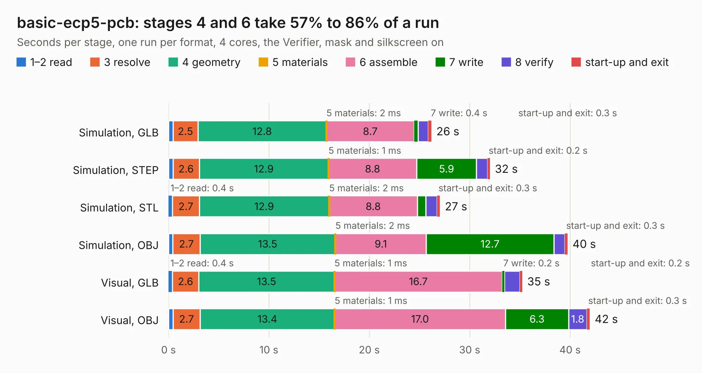

# 1623. basic-ecp5-pcb

Board 1,623 of the 3,116 of [Corpus Testing](../Corpus-Testing.md), on [Corpus Page 16](../CorpusTestingPages/Corpus-Testing-16.md#1623-basic-ecp5-pcb).

| Mode and format | 1–2 read | 3 resolve | 4 geometry | 5 materials | 6 assemble | 7 write | 8 verify | start-up and exit | Total |
|---|---:|---:|---:|---:|---:|---:|---:|---:|---:|
| Simulation, GLB | 0.4 | 2.5 | 12.8 | 2&nbsp;ms | 8.7 | 0.4 | 1.0 | 0.3 | 26.2 |
| Simulation, STEP | 0.4 | 2.6 | 12.9 | 1&nbsp;ms | 8.8 | 5.9 | 1.1 | 0.2 | 32.0 |
| Simulation, STL | 0.4 | 2.7 | 12.9 | 2&nbsp;ms | 8.8 | 0.8 | 1.1 | 0.3 | 27.0 |
| Simulation, OBJ | 0.4 | 2.7 | 13.5 | 2&nbsp;ms | 9.1 | 12.7 | 1.1 | 0.3 | 39.7 |
| Visual, GLB | 0.4 | 2.6 | 13.5 | 1&nbsp;ms | 16.7 | 0.2 | 1.6 | 0.2 | 35.2 |
| Visual, OBJ | 0.4 | 2.7 | 13.4 | 1&nbsp;ms | 17.0 | 6.3 | 1.8 | 0.3 | 42.0 |

<table align="center"><tr><td valign="top">

| Board | Repo: [mattvenn/basic-ecp5-pcb](https://github.com/mattvenn/basic-ecp5-pcb) Board: `basic-ecp5-pcb.kicad_pcb` |
|---|---|
| Folder | hardware |
| Complexity | 305&nbsp;/&nbsp;1000 (size&nbsp;250, features&nbsp;55) |
| KESE&nbsp;features | through vias, rounded, trapezoid or chamfered pads, filled zones, curved board outline |
| Tested | 9th November 2026 |
| Copper&nbsp;layers | 4 |
| File&nbsp;format | KiCad 5 (20171130) |
| Parts,&nbsp;tracks,&nbsp;vias | 62, 1,148, 130 |
| Triangles,&nbsp;simulation | 2,343,666 in 255 parts |
| Verifier | PASS in all six runs |

</td><td valign="top">

<table>
<tr><th>File type</th><th>File size</th><th>Peak memory used</th></tr>
<tr><th colspan="3" align="left">Simulation</th></tr>
<tr><td>GLB</td><td align="right">81&nbsp;MB</td><td align="right">707&nbsp;MB</td></tr>
<tr><td>STEP</td><td align="right">348&nbsp;MB</td><td align="right">928&nbsp;MB</td></tr>
<tr><td>STL</td><td align="right">117&nbsp;MB</td><td align="right">708&nbsp;MB</td></tr>
<tr><td>OBJ</td><td align="right">248&nbsp;MB</td><td align="right">1.6&nbsp;GB</td></tr>
<tr><th colspan="3" align="left">Visual</th></tr>
<tr><td>GLB</td><td align="right">42&nbsp;MB</td><td align="right">927&nbsp;MB</td></tr>
<tr><td>OBJ</td><td align="right">126&nbsp;MB</td><td align="right">925&nbsp;MB</td></tr>
</table>

</td></tr></table>

| Previous | Next |
|:---|---:|
| [1622. microstrip_width_nightly](b1622b_fmcw_microstrip-width-nightly.md) | [1624. ai-camera](b1624b_tokay-lite-pcb_ai-camera-rev0_ai-camera.md) |
