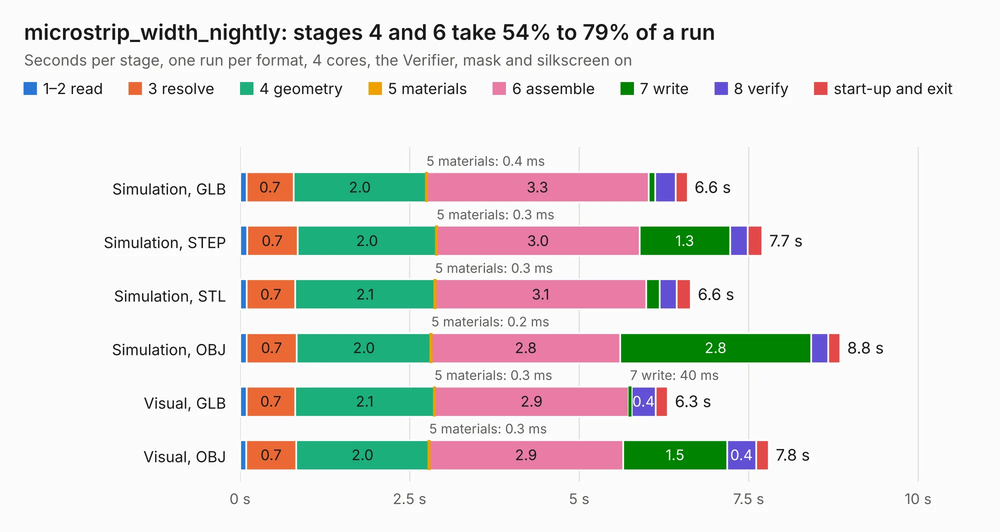

# 1623. microstrip_width_nightly

Board 1,623 of the 3,117 of [Corpus Testing](../Corpus-Testing.md), on [Corpus Page 16](../CorpusTestingPages/Corpus-Testing-16.md#1623-microstrip_width_nightly).

| Mode and format | 1–2 read | 3 resolve | 4 geometry | 5 materials | 6 assemble | 7 write | 8 verify | start-up and exit | Total |
|---|---:|---:|---:|---:|---:|---:|---:|---:|---:|
| Simulation, GLB | 93&nbsp;ms | 0.7 | 2.0 | 0.4&nbsp;ms | 3.3 | 94&nbsp;ms | 0.3 | 0.2 | 6.6 |
| Simulation, STEP | 0.1 | 0.7 | 2.0 | 0.3&nbsp;ms | 3.0 | 1.3 | 0.3 | 0.2 | 7.7 |
| Simulation, STL | 96&nbsp;ms | 0.7 | 2.1 | 0.3&nbsp;ms | 3.1 | 0.2 | 0.2 | 0.2 | 6.6 |
| Simulation, OBJ | 95&nbsp;ms | 0.7 | 2.0 | 0.2&nbsp;ms | 2.8 | 2.8 | 0.3 | 0.2 | 8.8 |
| Visual, GLB | 98&nbsp;ms | 0.7 | 2.1 | 0.3&nbsp;ms | 2.9 | 40&nbsp;ms | 0.4 | 0.2 | 6.3 |
| Visual, OBJ | 92&nbsp;ms | 0.7 | 2.0 | 0.3&nbsp;ms | 2.9 | 1.5 | 0.4 | 0.2 | 7.8 |

<table align="center"><tr><td valign="top">

| Board | Repo: [matthuszagh/fmcw](https://github.com/matthuszagh/fmcw) Board: `microstrip_width_nightly.kicad_pcb` |
|---|---|
| Folder | hardware / prototypes / microstrip_width |
| Complexity | 238&nbsp;/&nbsp;1000 (size&nbsp;168, features&nbsp;70) |
| KESE&nbsp;features | through vias, filled zones, stack-up, dielectric εr and tanδ, mask and silkscreen colours |
| Tested | 9th November 2026 |
| Copper&nbsp;layers | 4 |
| File&nbsp;format | KiCad 6 (20200119) |
| Parts,&nbsp;tracks,&nbsp;vias | 6, 3, 335 |
| Triangles,&nbsp;simulation | 749,524 in 16 parts |
| Verifier | PASS in all six runs |

</td><td valign="top">

<table>
<tr><th>File type</th><th>File size</th><th>Peak memory used</th></tr>
<tr><th colspan="3" align="left">Simulation</th></tr>
<tr><td>GLB</td><td align="right">23&nbsp;MB</td><td align="right">446&nbsp;MB</td></tr>
<tr><td>STEP</td><td align="right">30&nbsp;MB</td><td align="right">478&nbsp;MB</td></tr>
<tr><td>STL</td><td align="right">37&nbsp;MB</td><td align="right">448&nbsp;MB</td></tr>
<tr><td>OBJ</td><td align="right">74&nbsp;MB</td><td align="right">482&nbsp;MB</td></tr>
<tr><th colspan="3" align="left">Visual</th></tr>
<tr><td>GLB</td><td align="right">12&nbsp;MB</td><td align="right">372&nbsp;MB</td></tr>
<tr><td>OBJ</td><td align="right">35&nbsp;MB</td><td align="right">401&nbsp;MB</td></tr>
</table>

</td></tr></table>

| Previous | Next |
|:---|---:|
| [1622. microstrip_width](b1622b_fmcw_microstrip-width.md) | [1624. basic-ecp5-pcb](b1624b_basic-ecp5-pcb_basic-ecp5-pcb.md) |
