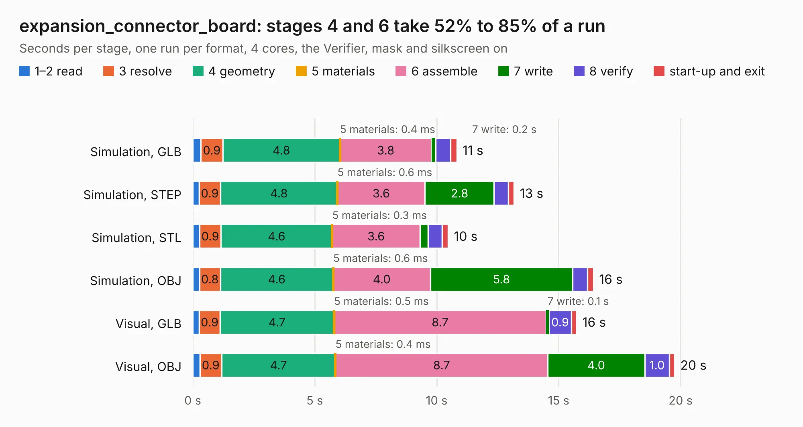

# 1625. expansion_connector_board

Board 1,625 of the 3,107 of [Corpus Testing](../Corpus-Testing.md), on [Corpus Page 16](../CorpusTestingPages/Corpus-Testing-16.md#1625-expansion_connector_board).

| Mode and format | 1–2 read | 3 resolve | 4 geometry | 5 materials | 6 assemble | 7 write | 8 verify | start-up and exit | Total |
|---|---:|---:|---:|---:|---:|---:|---:|---:|---:|
| Simulation, GLB | 0.3 | 0.9 | 4.8 | 0.4&nbsp;ms | 3.8 | 0.2 | 0.6 | 0.3 | 10.8 |
| Simulation, STEP | 0.3 | 0.9 | 4.8 | 0.6&nbsp;ms | 3.6 | 2.8 | 0.6 | 0.2 | 13.2 |
| Simulation, STL | 0.3 | 0.9 | 4.6 | 0.3&nbsp;ms | 3.6 | 0.3 | 0.6 | 0.3 | 10.5 |
| Simulation, OBJ | 0.3 | 0.8 | 4.6 | 0.6&nbsp;ms | 4.0 | 5.8 | 0.6 | 0.2 | 16.4 |
| Visual, GLB | 0.3 | 0.9 | 4.7 | 0.5&nbsp;ms | 8.7 | 0.1 | 0.9 | 0.2 | 15.7 |
| Visual, OBJ | 0.3 | 0.9 | 4.7 | 0.4&nbsp;ms | 8.7 | 4.0 | 1.0 | 0.2 | 19.8 |

<table align="center"><tr><td valign="top">

| Board | Repo: [MEGA65/mega65-r3-expansion-board](https://github.com/MEGA65/mega65-r3-expansion-board) Board: `expansion_connector_board.kicad_pcb` |
|---|---|
| Folder | expansion_connector_board |
| Complexity | 284&nbsp;/&nbsp;1000 (size&nbsp;159, features&nbsp;125) |
| KESE&nbsp;features | through vias, custom pads, rounded, trapezoid or chamfered pads, drill offsets, arc tracks, filled zones, copper drawings, stack-up, dielectric εr and tanδ |
| Tested | 9th November 2026 |
| Copper&nbsp;layers | 2 |
| File&nbsp;format | KiCad 9 (20241229) |
| Parts,&nbsp;tracks,&nbsp;vias | 18, 683, 47 |
| Triangles,&nbsp;simulation | 1,114,064 in 92 parts |
| Verifier | PASS in all six runs |

</td><td valign="top">

<table>
<tr><th>File type</th><th>File size</th><th>Peak memory used</th></tr>
<tr><th colspan="3" align="left">Simulation</th></tr>
<tr><td>GLB</td><td align="right">38&nbsp;MB</td><td align="right">511&nbsp;MB</td></tr>
<tr><td>STEP</td><td align="right">167&nbsp;MB</td><td align="right">568&nbsp;MB</td></tr>
<tr><td>STL</td><td align="right">56&nbsp;MB</td><td align="right">494&nbsp;MB</td></tr>
<tr><td>OBJ</td><td align="right">112&nbsp;MB</td><td align="right">768&nbsp;MB</td></tr>
<tr><th colspan="3" align="left">Visual</th></tr>
<tr><td>GLB</td><td align="right">26&nbsp;MB</td><td align="right">622&nbsp;MB</td></tr>
<tr><td>OBJ</td><td align="right">77&nbsp;MB</td><td align="right">605&nbsp;MB</td></tr>
</table>

</td></tr></table>

| Previous | Next |
|:---|---:|
| [1624. mega65-kbd](b1624b_mega65-kbd-pcb_mega65-kbd.md) | [1626. external_drive_board](b1626b_mega65-r3-expansion-board_external-drive-board.md) |
