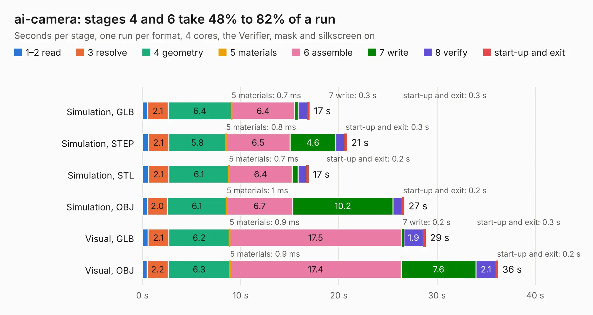

# 1626. ai-camera

Board 1,626 of the 3,118 of [Corpus Testing](../Corpus-Testing.md), on [Corpus Page 16](../CorpusTestingPages/Corpus-Testing-16.md#1626-ai-camera).

| Mode and format | 1–2 read | 3 resolve | 4 geometry | 5 materials | 6 assemble | 7 write | 8 verify | start-up and exit | Total |
|---|---:|---:|---:|---:|---:|---:|---:|---:|---:|
| Simulation, GLB | 0.5 | 2.1 | 6.4 | 0.7&nbsp;ms | 6.4 | 0.3 | 0.9 | 0.3 | 17.0 |
| Simulation, STEP | 0.6 | 2.1 | 5.8 | 0.8&nbsp;ms | 6.5 | 4.6 | 0.9 | 0.3 | 20.8 |
| Simulation, STL | 0.6 | 2.1 | 6.1 | 0.7&nbsp;ms | 6.4 | 0.6 | 0.8 | 0.2 | 16.9 |
| Simulation, OBJ | 0.5 | 2.0 | 6.1 | 1&nbsp;ms | 6.7 | 10.2 | 0.9 | 0.2 | 26.7 |
| Visual, GLB | 0.6 | 2.1 | 6.2 | 0.9&nbsp;ms | 17.5 | 0.2 | 1.9 | 0.3 | 28.9 |
| Visual, OBJ | 0.5 | 2.2 | 6.3 | 0.9&nbsp;ms | 17.4 | 7.6 | 2.1 | 0.2 | 36.2 |

<table align="center"><tr><td valign="top">

| Board | Repo: [maxlab-io/tokay-lite-pcb](https://github.com/maxlab-io/tokay-lite-pcb) Board: `ai-camera.kicad_pcb` |
|---|---|
| Folder | ai-camera-rev0 |
| Complexity | 339&nbsp;/&nbsp;1000 (size&nbsp;214, features&nbsp;125) |
| KESE&nbsp;features | through vias, slotted holes, custom pads, rounded, trapezoid or chamfered pads, filled zones, copper drawings, curved board outline, stack-up, dielectric εr and tanδ, mask and silkscreen colours |
| Tested | 9th November 2026 |
| Copper&nbsp;layers | 4 |
| File&nbsp;format | KiCad 6 (20211014) |
| Parts,&nbsp;tracks,&nbsp;vias | 130, 1,351, 340 |
| Triangles,&nbsp;simulation | 2,141,088 in 108 parts |
| Verifier | PASS in all six runs |

</td><td valign="top">

<table>
<tr><th>File type</th><th>File size</th><th>Peak memory used</th></tr>
<tr><th colspan="3" align="left">Simulation</th></tr>
<tr><td>GLB</td><td align="right">72&nbsp;MB</td><td align="right">876&nbsp;MB</td></tr>
<tr><td>STEP</td><td align="right">293&nbsp;MB</td><td align="right">965&nbsp;MB</td></tr>
<tr><td>STL</td><td align="right">107&nbsp;MB</td><td align="right">812&nbsp;MB</td></tr>
<tr><td>OBJ</td><td align="right">223&nbsp;MB</td><td align="right">1.4&nbsp;GB</td></tr>
<tr><th colspan="3" align="left">Visual</th></tr>
<tr><td>GLB</td><td align="right">51&nbsp;MB</td><td align="right">1.1&nbsp;GB</td></tr>
<tr><td>OBJ</td><td align="right">158&nbsp;MB</td><td align="right">1.2&nbsp;GB</td></tr>
</table>

</td></tr></table>

| Previous | Next |
|:---|---:|
| [1625. basic-ecp5-pcb](b1625b_basic-ecp5-pcb_basic-ecp5-pcb.md) | [1627. ai-camera](b1627b_tokay-lite-pcb_ai-camera-rev1_ai-camera.md) |
