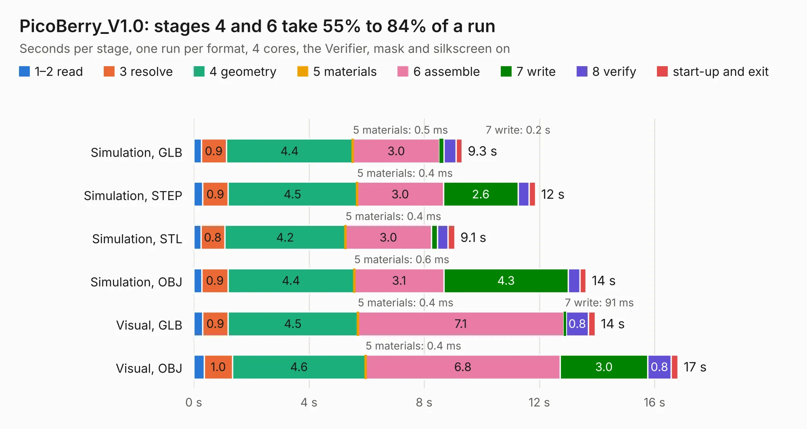

# 1627. PicoBerry_V1.0

Board 1,627 of the 3,101 of [Corpus Testing](../Corpus-Testing.md), on [Corpus Page 16](../CorpusTestingPages/Corpus-Testing-16.md#1627-picoberry_v10).

| Mode and format | 1–2 read | 3 resolve | 4 geometry | 5 materials | 6 assemble | 7 write | 8 verify | start-up and exit | Total |
|---|---:|---:|---:|---:|---:|---:|---:|---:|---:|
| Simulation, GLB | 0.3 | 0.9 | 4.4 | 0.5&nbsp;ms | 3.0 | 0.2 | 0.4 | 0.2 | 9.3 |
| Simulation, STEP | 0.3 | 0.9 | 4.5 | 0.4&nbsp;ms | 3.0 | 2.6 | 0.4 | 0.2 | 11.9 |
| Simulation, STL | 0.2 | 0.8 | 4.2 | 0.4&nbsp;ms | 3.0 | 0.2 | 0.4 | 0.2 | 9.1 |
| Simulation, OBJ | 0.3 | 0.9 | 4.4 | 0.6&nbsp;ms | 3.1 | 4.3 | 0.4 | 0.2 | 13.6 |
| Visual, GLB | 0.3 | 0.9 | 4.5 | 0.4&nbsp;ms | 7.1 | 91&nbsp;ms | 0.8 | 0.2 | 13.9 |
| Visual, OBJ | 0.4 | 1.0 | 4.6 | 0.4&nbsp;ms | 6.8 | 3.0 | 0.8 | 0.2 | 16.8 |

<table align="center"><tr><td valign="top">

| Board | Repo: [mfolejewski/PicoBerry](https://github.com/mfolejewski/PicoBerry) Board: `PicoBerry_V1.0.kicad_pcb` |
|---|---|
| Folder | source files / KiCad |
| Complexity | 285&nbsp;/&nbsp;1000 (size&nbsp;160, features&nbsp;125) |
| KESE&nbsp;features | through vias, slotted holes, rounded, trapezoid or chamfered pads, arc tracks, filled zones, curved board outline, stack-up, dielectric εr and tanδ, copper finish |
| Tested | 9th November 2026 |
| Copper&nbsp;layers | 2 |
| File&nbsp;format | KiCad 6 (20211014) |
| Parts,&nbsp;tracks,&nbsp;vias | 21, 637, 52 |
| Triangles,&nbsp;simulation | 823,516 in 98 parts |
| Verifier | PASS in all six runs |

</td><td valign="top">

<table>
<tr><th>File type</th><th>File size</th><th>Peak memory used</th></tr>
<tr><th colspan="3" align="left">Simulation</th></tr>
<tr><td>GLB</td><td align="right">29&nbsp;MB</td><td align="right">398&nbsp;MB</td></tr>
<tr><td>STEP</td><td align="right">164&nbsp;MB</td><td align="right">495&nbsp;MB</td></tr>
<tr><td>STL</td><td align="right">41&nbsp;MB</td><td align="right">406&nbsp;MB</td></tr>
<tr><td>OBJ</td><td align="right">84&nbsp;MB</td><td align="right">592&nbsp;MB</td></tr>
<tr><th colspan="3" align="left">Visual</th></tr>
<tr><td>GLB</td><td align="right">20&nbsp;MB</td><td align="right">494&nbsp;MB</td></tr>
<tr><td>OBJ</td><td align="right">60&nbsp;MB</td><td align="right">533&nbsp;MB</td></tr>
</table>

</td></tr></table>

| Previous | Next |
|:---|---:|
| [1626. nubus-to-ztex](b1626b_NuBusFPGA_nubus-to-ztex.md) | [1628. CM5IO](b1628b_openxtcm5-head-unit_CM5IO.md) |
