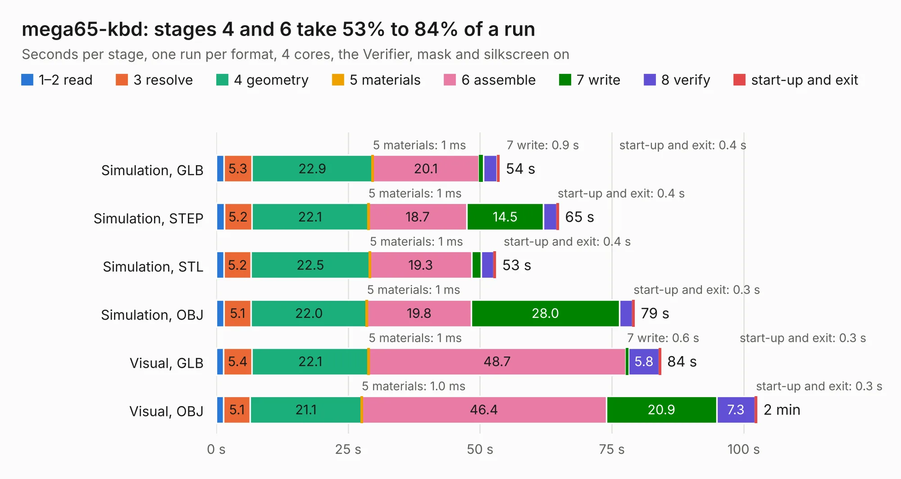

# 1627. mega65-kbd

Board 1,627 of the 3,110 of [Corpus Testing](../Corpus-Testing.md), on [Corpus Page 16](../CorpusTestingPages/Corpus-Testing-16.md#1627-mega65-kbd).

| Mode and format | 1–2 read | 3 resolve | 4 geometry | 5 materials | 6 assemble | 7 write | 8 verify | start-up and exit | Total |
|---|---:|---:|---:|---:|---:|---:|---:|---:|---:|
| Simulation, GLB | 1.4 | 5.3 | 22.9 | 1&nbsp;ms | 20.1 | 0.9 | 2.6 | 0.4 | 53.6 |
| Simulation, STEP | 1.5 | 5.2 | 22.1 | 1&nbsp;ms | 18.7 | 14.5 | 2.5 | 0.4 | 64.9 |
| Simulation, STL | 1.4 | 5.2 | 22.5 | 1&nbsp;ms | 19.3 | 1.8 | 2.4 | 0.4 | 53.0 |
| Simulation, OBJ | 1.5 | 5.1 | 22.0 | 1&nbsp;ms | 19.8 | 28.0 | 2.5 | 0.3 | 79.3 |
| Visual, GLB | 1.4 | 5.4 | 22.1 | 1&nbsp;ms | 48.7 | 0.6 | 5.8 | 0.3 | 84.3 |
| Visual, OBJ | 1.4 | 5.1 | 21.1 | 1.0&nbsp;ms | 46.4 | 20.9 | 7.3 | 0.3 | 102.5 |

<table align="center"><tr><td valign="top">

| Board | Repo: [MEGA65/mega65-kbd-pcb](https://github.com/MEGA65/mega65-kbd-pcb) Board: `mega65-kbd.kicad_pcb` |
|---|---|
| Complexity | 237&nbsp;/&nbsp;1000 (size&nbsp;192, features&nbsp;45) |
| KESE&nbsp;features | through vias, filled zones, curved board outline |
| Tested | 9th November 2026 |
| Copper&nbsp;layers | 2 |
| File&nbsp;format | KiCad 6 (20211014) |
| Parts,&nbsp;tracks,&nbsp;vias | 105, 1,364, 210 |
| Triangles,&nbsp;simulation | 4,669,240 in 287 parts |
| Verifier | PASS in all six runs |

</td><td valign="top">

<table>
<tr><th>File type</th><th>File size</th><th>Peak memory used</th></tr>
<tr><th colspan="3" align="left">Simulation</th></tr>
<tr><td>GLB</td><td align="right">157&nbsp;MB</td><td align="right">1.7&nbsp;GB</td></tr>
<tr><td>STEP</td><td align="right">680&nbsp;MB</td><td align="right">1.9&nbsp;GB</td></tr>
<tr><td>STL</td><td align="right">233&nbsp;MB</td><td align="right">1.7&nbsp;GB</td></tr>
<tr><td>OBJ</td><td align="right">493&nbsp;MB</td><td align="right">3.0&nbsp;GB</td></tr>
<tr><th colspan="3" align="left">Visual</th></tr>
<tr><td>GLB</td><td align="right">112&nbsp;MB</td><td align="right">2.0&nbsp;GB</td></tr>
<tr><td>OBJ</td><td align="right">357&nbsp;MB</td><td align="right">2.3&nbsp;GB</td></tr>
</table>

</td></tr></table>

| Previous | Next |
|:---|---:|
| [1626. ecp5-dev-board](b1626b_ecp5-dev-board_ecp5-dev-board.md) | [1628. expansion_connector_board](b1628b_mega65-r3-expansion-board_expansion-connector-board.md) |
