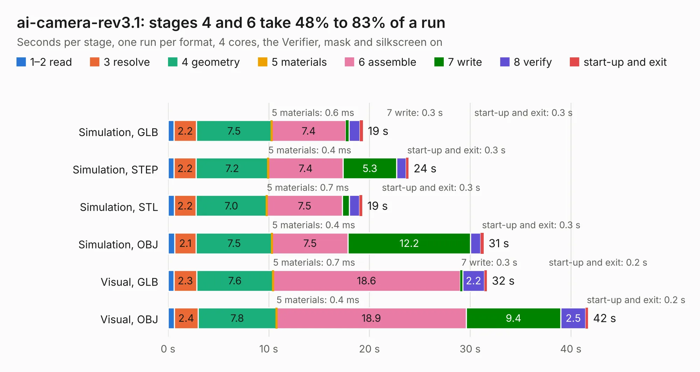

# 1628. ai-camera-rev3.1

Board 1,628 of the 3,117 of [Corpus Testing](../Corpus-Testing.md), on [Corpus Page 16](../CorpusTestingPages/Corpus-Testing-16.md#1628-ai-camera-rev31).

| Mode and format | 1–2 read | 3 resolve | 4 geometry | 5 materials | 6 assemble | 7 write | 8 verify | start-up and exit | Total |
|---|---:|---:|---:|---:|---:|---:|---:|---:|---:|
| Simulation, GLB | 0.6 | 2.2 | 7.5 | 0.6&nbsp;ms | 7.4 | 0.3 | 1.1 | 0.3 | 19.4 |
| Simulation, STEP | 0.6 | 2.2 | 7.2 | 0.4&nbsp;ms | 7.4 | 5.3 | 0.9 | 0.3 | 23.9 |
| Simulation, STL | 0.6 | 2.2 | 7.0 | 0.7&nbsp;ms | 7.5 | 0.7 | 1.0 | 0.3 | 19.3 |
| Simulation, OBJ | 0.7 | 2.1 | 7.5 | 0.4&nbsp;ms | 7.5 | 12.2 | 1.0 | 0.3 | 31.3 |
| Visual, GLB | 0.6 | 2.3 | 7.6 | 0.7&nbsp;ms | 18.6 | 0.3 | 2.2 | 0.2 | 31.7 |
| Visual, OBJ | 0.6 | 2.4 | 7.8 | 0.4&nbsp;ms | 18.9 | 9.4 | 2.5 | 0.2 | 41.7 |

<table align="center"><tr><td valign="top">

| Board | Repo: [maxlab-io/tokay-lite-pcb](https://github.com/maxlab-io/tokay-lite-pcb) Board: `ai-camera-rev3.1.kicad_pcb` |
|---|---|
| Folder | ai-camera-rev3.1 |
| Complexity | 314&nbsp;/&nbsp;1000 (size&nbsp;214, features&nbsp;100) |
| KESE&nbsp;features | through vias, slotted holes, rounded, trapezoid or chamfered pads, filled zones, curved board outline, stack-up, dielectric εr and tanδ, mask and silkscreen colours |
| Tested | 9th November 2026 |
| Copper&nbsp;layers | 4 |
| File&nbsp;format | KiCad 7 (20221018) |
| Parts,&nbsp;tracks,&nbsp;vias | 153, 1,223, 330 |
| Triangles,&nbsp;simulation | 2,082,322 in 113 parts |
| Verifier | PASS in all six runs |

</td><td valign="top">

<table>
<tr><th>File type</th><th>File size</th><th>Peak memory used</th></tr>
<tr><th colspan="3" align="left">Simulation</th></tr>
<tr><td>GLB</td><td align="right">70&nbsp;MB</td><td align="right">809&nbsp;MB</td></tr>
<tr><td>STEP</td><td align="right">291&nbsp;MB</td><td align="right">929&nbsp;MB</td></tr>
<tr><td>STL</td><td align="right">104&nbsp;MB</td><td align="right">822&nbsp;MB</td></tr>
<tr><td>OBJ</td><td align="right">217&nbsp;MB</td><td align="right">1.4&nbsp;GB</td></tr>
<tr><th colspan="3" align="left">Visual</th></tr>
<tr><td>GLB</td><td align="right">51&nbsp;MB</td><td align="right">933&nbsp;MB</td></tr>
<tr><td>OBJ</td><td align="right">156&nbsp;MB</td><td align="right">1.1&nbsp;GB</td></tr>
</table>

</td></tr></table>

| Previous | Next |
|:---|---:|
| [1627. ai-camera-rev2](b1627b_tokay-lite-pcb_ai-camera-rev2.md) | [1629. ai-camera-rev3.2](b1629b_tokay-lite-pcb_ai-camera-rev3-2.md) |
