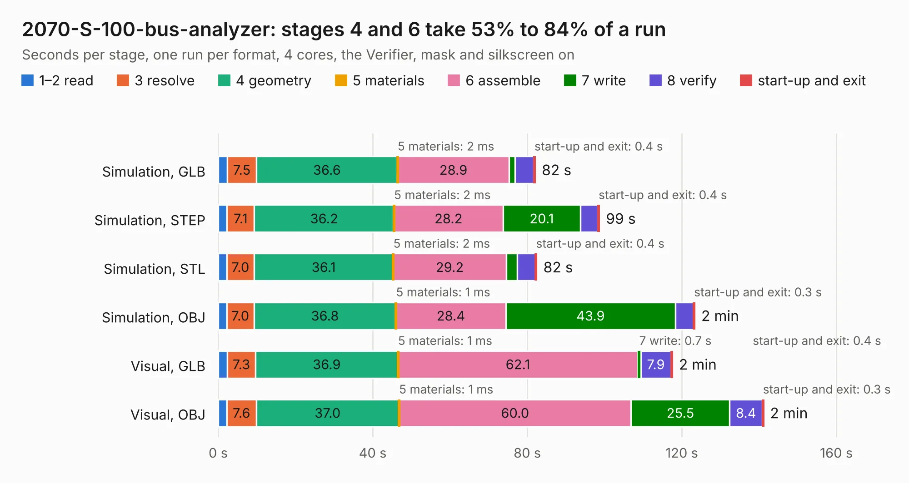

# 1631. 2070-S-100-bus-analyzer

Board 1,631 of the 3,103 of [Corpus Testing](../Corpus-Testing.md), on [Corpus Page 16](../CorpusTestingPages/Corpus-Testing-16.md#1631-2070-s-100-bus-analyzer).

| Mode and format | 1–2 read | 3 resolve | 4 geometry | 5 materials | 6 assemble | 7 write | 8 verify | start-up and exit | Total |
|---|---:|---:|---:|---:|---:|---:|---:|---:|---:|
| Simulation, GLB | 2.4 | 7.5 | 36.6 | 2&nbsp;ms | 28.9 | 1.5 | 4.9 | 0.4 | 82.1 |
| Simulation, STEP | 2.3 | 7.1 | 36.2 | 2&nbsp;ms | 28.2 | 20.1 | 4.5 | 0.4 | 98.7 |
| Simulation, STL | 2.2 | 7.0 | 36.1 | 2&nbsp;ms | 29.2 | 2.8 | 4.7 | 0.4 | 82.5 |
| Simulation, OBJ | 2.2 | 7.0 | 36.8 | 1&nbsp;ms | 28.4 | 43.9 | 4.7 | 0.3 | 123.3 |
| Visual, GLB | 2.3 | 7.3 | 36.9 | 1&nbsp;ms | 62.1 | 0.7 | 7.9 | 0.4 | 117.6 |
| Visual, OBJ | 2.2 | 7.6 | 37.0 | 1&nbsp;ms | 60.0 | 25.5 | 8.4 | 0.3 | 141.2 |

<table align="center"><tr><td valign="top">

| Board | Repo: [MichaelPetry/2070-S-100-bus-analyzer](https://github.com/MichaelPetry/2070-S-100-bus-analyzer) Board: `2070-S-100-bus-analyzer.kicad_pcb` |
|---|---|
| Complexity | 366&nbsp;/&nbsp;1000 (size&nbsp;216, features&nbsp;150) |
| KESE&nbsp;features | through vias, slotted holes, custom pads, rounded, trapezoid or chamfered pads, arc tracks, filled zones, copper drawings, curved board outline, stack-up, dielectric εr and tanδ, copper finish |
| Tested | 9th November 2026 |
| Copper&nbsp;layers | 4 |
| File&nbsp;format | KiCad 9 (20241229) |
| Parts,&nbsp;tracks,&nbsp;vias | 90, 1,959, 520 |
| Triangles,&nbsp;simulation | 7,342,844 in 412 parts |
| Verifier | PASS in all six runs |

</td><td valign="top">

<table>
<tr><th>File type</th><th>File size</th><th>Peak memory used</th></tr>
<tr><th colspan="3" align="left">Simulation</th></tr>
<tr><td>GLB</td><td align="right">244&nbsp;MB</td><td align="right">2.1&nbsp;GB</td></tr>
<tr><td>STEP</td><td align="right">1.0&nbsp;GB</td><td align="right">2.8&nbsp;GB</td></tr>
<tr><td>STL</td><td align="right">367&nbsp;MB</td><td align="right">2.0&nbsp;GB</td></tr>
<tr><td>OBJ</td><td align="right">780&nbsp;MB</td><td align="right">4.7&nbsp;GB</td></tr>
<tr><th colspan="3" align="left">Visual</th></tr>
<tr><td>GLB</td><td align="right">151&nbsp;MB</td><td align="right">2.4&nbsp;GB</td></tr>
<tr><td>OBJ</td><td align="right">479&nbsp;MB</td><td align="right">3.1&nbsp;GB</td></tr>
</table>

</td></tr></table>

| Previous | Next |
|:---|---:|
| [1630. CM5IO](b1630b_openxtcm5-head-unit_CM5IO.md) | [1632. EDA-02327-V2-0_pcb](b1632b_fmc-tester-v2_EDA-02327-V2-0-pcb.md) |
