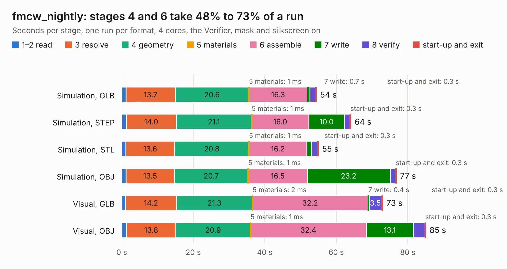

# 1632. fmcw_nightly

Board 1,632 of the 3,139 of [Corpus Testing](../Corpus-Testing.md), on [Corpus Page 16](../CorpusTestingPages/Corpus-Testing-16.md#1632-fmcw_nightly).

| Mode and format | 1–2 read | 3 resolve | 4 geometry | 5 materials | 6 assemble | 7 write | 8 verify | start-up and exit | Total |
|---|---:|---:|---:|---:|---:|---:|---:|---:|---:|
| Simulation, GLB | 1.2 | 13.7 | 20.6 | 1&nbsp;ms | 16.3 | 0.7 | 1.6 | 0.3 | 54.5 |
| Simulation, STEP | 1.3 | 14.0 | 21.1 | 1&nbsp;ms | 16.0 | 10.0 | 1.5 | 0.3 | 64.1 |
| Simulation, STL | 1.2 | 13.6 | 20.8 | 1&nbsp;ms | 16.2 | 1.3 | 1.6 | 0.3 | 55.0 |
| Simulation, OBJ | 1.2 | 13.5 | 20.7 | 1&nbsp;ms | 16.5 | 23.2 | 1.5 | 0.3 | 76.8 |
| Visual, GLB | 1.1 | 14.2 | 21.3 | 2&nbsp;ms | 32.2 | 0.4 | 3.5 | 0.3 | 73.0 |
| Visual, OBJ | 1.4 | 13.8 | 20.9 | 1&nbsp;ms | 32.4 | 13.1 | 3.2 | 0.3 | 85.1 |

<table align="center"><tr><td valign="top">

| Board | Repo: [matthuszagh/fmcw](https://github.com/matthuszagh/fmcw) Board: `fmcw_nightly.kicad_pcb` |
|---|---|
| Folder | hardware / boards / rev2b |
| Complexity | 435&nbsp;/&nbsp;1000 (size&nbsp;295, features&nbsp;140) |
| KESE&nbsp;features | through vias, slotted holes, custom pads, rounded, trapezoid or chamfered pads, filled zones, copper drawings, curved board outline, stack-up, dielectric εr and tanδ, copper finish, mask and silkscreen colours |
| Tested | 9th November 2026 |
| Copper&nbsp;layers | 4 |
| File&nbsp;format | KiCad 6 (20200119) |
| Parts,&nbsp;tracks,&nbsp;vias | 437, 1,170, 439 |
| Triangles,&nbsp;simulation | 3,680,954 in 245 parts |
| Verifier | PASS in all six runs |

</td><td valign="top">

<table>
<tr><th>File type</th><th>File size</th><th>Peak memory used</th></tr>
<tr><th colspan="3" align="left">Simulation</th></tr>
<tr><td>GLB</td><td align="right">126&nbsp;MB</td><td align="right">1.3&nbsp;GB</td></tr>
<tr><td>STEP</td><td align="right">586&nbsp;MB</td><td align="right">1.5&nbsp;GB</td></tr>
<tr><td>STL</td><td align="right">184&nbsp;MB</td><td align="right">1.2&nbsp;GB</td></tr>
<tr><td>OBJ</td><td align="right">395&nbsp;MB</td><td align="right">2.4&nbsp;GB</td></tr>
<tr><th colspan="3" align="left">Visual</th></tr>
<tr><td>GLB</td><td align="right">74&nbsp;MB</td><td align="right">1.3&nbsp;GB</td></tr>
<tr><td>OBJ</td><td align="right">235&nbsp;MB</td><td align="right">1.6&nbsp;GB</td></tr>
</table>

</td></tr></table>

| Previous | Next |
|:---|---:|
| [1631. fmcw](b1631b_fmcw_hardware-boards-rev2b_fmcw.md) | [1633. caps](b1633b_fmcw_caps.md) |
