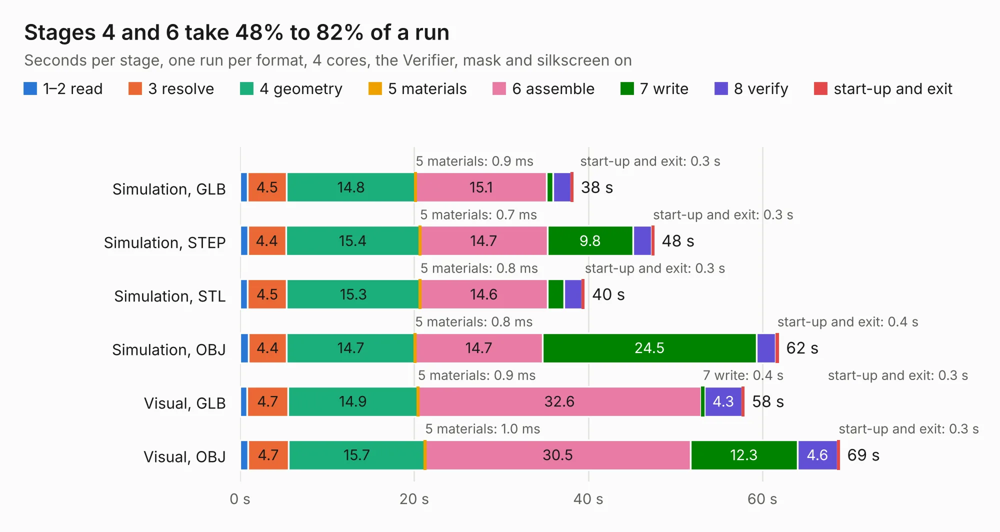

# 1633. mega65-r3-expansion-board.kicad

Board 1,633 of the 3,112 of [Corpus Testing](../Corpus-Testing.md), on [Corpus Page 16](../CorpusTestingPages/Corpus-Testing-16.md#1633-mega65-r3-expansion-boardkicad).

| Mode and format | 1–2 read | 3 resolve | 4 geometry | 5 materials | 6 assemble | 7 write | 8 verify | start-up and exit | Total |
|---|---:|---:|---:|---:|---:|---:|---:|---:|---:|
| Simulation, GLB | 0.9 | 4.5 | 14.8 | 0.9&nbsp;ms | 15.1 | 0.7 | 2.0 | 0.3 | 38.3 |
| Simulation, STEP | 0.9 | 4.4 | 15.4 | 0.7&nbsp;ms | 14.7 | 9.8 | 2.2 | 0.3 | 47.6 |
| Simulation, STL | 0.9 | 4.5 | 15.3 | 0.8&nbsp;ms | 14.6 | 1.9 | 2.0 | 0.3 | 39.6 |
| Simulation, OBJ | 1.0 | 4.4 | 14.7 | 0.8&nbsp;ms | 14.7 | 24.5 | 2.2 | 0.4 | 61.9 |
| Visual, GLB | 0.8 | 4.7 | 14.9 | 0.9&nbsp;ms | 32.6 | 0.4 | 4.3 | 0.3 | 58.0 |
| Visual, OBJ | 0.9 | 4.7 | 15.7 | 1.0&nbsp;ms | 30.5 | 12.3 | 4.6 | 0.3 | 68.9 |

<table align="center"><tr><td valign="top">

| Board | Repo: [MEGA65/mega65-r3-expansion-board](https://github.com/MEGA65/mega65-r3-expansion-board) Board: `mega65-r3-expansion-board.kicad.kicad_pcb` |
|---|---|
| Complexity | 304&nbsp;/&nbsp;1000 (size&nbsp;219, features&nbsp;85) |
| KESE&nbsp;features | through vias, slotted holes, filled zones, curved board outline, stack-up, dielectric εr and tanδ |
| Tested | 9th November 2026 |
| Copper&nbsp;layers | 4 |
| File&nbsp;format | KiCad 9 (20241229) |
| Parts,&nbsp;tracks,&nbsp;vias | 102, 2,880, 310 |
| Triangles,&nbsp;simulation | 5,028,540 in 186 parts |
| Verifier | PASS in all six runs |

</td><td valign="top">

<table>
<tr><th>File type</th><th>File size</th><th>Peak memory used</th></tr>
<tr><th colspan="3" align="left">Simulation</th></tr>
<tr><td>GLB</td><td align="right">169&nbsp;MB</td><td align="right">1.3&nbsp;GB</td></tr>
<tr><td>STEP</td><td align="right">591&nbsp;MB</td><td align="right">1.7&nbsp;GB</td></tr>
<tr><td>STL</td><td align="right">251&nbsp;MB</td><td align="right">1.3&nbsp;GB</td></tr>
<tr><td>OBJ</td><td align="right">538&nbsp;MB</td><td align="right">3.2&nbsp;GB</td></tr>
<tr><th colspan="3" align="left">Visual</th></tr>
<tr><td>GLB</td><td align="right">85&nbsp;MB</td><td align="right">1.6&nbsp;GB</td></tr>
<tr><td>OBJ</td><td align="right">272&nbsp;MB</td><td align="right">1.9&nbsp;GB</td></tr>
</table>

</td></tr></table>

| Previous | Next |
|:---|---:|
| [1632. jtag_base_board](b1632b_mega65-r3-expansion-board_jtag-base-board.md) | [1634. pmod_connector_board](b1634b_mega65-r3-expansion-board_pmod-connector-board.md) |
