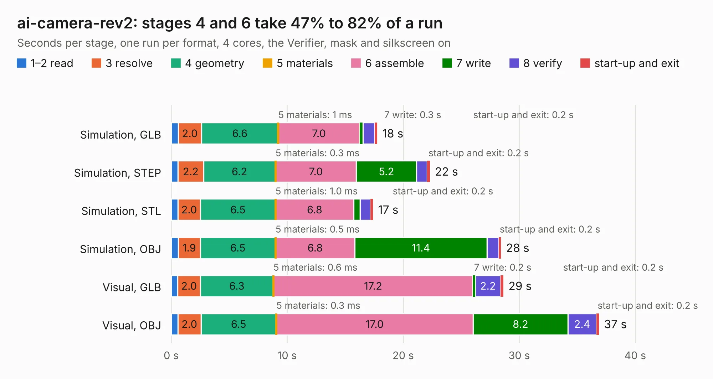

# 1633. ai-camera-rev2

Board 1,633 of the 3,124 of [Corpus Testing](../Corpus-Testing.md), on [Corpus Page 16](../CorpusTestingPages/Corpus-Testing-16.md#1633-ai-camera-rev2).

| Mode and format | 1–2 read | 3 resolve | 4 geometry | 5 materials | 6 assemble | 7 write | 8 verify | start-up and exit | Total |
|---|---:|---:|---:|---:|---:|---:|---:|---:|---:|
| Simulation, GLB | 0.6 | 2.0 | 6.6 | 1&nbsp;ms | 7.0 | 0.3 | 1.0 | 0.2 | 17.8 |
| Simulation, STEP | 0.6 | 2.2 | 6.2 | 0.3&nbsp;ms | 7.0 | 5.2 | 0.9 | 0.2 | 22.3 |
| Simulation, STL | 0.6 | 2.0 | 6.5 | 1.0&nbsp;ms | 6.8 | 0.5 | 0.9 | 0.2 | 17.4 |
| Simulation, OBJ | 0.6 | 1.9 | 6.5 | 0.5&nbsp;ms | 6.8 | 11.4 | 1.0 | 0.2 | 28.4 |
| Visual, GLB | 0.6 | 2.0 | 6.3 | 0.6&nbsp;ms | 17.2 | 0.2 | 2.2 | 0.2 | 28.6 |
| Visual, OBJ | 0.6 | 2.0 | 6.5 | 0.3&nbsp;ms | 17.0 | 8.2 | 2.4 | 0.2 | 36.9 |

<table align="center"><tr><td valign="top">

| Board | Repo: [maxlab-io/tokay-lite-pcb](https://github.com/maxlab-io/tokay-lite-pcb) Board: `ai-camera-rev2.kicad_pcb` |
|---|---|
| Folder | ai-camera-rev2 |
| Complexity | 314&nbsp;/&nbsp;1000 (size&nbsp;214, features&nbsp;100) |
| KESE&nbsp;features | through vias, slotted holes, rounded, trapezoid or chamfered pads, filled zones, curved board outline, stack-up, dielectric εr and tanδ, mask and silkscreen colours |
| Tested | 9th November 2026 |
| Copper&nbsp;layers | 4 |
| File&nbsp;format | KiCad 7 (20221018) |
| Parts,&nbsp;tracks,&nbsp;vias | 153, 1,208, 330 |
| Triangles,&nbsp;simulation | 2,131,926 in 113 parts |
| Verifier | PASS in all six runs |

</td><td valign="top">

<table>
<tr><th>File type</th><th>File size</th><th>Peak memory used</th></tr>
<tr><th colspan="3" align="left">Simulation</th></tr>
<tr><td>GLB</td><td align="right">72&nbsp;MB</td><td align="right">874&nbsp;MB</td></tr>
<tr><td>STEP</td><td align="right">309&nbsp;MB</td><td align="right">989&nbsp;MB</td></tr>
<tr><td>STL</td><td align="right">107&nbsp;MB</td><td align="right">793&nbsp;MB</td></tr>
<tr><td>OBJ</td><td align="right">222&nbsp;MB</td><td align="right">1.4&nbsp;GB</td></tr>
<tr><th colspan="3" align="left">Visual</th></tr>
<tr><td>GLB</td><td align="right">52&nbsp;MB</td><td align="right">1.0&nbsp;GB</td></tr>
<tr><td>OBJ</td><td align="right">159&nbsp;MB</td><td align="right">1.1&nbsp;GB</td></tr>
</table>

</td></tr></table>

| Previous | Next |
|:---|---:|
| [1632. ai-camera](b1632b_tokay-lite-pcb_ai-camera-rev1_ai-camera.md) | [1634. ai-camera-rev3.1](b1634b_tokay-lite-pcb_ai-camera-rev3-1.md) |
