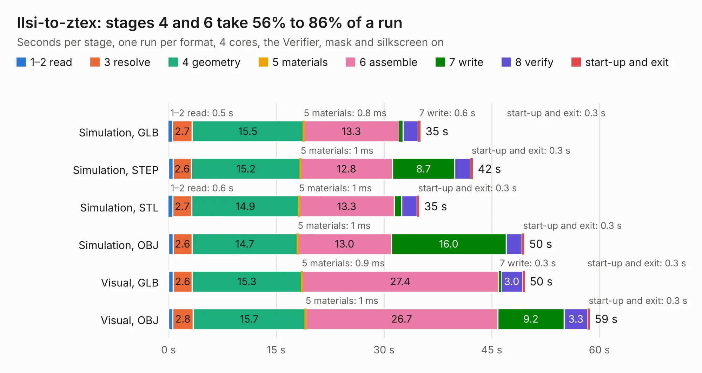

# 1634. IIsi-to-ztex

Board 1,634 of the 3,111 of [Corpus Testing](../Corpus-Testing.md), on [Corpus Page 16](../CorpusTestingPages/Corpus-Testing-16.md#1634-iisi-to-ztex).

| Mode and format | 1–2 read | 3 resolve | 4 geometry | 5 materials | 6 assemble | 7 write | 8 verify | start-up and exit | Total |
|---|---:|---:|---:|---:|---:|---:|---:|---:|---:|
| Simulation, GLB | 0.5 | 2.7 | 15.5 | 0.8&nbsp;ms | 13.3 | 0.6 | 2.1 | 0.3 | 35.1 |
| Simulation, STEP | 0.6 | 2.6 | 15.2 | 1&nbsp;ms | 12.8 | 8.7 | 2.2 | 0.3 | 42.4 |
| Simulation, STL | 0.6 | 2.7 | 14.9 | 1&nbsp;ms | 13.3 | 1.0 | 2.2 | 0.3 | 34.9 |
| Simulation, OBJ | 0.7 | 2.6 | 14.7 | 1&nbsp;ms | 13.0 | 16.0 | 2.2 | 0.3 | 49.5 |
| Visual, GLB | 0.7 | 2.6 | 15.3 | 0.9&nbsp;ms | 27.4 | 0.3 | 3.0 | 0.3 | 49.6 |
| Visual, OBJ | 0.6 | 2.8 | 15.7 | 1&nbsp;ms | 26.7 | 9.2 | 3.3 | 0.3 | 58.6 |

<table align="center"><tr><td valign="top">

| Board | Repo: [MelkhiorVintageComputing/IIsiFPGA](https://github.com/MelkhiorVintageComputing/IIsiFPGA) Board: `IIsi-to-ztex.kicad_pcb` |
|---|---|
| Folder | IIsi-to-ztex |
| Complexity | 256&nbsp;/&nbsp;1000 (size&nbsp;211, features&nbsp;45) |
| KESE&nbsp;features | through vias, rounded, trapezoid or chamfered pads, filled zones |
| Tested | 9th November 2026 |
| Copper&nbsp;layers | 4 |
| File&nbsp;format | KiCad 5 (20171130) |
| Parts,&nbsp;tracks,&nbsp;vias | 63, 2,837, 112 |
| Triangles,&nbsp;simulation | 3,427,216 in 267 parts |
| Verifier | PASS in all six runs |

</td><td valign="top">

<table>
<tr><th>File type</th><th>File size</th><th>Peak memory used</th></tr>
<tr><th colspan="3" align="left">Simulation</th></tr>
<tr><td>GLB</td><td align="right">114&nbsp;MB</td><td align="right">1.0&nbsp;GB</td></tr>
<tr><td>STEP</td><td align="right">444&nbsp;MB</td><td align="right">1.3&nbsp;GB</td></tr>
<tr><td>STL</td><td align="right">171&nbsp;MB</td><td align="right">1.0&nbsp;GB</td></tr>
<tr><td>OBJ</td><td align="right">359&nbsp;MB</td><td align="right">2.2&nbsp;GB</td></tr>
<tr><th colspan="3" align="left">Visual</th></tr>
<tr><td>GLB</td><td align="right">65&nbsp;MB</td><td align="right">1.3&nbsp;GB</td></tr>
<tr><td>OBJ</td><td align="right">204&nbsp;MB</td><td align="right">1.4&nbsp;GB</td></tr>
</table>

</td></tr></table>

| Previous | Next |
|:---|---:|
| [1633. pmod_connector_board](b1633b_mega65-r3-expansion-board_pmod-connector-board.md) | [1635. IIsiA7_Mini](b1635b_IIsiFPGA_IIsiA7-Mini.md) |
