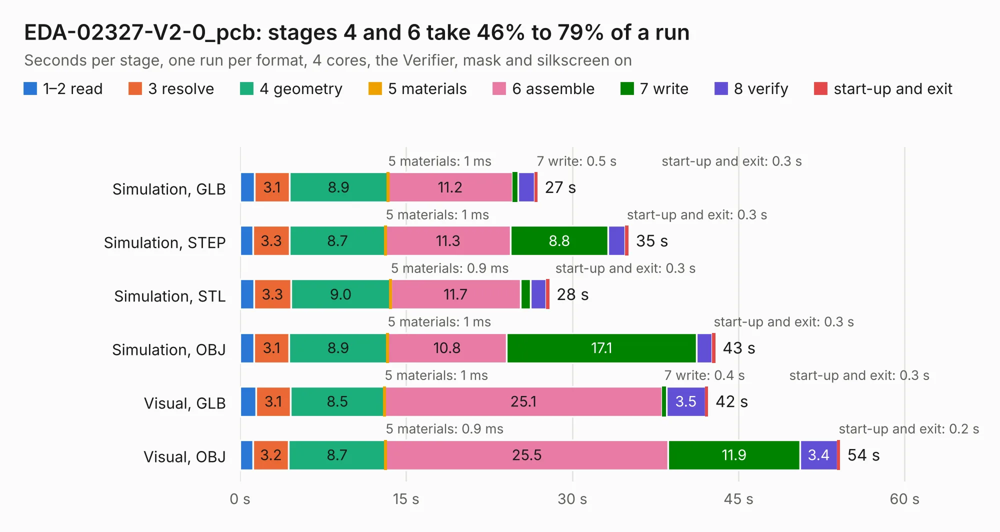

# 1634. EDA-02327-V2-0_pcb

Board 1,634 of the 3,105 of [Corpus Testing](../Corpus-Testing.md), on [Corpus Page 16](../CorpusTestingPages/Corpus-Testing-16.md#1634-eda-02327-v2-0_pcb).

| Mode and format | 1–2 read | 3 resolve | 4 geometry | 5 materials | 6 assemble | 7 write | 8 verify | start-up and exit | Total |
|---|---:|---:|---:|---:|---:|---:|---:|---:|---:|
| Simulation, GLB | 1.3 | 3.1 | 8.9 | 1&nbsp;ms | 11.2 | 0.5 | 1.5 | 0.3 | 26.8 |
| Simulation, STEP | 1.2 | 3.3 | 8.7 | 1&nbsp;ms | 11.3 | 8.8 | 1.5 | 0.3 | 35.1 |
| Simulation, STL | 1.3 | 3.3 | 9.0 | 0.9&nbsp;ms | 11.7 | 0.9 | 1.4 | 0.3 | 27.9 |
| Simulation, OBJ | 1.3 | 3.1 | 8.9 | 1&nbsp;ms | 10.8 | 17.1 | 1.4 | 0.3 | 42.9 |
| Visual, GLB | 1.4 | 3.1 | 8.5 | 1&nbsp;ms | 25.1 | 0.4 | 3.5 | 0.3 | 42.3 |
| Visual, OBJ | 1.2 | 3.2 | 8.7 | 0.9&nbsp;ms | 25.5 | 11.9 | 3.4 | 0.2 | 54.2 |

<table align="center"><tr><td valign="top">

| Board | Repo: [michalgaska/fmc-tester-v2](https://github.com/michalgaska/fmc-tester-v2) Board: `EDA-02327-V2-0_pcb.kicad_pcb` |
|---|---|
| Complexity | 377&nbsp;/&nbsp;1000 (size&nbsp;272, features&nbsp;105) |
| KESE&nbsp;features | through vias, rounded, trapezoid or chamfered pads, filled zones, copper drawings, copper text, curved board outline, stack-up, dielectric εr and tanδ |
| Tested | 9th November 2026 |
| Copper&nbsp;layers | 4 |
| File&nbsp;format | KiCad 6 (20211014) |
| Parts,&nbsp;tracks,&nbsp;vias | 169, 4,424, 556 |
| Triangles,&nbsp;simulation | 3,191,776 in 347 parts |
| Verifier | PASS in all six runs |

</td><td valign="top">

<table>
<tr><th>File type</th><th>File size</th><th>Peak memory used</th></tr>
<tr><th colspan="3" align="left">Simulation</th></tr>
<tr><td>GLB</td><td align="right">108&nbsp;MB</td><td align="right">945&nbsp;MB</td></tr>
<tr><td>STEP</td><td align="right">425&nbsp;MB</td><td align="right">1.4&nbsp;GB</td></tr>
<tr><td>STL</td><td align="right">160&nbsp;MB</td><td align="right">958&nbsp;MB</td></tr>
<tr><td>OBJ</td><td align="right">348&nbsp;MB</td><td align="right">2.1&nbsp;GB</td></tr>
<tr><th colspan="3" align="left">Visual</th></tr>
<tr><td>GLB</td><td align="right">74&nbsp;MB</td><td align="right">1.3&nbsp;GB</td></tr>
<tr><td>OBJ</td><td align="right">246&nbsp;MB</td><td align="right">1.7&nbsp;GB</td></tr>
</table>

</td></tr></table>

| Previous | Next |
|:---|---:|
| [1633. 2070-S-100-bus-analyzer](b1633b_2070-S-100-bus-analyzer_2070-S-100-bus-analyzer.md) | [1635. moteus_c1](b1635b_moteus_hw-c1_moteus-c1.md) |
