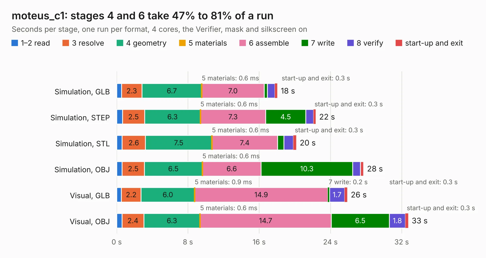

# 1634. moteus_c1

Board 1,634 of the 3,102 of [Corpus Testing](../Corpus-Testing.md), on [Corpus Page 16](../CorpusTestingPages/Corpus-Testing-16.md#1634-moteus_c1).

| Mode and format | 1–2 read | 3 resolve | 4 geometry | 5 materials | 6 assemble | 7 write | 8 verify | start-up and exit | Total |
|---|---:|---:|---:|---:|---:|---:|---:|---:|---:|
| Simulation, GLB | 0.5 | 2.3 | 6.7 | 0.6&nbsp;ms | 7.0 | 0.3 | 0.8 | 0.3 | 18.0 |
| Simulation, STEP | 0.6 | 2.5 | 6.3 | 0.6&nbsp;ms | 7.3 | 4.5 | 0.9 | 0.3 | 22.4 |
| Simulation, STL | 0.6 | 2.6 | 7.5 | 0.6&nbsp;ms | 7.4 | 0.7 | 1.1 | 0.3 | 20.2 |
| Simulation, OBJ | 0.6 | 2.5 | 6.5 | 0.6&nbsp;ms | 6.6 | 10.3 | 0.9 | 0.4 | 27.7 |
| Visual, GLB | 0.5 | 2.2 | 6.0 | 0.9&nbsp;ms | 14.9 | 0.2 | 1.7 | 0.3 | 25.9 |
| Visual, OBJ | 0.6 | 2.4 | 6.3 | 0.6&nbsp;ms | 14.7 | 6.5 | 1.8 | 0.3 | 32.7 |

<table align="center"><tr><td valign="top">

| Board | Repo: [mjbots/moteus](https://github.com/mjbots/moteus) Board: `moteus_c1.kicad_pcb` |
|---|---|
| Folder | hw / c1 / r1.1 |
| Complexity | 339&nbsp;/&nbsp;1000 (size&nbsp;249, features&nbsp;90) |
| KESE&nbsp;features | through vias, rounded, trapezoid or chamfered pads, filled zones, curved board outline, stack-up, dielectric εr and tanδ, mask and silkscreen colours |
| Tested | 9th November 2026 |
| Copper&nbsp;layers | 4 |
| File&nbsp;format | KiCad 7 (20221018) |
| Parts,&nbsp;tracks,&nbsp;vias | 120, 1,088, 289 |
| Triangles,&nbsp;simulation | 1,693,562 in 114 parts |
| Verifier | PASS in all six runs |

</td><td valign="top">

<table>
<tr><th>File type</th><th>File size</th><th>Peak memory used</th></tr>
<tr><th colspan="3" align="left">Simulation</th></tr>
<tr><td>GLB</td><td align="right">58&nbsp;MB</td><td align="right">597&nbsp;MB</td></tr>
<tr><td>STEP</td><td align="right">199&nbsp;MB</td><td align="right">664&nbsp;MB</td></tr>
<tr><td>STL</td><td align="right">85&nbsp;MB</td><td align="right">609&nbsp;MB</td></tr>
<tr><td>OBJ</td><td align="right">174&nbsp;MB</td><td align="right">1.2&nbsp;GB</td></tr>
<tr><th colspan="3" align="left">Visual</th></tr>
<tr><td>GLB</td><td align="right">35&nbsp;MB</td><td align="right">767&nbsp;MB</td></tr>
<tr><td>OBJ</td><td align="right">107&nbsp;MB</td><td align="right">819&nbsp;MB</td></tr>
</table>

</td></tr></table>

| Previous | Next |
|:---|---:|
| [1633. moteus_c1](b1633b_moteus_hw-c1-r1-0_moteus-c1.md) | [1635. mjuart](b1635b_moteus_mjuart.md) |
