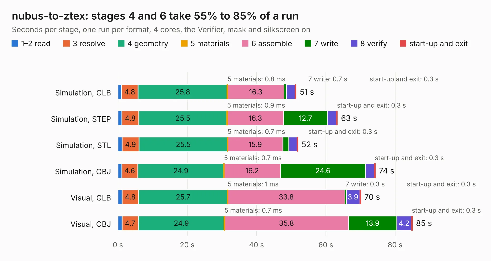

# 1635. nubus-to-ztex

Board 1,635 of the 3,110 of [Corpus Testing](../Corpus-Testing.md), on [Corpus Page 16](../CorpusTestingPages/Corpus-Testing-16.md#1635-nubus-to-ztex).

| Mode and format | 1–2 read | 3 resolve | 4 geometry | 5 materials | 6 assemble | 7 write | 8 verify | start-up and exit | Total |
|---|---:|---:|---:|---:|---:|---:|---:|---:|---:|
| Simulation, GLB | 1.0 | 4.8 | 25.8 | 0.8&nbsp;ms | 16.3 | 0.7 | 2.5 | 0.3 | 51.5 |
| Simulation, STEP | 1.2 | 4.8 | 25.5 | 0.9&nbsp;ms | 16.3 | 12.7 | 2.6 | 0.3 | 63.4 |
| Simulation, STL | 1.2 | 4.9 | 25.5 | 0.7&nbsp;ms | 15.9 | 1.7 | 2.4 | 0.3 | 52.0 |
| Simulation, OBJ | 1.1 | 4.6 | 24.9 | 0.7&nbsp;ms | 16.2 | 24.6 | 2.5 | 0.3 | 74.3 |
| Visual, GLB | 1.2 | 4.8 | 25.7 | 1&nbsp;ms | 33.8 | 0.3 | 3.9 | 0.3 | 70.1 |
| Visual, OBJ | 1.2 | 4.7 | 24.9 | 0.7&nbsp;ms | 35.8 | 13.9 | 4.2 | 0.3 | 85.0 |

<table align="center"><tr><td valign="top">

| Board | Repo: [MelkhiorVintageComputing/NuBusFPGA](https://github.com/MelkhiorVintageComputing/NuBusFPGA) Board: `nubus-to-ztex.kicad_pcb` |
|---|---|
| Folder | nubus-to-ztex |
| Complexity | 290&nbsp;/&nbsp;1000 (size&nbsp;225, features&nbsp;65) |
| KESE&nbsp;features | through vias, slotted holes, rounded, trapezoid or chamfered pads, filled zones, curved board outline |
| Tested | 9th November 2026 |
| Copper&nbsp;layers | 4 |
| File&nbsp;format | KiCad 5 (20171130) |
| Parts,&nbsp;tracks,&nbsp;vias | 101, 5,227, 164 |
| Triangles,&nbsp;simulation | 4,022,564 in 220 parts |
| Verifier | PASS in all six runs |

</td><td valign="top">

<table>
<tr><th>File type</th><th>File size</th><th>Peak memory used</th></tr>
<tr><th colspan="3" align="left">Simulation</th></tr>
<tr><td>GLB</td><td align="right">138&nbsp;MB</td><td align="right">1.3&nbsp;GB</td></tr>
<tr><td>STEP</td><td align="right">640&nbsp;MB</td><td align="right">1.5&nbsp;GB</td></tr>
<tr><td>STL</td><td align="right">201&nbsp;MB</td><td align="right">1.3&nbsp;GB</td></tr>
<tr><td>OBJ</td><td align="right">430&nbsp;MB</td><td align="right">2.7&nbsp;GB</td></tr>
<tr><th colspan="3" align="left">Visual</th></tr>
<tr><td>GLB</td><td align="right">80&nbsp;MB</td><td align="right">1.4&nbsp;GB</td></tr>
<tr><td>OBJ</td><td align="right">251&nbsp;MB</td><td align="right">1.7&nbsp;GB</td></tr>
</table>

</td></tr></table>

| Previous | Next |
|:---|---:|
| [1634. IIsiA7_Mini](b1634b_IIsiFPGA_IIsiA7-Mini.md) | [1636. PicoBerry_V1.0](b1636b_PicoBerry_PicoBerry-V1-0.md) |
