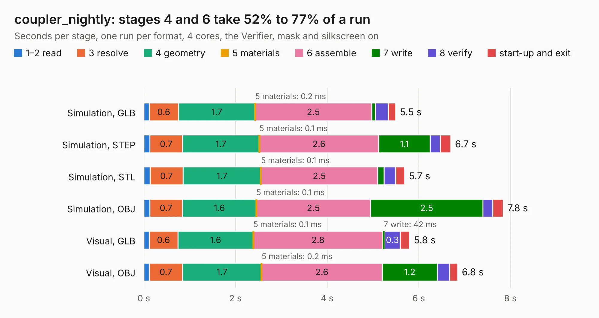

# 1636. coupler_nightly

Board 1,636 of the 3,138 of [Corpus Testing](../Corpus-Testing.md), on [Corpus Page 16](../CorpusTestingPages/Corpus-Testing-16.md#1636-coupler_nightly).

| Mode and format | 1–2 read | 3 resolve | 4 geometry | 5 materials | 6 assemble | 7 write | 8 verify | start-up and exit | Total |
|---|---:|---:|---:|---:|---:|---:|---:|---:|---:|
| Simulation, GLB | 0.1 | 0.6 | 1.7 | 0.2&nbsp;ms | 2.5 | 81&nbsp;ms | 0.3 | 0.2 | 5.5 |
| Simulation, STEP | 0.1 | 0.7 | 1.7 | 0.1&nbsp;ms | 2.6 | 1.1 | 0.2 | 0.2 | 6.7 |
| Simulation, STL | 0.1 | 0.7 | 1.7 | 0.1&nbsp;ms | 2.5 | 0.1 | 0.3 | 0.2 | 5.7 |
| Simulation, OBJ | 0.1 | 0.7 | 1.6 | 0.1&nbsp;ms | 2.5 | 2.5 | 0.2 | 0.2 | 7.8 |
| Visual, GLB | 0.1 | 0.6 | 1.6 | 0.1&nbsp;ms | 2.8 | 42&nbsp;ms | 0.3 | 0.2 | 5.8 |
| Visual, OBJ | 0.1 | 0.7 | 1.7 | 0.2&nbsp;ms | 2.6 | 1.2 | 0.3 | 0.2 | 6.8 |

<table align="center"><tr><td valign="top">

| Board | Repo: [matthuszagh/fmcw](https://github.com/matthuszagh/fmcw) Board: `coupler_nightly.kicad_pcb` |
|---|---|
| Folder | hardware / prototypes / coupler |
| Complexity | 237&nbsp;/&nbsp;1000 (size&nbsp;167, features&nbsp;70) |
| KESE&nbsp;features | through vias, filled zones, stack-up, dielectric εr and tanδ, mask and silkscreen colours |
| Tested | 9th November 2026 |
| Copper&nbsp;layers | 4 |
| File&nbsp;format | KiCad 6 (20200119) |
| Parts,&nbsp;tracks,&nbsp;vias | 5, 137, 305 |
| Triangles,&nbsp;simulation | 659,588 in 18 parts |
| Verifier | PASS in all six runs |

</td><td valign="top">

<table>
<tr><th>File type</th><th>File size</th><th>Peak memory used</th></tr>
<tr><th colspan="3" align="left">Simulation</th></tr>
<tr><td>GLB</td><td align="right">21&nbsp;MB</td><td align="right">412&nbsp;MB</td></tr>
<tr><td>STEP</td><td align="right">30&nbsp;MB</td><td align="right">458&nbsp;MB</td></tr>
<tr><td>STL</td><td align="right">33&nbsp;MB</td><td align="right">407&nbsp;MB</td></tr>
<tr><td>OBJ</td><td align="right">65&nbsp;MB</td><td align="right">434&nbsp;MB</td></tr>
<tr><th colspan="3" align="left">Visual</th></tr>
<tr><td>GLB</td><td align="right">11&nbsp;MB</td><td align="right">357&nbsp;MB</td></tr>
<tr><td>OBJ</td><td align="right">32&nbsp;MB</td><td align="right">382&nbsp;MB</td></tr>
</table>

</td></tr></table>

| Previous | Next |
|:---|---:|
| [1635. coupler](b1635b_fmcw_coupler.md) | [1637. microstrip_width](b1637b_fmcw_microstrip-width.md) |
