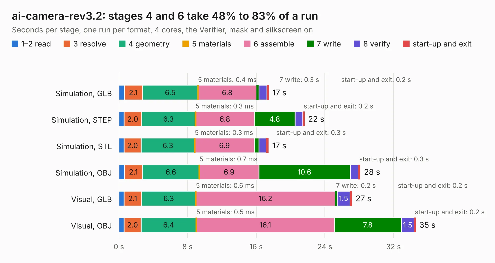

# 1636. ai-camera-rev3.2

Board 1,636 of the 3,126 of [Corpus Testing](../Corpus-Testing.md), on [Corpus Page 16](../CorpusTestingPages/Corpus-Testing-16.md#1636-ai-camera-rev32).

| Mode and format | 1–2 read | 3 resolve | 4 geometry | 5 materials | 6 assemble | 7 write | 8 verify | start-up and exit | Total |
|---|---:|---:|---:|---:|---:|---:|---:|---:|---:|
| Simulation, GLB | 0.6 | 2.1 | 6.5 | 0.4&nbsp;ms | 6.8 | 0.3 | 0.9 | 0.2 | 17.5 |
| Simulation, STEP | 0.6 | 2.0 | 6.3 | 0.3&nbsp;ms | 6.8 | 4.8 | 0.9 | 0.2 | 21.6 |
| Simulation, STL | 0.6 | 2.0 | 6.3 | 0.3&nbsp;ms | 6.9 | 0.5 | 0.9 | 0.3 | 17.5 |
| Simulation, OBJ | 0.6 | 2.1 | 6.6 | 0.7&nbsp;ms | 6.9 | 10.6 | 0.9 | 0.3 | 28.2 |
| Visual, GLB | 0.6 | 2.1 | 6.3 | 0.6&nbsp;ms | 16.2 | 0.2 | 1.5 | 0.2 | 27.2 |
| Visual, OBJ | 0.6 | 2.0 | 6.4 | 0.5&nbsp;ms | 16.1 | 7.8 | 1.5 | 0.2 | 34.6 |

<table align="center"><tr><td valign="top">

| Board | Repo: [maxlab-io/tokay-lite-pcb](https://github.com/maxlab-io/tokay-lite-pcb) Board: `ai-camera-rev3.2.kicad_pcb` |
|---|---|
| Folder | ai-camera-rev3.2 |
| Complexity | 315&nbsp;/&nbsp;1000 (size&nbsp;215, features&nbsp;100) |
| KESE&nbsp;features | through vias, slotted holes, rounded, trapezoid or chamfered pads, filled zones, curved board outline, stack-up, dielectric εr and tanδ, mask and silkscreen colours |
| Tested | 9th November 2026 |
| Copper&nbsp;layers | 4 |
| File&nbsp;format | KiCad 8 (20240108) |
| Parts,&nbsp;tracks,&nbsp;vias | 153, 1,274, 330 |
| Triangles,&nbsp;simulation | 2,092,308 in 113 parts |
| Verifier | PASS in all six runs |

</td><td valign="top">

<table>
<tr><th>File type</th><th>File size</th><th>Peak memory used</th></tr>
<tr><th colspan="3" align="left">Simulation</th></tr>
<tr><td>GLB</td><td align="right">70&nbsp;MB</td><td align="right">827&nbsp;MB</td></tr>
<tr><td>STEP</td><td align="right">294&nbsp;MB</td><td align="right">949&nbsp;MB</td></tr>
<tr><td>STL</td><td align="right">105&nbsp;MB</td><td align="right">874&nbsp;MB</td></tr>
<tr><td>OBJ</td><td align="right">218&nbsp;MB</td><td align="right">1.4&nbsp;GB</td></tr>
<tr><th colspan="3" align="left">Visual</th></tr>
<tr><td>GLB</td><td align="right">51&nbsp;MB</td><td align="right">919&nbsp;MB</td></tr>
<tr><td>OBJ</td><td align="right">157&nbsp;MB</td><td align="right">1.1&nbsp;GB</td></tr>
</table>

</td></tr></table>

| Previous | Next |
|:---|---:|
| [1635. ai-camera-rev3.1](b1635b_tokay-lite-pcb_ai-camera-rev3-1.md) | [1637. ai-camera-rev3](b1637b_tokay-lite-pcb_ai-camera-rev3.md) |
