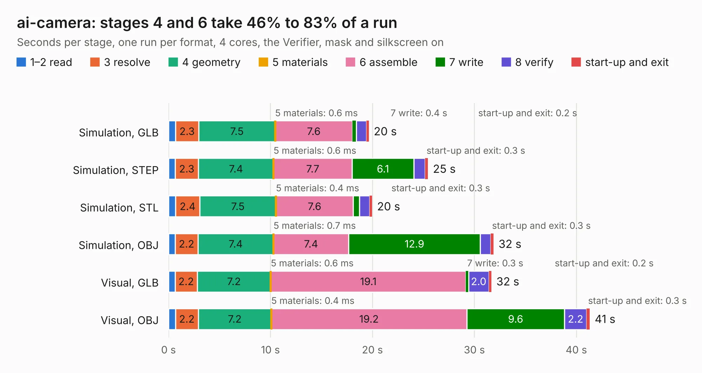

# 1637. ai-camera

Board 1,637 of the 3,132 of [Corpus Testing](../Corpus-Testing.md), on [Corpus Page 16](../CorpusTestingPages/Corpus-Testing-16.md#1637-ai-camera).

| Mode and format | 1–2 read | 3 resolve | 4 geometry | 5 materials | 6 assemble | 7 write | 8 verify | start-up and exit | Total |
|---|---:|---:|---:|---:|---:|---:|---:|---:|---:|
| Simulation, GLB | 0.7 | 2.3 | 7.5 | 0.6&nbsp;ms | 7.6 | 0.4 | 1.0 | 0.2 | 19.6 |
| Simulation, STEP | 0.6 | 2.3 | 7.4 | 0.6&nbsp;ms | 7.7 | 6.1 | 1.1 | 0.3 | 25.4 |
| Simulation, STL | 0.7 | 2.4 | 7.5 | 0.4&nbsp;ms | 7.6 | 0.6 | 1.0 | 0.3 | 20.0 |
| Simulation, OBJ | 0.7 | 2.2 | 7.4 | 0.7&nbsp;ms | 7.4 | 12.9 | 1.0 | 0.3 | 31.9 |
| Visual, GLB | 0.6 | 2.2 | 7.2 | 0.6&nbsp;ms | 19.1 | 0.3 | 2.0 | 0.2 | 31.7 |
| Visual, OBJ | 0.7 | 2.2 | 7.2 | 0.4&nbsp;ms | 19.2 | 9.6 | 2.2 | 0.3 | 41.3 |

<table align="center"><tr><td valign="top">

| Board | Repo: [maxlab-io/tokay-lite-pcb](https://github.com/maxlab-io/tokay-lite-pcb) Board: `ai-camera.kicad_pcb` |
|---|---|
| Folder | ai-camera-rev1 |
| Complexity | 339&nbsp;/&nbsp;1000 (size&nbsp;214, features&nbsp;125) |
| KESE&nbsp;features | through vias, slotted holes, custom pads, rounded, trapezoid or chamfered pads, filled zones, copper drawings, curved board outline, stack-up, dielectric εr and tanδ, mask and silkscreen colours |
| Tested | 9th November 2026 |
| Copper&nbsp;layers | 4 |
| File&nbsp;format | KiCad 7 (20221018) |
| Parts,&nbsp;tracks,&nbsp;vias | 151, 1,227, 305 |
| Triangles,&nbsp;simulation | 2,114,240 in 113 parts |
| Verifier | PASS in all six runs |

</td><td valign="top">

<table>
<tr><th>File type</th><th>File size</th><th>Peak memory used</th></tr>
<tr><th colspan="3" align="left">Simulation</th></tr>
<tr><td>GLB</td><td align="right">71&nbsp;MB</td><td align="right">818&nbsp;MB</td></tr>
<tr><td>STEP</td><td align="right">308&nbsp;MB</td><td align="right">943&nbsp;MB</td></tr>
<tr><td>STL</td><td align="right">106&nbsp;MB</td><td align="right">851&nbsp;MB</td></tr>
<tr><td>OBJ</td><td align="right">221&nbsp;MB</td><td align="right">1.4&nbsp;GB</td></tr>
<tr><th colspan="3" align="left">Visual</th></tr>
<tr><td>GLB</td><td align="right">52&nbsp;MB</td><td align="right">958&nbsp;MB</td></tr>
<tr><td>OBJ</td><td align="right">160&nbsp;MB</td><td align="right">1.1&nbsp;GB</td></tr>
</table>

</td></tr></table>

| Previous | Next |
|:---|---:|
| [1636. ai-camera](b1636b_tokay-lite-pcb_ai-camera-rev0_ai-camera.md) | [1638. ai-camera-rev2](b1638b_tokay-lite-pcb_ai-camera-rev2.md) |
