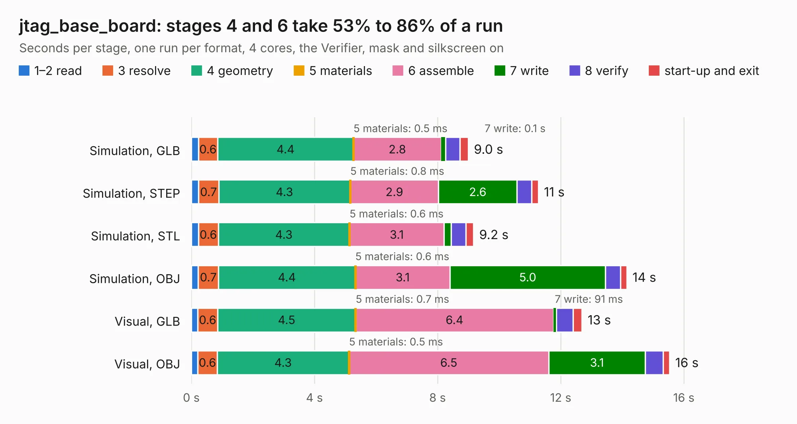

# 1642. jtag_base_board

Board 1,642 of the 3,124 of [Corpus Testing](../Corpus-Testing.md), on [Corpus Page 16](../CorpusTestingPages/Corpus-Testing-16.md#1642-jtag_base_board).

| Mode and format | 1–2 read | 3 resolve | 4 geometry | 5 materials | 6 assemble | 7 write | 8 verify | start-up and exit | Total |
|---|---:|---:|---:|---:|---:|---:|---:|---:|---:|
| Simulation, GLB | 0.2 | 0.6 | 4.4 | 0.5&nbsp;ms | 2.8 | 0.1 | 0.5 | 0.3 | 9.0 |
| Simulation, STEP | 0.2 | 0.7 | 4.3 | 0.8&nbsp;ms | 2.9 | 2.6 | 0.5 | 0.2 | 11.3 |
| Simulation, STL | 0.2 | 0.6 | 4.3 | 0.6&nbsp;ms | 3.1 | 0.2 | 0.5 | 0.2 | 9.2 |
| Simulation, OBJ | 0.2 | 0.7 | 4.4 | 0.6&nbsp;ms | 3.1 | 5.0 | 0.5 | 0.2 | 14.1 |
| Visual, GLB | 0.2 | 0.6 | 4.5 | 0.7&nbsp;ms | 6.4 | 91&nbsp;ms | 0.6 | 0.3 | 12.7 |
| Visual, OBJ | 0.2 | 0.6 | 4.3 | 0.5&nbsp;ms | 6.5 | 3.1 | 0.6 | 0.2 | 15.5 |

<table align="center"><tr><td valign="top">

| Board | Repo: [MEGA65/mega65-r3-expansion-board](https://github.com/MEGA65/mega65-r3-expansion-board) Board: `jtag_base_board.kicad_pcb` |
|---|---|
| Folder | jtag_base_board |
| Complexity | 197&nbsp;/&nbsp;1000 (size&nbsp;132, features&nbsp;65) |
| KESE&nbsp;features | through vias, filled zones, stack-up, dielectric εr and tanδ |
| Tested | 9th November 2026 |
| Copper&nbsp;layers | 2 |
| File&nbsp;format | KiCad 10 (20260206) |
| Parts,&nbsp;tracks,&nbsp;vias | 10, 229, 2 |
| Triangles,&nbsp;simulation | 936,044 in 72 parts |
| Verifier | PASS in all six runs |

</td><td valign="top">

<table>
<tr><th>File type</th><th>File size</th><th>Peak memory used</th></tr>
<tr><th colspan="3" align="left">Simulation</th></tr>
<tr><td>GLB</td><td align="right">32&nbsp;MB</td><td align="right">406&nbsp;MB</td></tr>
<tr><td>STEP</td><td align="right">139&nbsp;MB</td><td align="right">505&nbsp;MB</td></tr>
<tr><td>STL</td><td align="right">47&nbsp;MB</td><td align="right">416&nbsp;MB</td></tr>
<tr><td>OBJ</td><td align="right">95&nbsp;MB</td><td align="right">668&nbsp;MB</td></tr>
<tr><th colspan="3" align="left">Visual</th></tr>
<tr><td>GLB</td><td align="right">20&nbsp;MB</td><td align="right">530&nbsp;MB</td></tr>
<tr><td>OBJ</td><td align="right">59&nbsp;MB</td><td align="right">567&nbsp;MB</td></tr>
</table>

</td></tr></table>

| Previous | Next |
|:---|---:|
| [1641. external_drive_board](b1641b_mega65-r3-expansion-board_external-drive-board.md) | [1643. mega65-r3-expansion-board.kicad](b1643b_mega65-r3-expansion-board_mega65-r3-expansion-board-kicad.md) |
