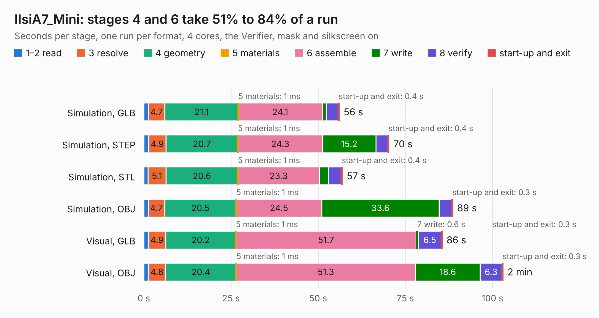

# 1643. IIsiA7_Mini

Board 1,643 of the 3,121 of [Corpus Testing](../Corpus-Testing.md), on [Corpus Page 16](../CorpusTestingPages/Corpus-Testing-16.md#1643-iisia7_mini).

| Mode and format | 1–2 read | 3 resolve | 4 geometry | 5 materials | 6 assemble | 7 write | 8 verify | start-up and exit | Total |
|---|---:|---:|---:|---:|---:|---:|---:|---:|---:|
| Simulation, GLB | 1.3 | 4.7 | 21.1 | 1&nbsp;ms | 24.1 | 1.1 | 3.4 | 0.4 | 56.1 |
| Simulation, STEP | 1.4 | 4.9 | 20.7 | 1&nbsp;ms | 24.3 | 15.2 | 3.5 | 0.4 | 70.4 |
| Simulation, STL | 1.2 | 5.1 | 20.6 | 1&nbsp;ms | 23.3 | 2.5 | 3.7 | 0.4 | 57.0 |
| Simulation, OBJ | 1.3 | 4.7 | 20.5 | 1&nbsp;ms | 24.5 | 33.6 | 3.6 | 0.3 | 88.6 |
| Visual, GLB | 1.4 | 4.9 | 20.2 | 1&nbsp;ms | 51.7 | 0.6 | 6.5 | 0.3 | 85.6 |
| Visual, OBJ | 1.4 | 4.8 | 20.4 | 1&nbsp;ms | 51.3 | 18.6 | 6.3 | 0.3 | 103.1 |

<table align="center"><tr><td valign="top">

| Board | Repo: [MelkhiorVintageComputing/IIsiFPGA](https://github.com/MelkhiorVintageComputing/IIsiFPGA) Board: `IIsiA7_Mini.kicad_pcb` |
|---|---|
| Folder | IIsiA7_Mini |
| Complexity | 410&nbsp;/&nbsp;1000 (size&nbsp;310, features&nbsp;100) |
| KESE&nbsp;features | through vias, slotted holes, rounded, trapezoid or chamfered pads, arc tracks, filled zones, stack-up, dielectric εr and tanδ |
| Tested | 9th November 2026 |
| Copper&nbsp;layers | 6 |
| File&nbsp;format | KiCad 9 (20241229) |
| Parts,&nbsp;tracks,&nbsp;vias | 218, 5,573, 523 |
| Triangles,&nbsp;simulation | 6,574,296 in 382 parts |
| Verifier | PASS in all six runs |

</td><td valign="top">

<table>
<tr><th>File type</th><th>File size</th><th>Peak memory used</th></tr>
<tr><th colspan="3" align="left">Simulation</th></tr>
<tr><td>GLB</td><td align="right">219&nbsp;MB</td><td align="right">1.7&nbsp;GB</td></tr>
<tr><td>STEP</td><td align="right">881&nbsp;MB</td><td align="right">2.3&nbsp;GB</td></tr>
<tr><td>STL</td><td align="right">329&nbsp;MB</td><td align="right">1.7&nbsp;GB</td></tr>
<tr><td>OBJ</td><td align="right">695&nbsp;MB</td><td align="right">4.2&nbsp;GB</td></tr>
<tr><th colspan="3" align="left">Visual</th></tr>
<tr><td>GLB</td><td align="right">132&nbsp;MB</td><td align="right">2.1&nbsp;GB</td></tr>
<tr><td>OBJ</td><td align="right">419&nbsp;MB</td><td align="right">2.7&nbsp;GB</td></tr>
</table>

</td></tr></table>

| Previous | Next |
|:---|---:|
| [1642. IIsi-to-ztex](b1642b_IIsiFPGA_IIsi-to-ztex.md) | [1644. nubus-to-ztex](b1644b_NuBusFPGA_nubus-to-ztex.md) |
