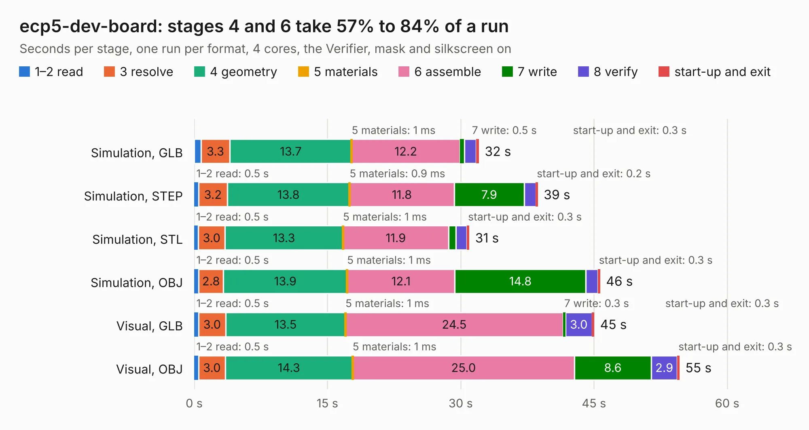

# 1647 ecp5-dev-board

Board 1,647 of the 3,138 of [Corpus Testing](../Corpus-Testing.md), on [Corpus Page 16](../CorpusTestingPages/Corpus-Testing-16.md#1647-ecp5-dev-board).

| Mode and format | 1–2 read | 3 resolve | 4 geometry | 5 materials | 6 assemble | 7 write | 8 verify | start-up and exit | Total |
|---|---:|---:|---:|---:|---:|---:|---:|---:|---:|
| Simulation, GLB | 0.8 | 3.3 | 13.7 | 1&nbsp;ms | 12.2 | 0.5 | 1.3 | 0.3 | 32.1 |
| Simulation, STEP | 0.5 | 3.2 | 13.8 | 0.9&nbsp;ms | 11.8 | 7.9 | 1.3 | 0.2 | 38.7 |
| Simulation, STL | 0.5 | 3.0 | 13.3 | 1&nbsp;ms | 11.9 | 0.8 | 1.2 | 0.3 | 31.0 |
| Simulation, OBJ | 0.5 | 2.8 | 13.9 | 1&nbsp;ms | 12.1 | 14.8 | 1.3 | 0.3 | 45.7 |
| Visual, GLB | 0.5 | 3.0 | 13.5 | 1&nbsp;ms | 24.5 | 0.3 | 3.0 | 0.3 | 45.0 |
| Visual, OBJ | 0.5 | 3.0 | 14.3 | 1&nbsp;ms | 25.0 | 8.6 | 2.9 | 0.3 | 54.6 |

<table align="center"><tr><td valign="top">

| Board | Repo: [medhyal/ecp5-dev-board](https://github.com/medhyal/ecp5-dev-board) Board: `ecp5-dev-board.kicad_pcb` |
|---|---|
| Folder | v0.1 |
| Complexity | 331&nbsp;/&nbsp;1000 (size&nbsp;276, features&nbsp;55) |
| KESE&nbsp;features | through vias, rounded, trapezoid or chamfered pads, filled zones, curved board outline |
| Tested | 9th November 2026 |
| Copper&nbsp;layers | 4 |
| File&nbsp;format | KiCad 5 (20171130) |
| Parts,&nbsp;tracks,&nbsp;vias | 107, 3,371, 336 |
| Triangles,&nbsp;simulation | 2,965,762 in 283 parts |
| Verifier | PASS in all six runs |

</td><td valign="top">

<table>
<tr><th>File type</th><th>File size</th><th>Peak memory used</th></tr>
<tr><th colspan="3" align="left">Simulation</th></tr>
<tr><td>GLB</td><td align="right">102&nbsp;MB</td><td align="right">1.0&nbsp;GB</td></tr>
<tr><td>STEP</td><td align="right">457&nbsp;MB</td><td align="right">1.2&nbsp;GB</td></tr>
<tr><td>STL</td><td align="right">148&nbsp;MB</td><td align="right">1.1&nbsp;GB</td></tr>
<tr><td>OBJ</td><td align="right">314&nbsp;MB</td><td align="right">1.9&nbsp;GB</td></tr>
<tr><th colspan="3" align="left">Visual</th></tr>
<tr><td>GLB</td><td align="right">60&nbsp;MB</td><td align="right">1.1&nbsp;GB</td></tr>
<tr><td>OBJ</td><td align="right">188&nbsp;MB</td><td align="right">1.3&nbsp;GB</td></tr>
</table>

</td></tr></table>

| Previous | Next |
|:---|---:|
| [1646 CM4_NAS](b1646b_CM4-NAS_CM4-NAS.md) | [1648 mega65-kbd](b1648b_mega65-kbd-pcb_mega65-kbd.md) |
