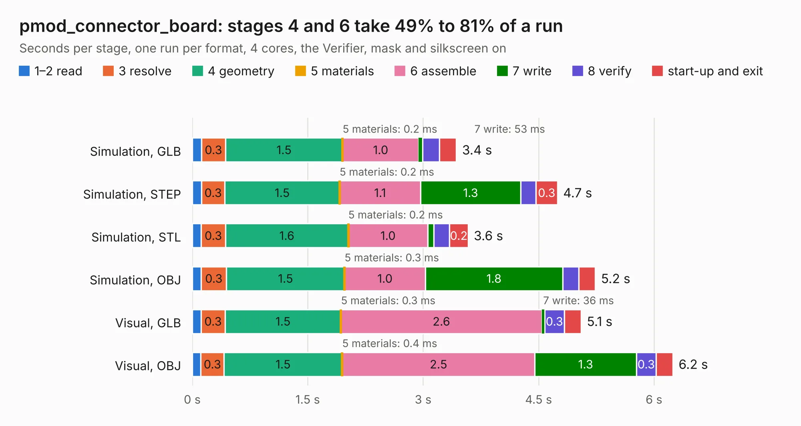

# 1653. pmod_connector_board

Board 1,653 of the 3,139 of [Corpus Testing](../Corpus-Testing.md), on [Corpus Page 16](../CorpusTestingPages/Corpus-Testing-16.md#1653-pmod_connector_board).

| Mode and format | 1–2 read | 3 resolve | 4 geometry | 5 materials | 6 assemble | 7 write | 8 verify | start-up and exit | Total |
|---|---:|---:|---:|---:|---:|---:|---:|---:|---:|
| Simulation, GLB | 0.1 | 0.3 | 1.5 | 0.2&nbsp;ms | 1.0 | 53&nbsp;ms | 0.2 | 0.2 | 3.4 |
| Simulation, STEP | 0.1 | 0.3 | 1.5 | 0.2&nbsp;ms | 1.1 | 1.3 | 0.2 | 0.3 | 4.7 |
| Simulation, STL | 0.1 | 0.3 | 1.6 | 0.2&nbsp;ms | 1.0 | 77&nbsp;ms | 0.2 | 0.2 | 3.6 |
| Simulation, OBJ | 0.1 | 0.3 | 1.5 | 0.3&nbsp;ms | 1.0 | 1.8 | 0.2 | 0.2 | 5.2 |
| Visual, GLB | 0.1 | 0.3 | 1.5 | 0.3&nbsp;ms | 2.6 | 36&nbsp;ms | 0.3 | 0.2 | 5.1 |
| Visual, OBJ | 0.1 | 0.3 | 1.5 | 0.4&nbsp;ms | 2.5 | 1.3 | 0.3 | 0.2 | 6.2 |

<table align="center"><tr><td valign="top">

| Board | Repo: [MEGA65/mega65-r3-expansion-board](https://github.com/MEGA65/mega65-r3-expansion-board) Board: `pmod_connector_board.kicad_pcb` |
|---|---|
| Folder | pmod_connector_board |
| Complexity | 170&nbsp;/&nbsp;1000 (size&nbsp;125, features&nbsp;45) |
| KESE&nbsp;features | through vias, stack-up, dielectric εr and tanδ |
| Tested | 9th November 2026 |
| Copper&nbsp;layers | 2 |
| File&nbsp;format | KiCad 6 (20211014) |
| Parts,&nbsp;tracks,&nbsp;vias | 4, 212, 16 |
| Triangles,&nbsp;simulation | 310,928 in 29 parts |
| Verifier | PASS in all six runs |

</td><td valign="top">

<table>
<tr><th>File type</th><th>File size</th><th>Peak memory used</th></tr>
<tr><th colspan="3" align="left">Simulation</th></tr>
<tr><td>GLB</td><td align="right">11&nbsp;MB</td><td align="right">227&nbsp;MB</td></tr>
<tr><td>STEP</td><td align="right">47&nbsp;MB</td><td align="right">258&nbsp;MB</td></tr>
<tr><td>STL</td><td align="right">16&nbsp;MB</td><td align="right">240&nbsp;MB</td></tr>
<tr><td>OBJ</td><td align="right">32&nbsp;MB</td><td align="right">259&nbsp;MB</td></tr>
<tr><th colspan="3" align="left">Visual</th></tr>
<tr><td>GLB</td><td align="right">7.5&nbsp;MB</td><td align="right">242&nbsp;MB</td></tr>
<tr><td>OBJ</td><td align="right">23&nbsp;MB</td><td align="right">245&nbsp;MB</td></tr>
</table>

</td></tr></table>

| Previous | Next |
|:---|---:|
| [1652. mega65-r3-expansion-board.kicad](b1652b_mega65-r3-expansion-board_mega65-r3-expansion-board-kicad.md) | [1654. IIsi-to-ztex](b1654b_IIsiFPGA_IIsi-to-ztex.md) |
