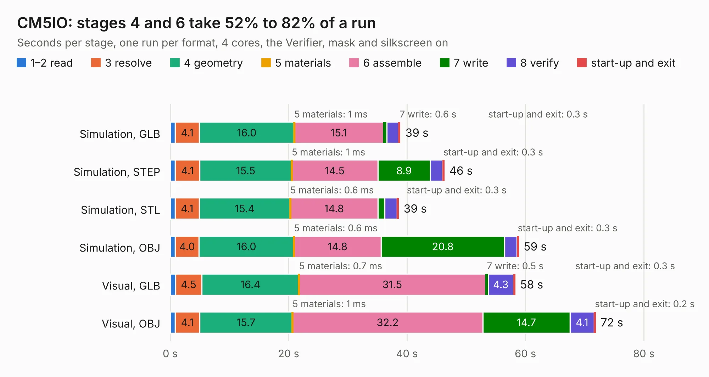

# 1653. CM5IO

Board 1,653 of the 3,131 of [Corpus Testing](../Corpus-Testing.md), on [Corpus Page 16](../CorpusTestingPages/Corpus-Testing-16.md#1653-cm5io).

| Mode and format | 1–2 read | 3 resolve | 4 geometry | 5 materials | 6 assemble | 7 write | 8 verify | start-up and exit | Total |
|---|---:|---:|---:|---:|---:|---:|---:|---:|---:|
| Simulation, GLB | 0.8 | 4.1 | 16.0 | 1&nbsp;ms | 15.1 | 0.6 | 2.0 | 0.3 | 38.9 |
| Simulation, STEP | 0.9 | 4.1 | 15.5 | 1&nbsp;ms | 14.5 | 8.9 | 2.1 | 0.3 | 46.3 |
| Simulation, STL | 0.8 | 4.1 | 15.4 | 0.6&nbsp;ms | 14.8 | 1.1 | 2.1 | 0.3 | 38.6 |
| Simulation, OBJ | 0.9 | 4.0 | 16.0 | 0.6&nbsp;ms | 14.8 | 20.8 | 2.1 | 0.3 | 58.8 |
| Visual, GLB | 0.9 | 4.5 | 16.4 | 0.7&nbsp;ms | 31.5 | 0.5 | 4.3 | 0.3 | 58.2 |
| Visual, OBJ | 0.8 | 4.1 | 15.7 | 1&nbsp;ms | 32.2 | 14.7 | 4.1 | 0.2 | 71.8 |

<table align="center"><tr><td valign="top">

| Board | Repo: [mibs510/openxtcm5-head-unit](https://github.com/mibs510/openxtcm5-head-unit) Board: `CM5IO.kicad_pcb` |
|---|---|
| Folder | pcb / lib / RPI-CM5-IO |
| Complexity | 347&nbsp;/&nbsp;1000 (size&nbsp;222, features&nbsp;125) |
| KESE&nbsp;features | through vias, slotted holes, rounded, trapezoid or chamfered pads, arc tracks, filled zones, copper text, curved board outline, stack-up, dielectric εr and tanδ, mask and silkscreen colours |
| Tested | 9th November 2026 |
| Copper&nbsp;layers | 4 |
| File&nbsp;format | KiCad 8 (20240108) |
| Parts,&nbsp;tracks,&nbsp;vias | 64, 4,090, 703 |
| Triangles,&nbsp;simulation | 3,764,542 in 226 parts |
| Verifier | PASS in all six runs |

</td><td valign="top">

<table>
<tr><th>File type</th><th>File size</th><th>Peak memory used</th></tr>
<tr><th colspan="3" align="left">Simulation</th></tr>
<tr><td>GLB</td><td align="right">126&nbsp;MB</td><td align="right">1.2&nbsp;GB</td></tr>
<tr><td>STEP</td><td align="right">497&nbsp;MB</td><td align="right">1.6&nbsp;GB</td></tr>
<tr><td>STL</td><td align="right">188&nbsp;MB</td><td align="right">1.2&nbsp;GB</td></tr>
<tr><td>OBJ</td><td align="right">397&nbsp;MB</td><td align="right">2.5&nbsp;GB</td></tr>
<tr><th colspan="3" align="left">Visual</th></tr>
<tr><td>GLB</td><td align="right">86&nbsp;MB</td><td align="right">1.5&nbsp;GB</td></tr>
<tr><td>OBJ</td><td align="right">274&nbsp;MB</td><td align="right">1.8&nbsp;GB</td></tr>
</table>

</td></tr></table>

| Previous | Next |
|:---|---:|
| [1652. PicoBerry_V1.0](b1652b_PicoBerry_PicoBerry-V1-0.md) | [1654. 2070-S-100-bus-analyzer](b1654b_2070-S-100-bus-analyzer_2070-S-100-bus-analyzer.md) |
