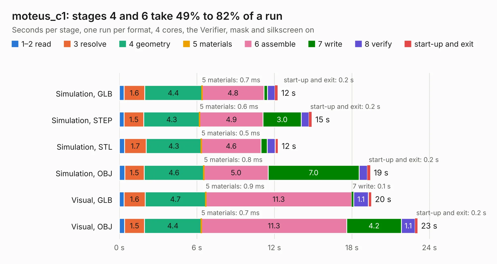

# 1654. moteus_c1

Board 1,654 of the 3,128 of [Corpus Testing](../Corpus-Testing.md), on [Corpus Page 16](../CorpusTestingPages/Corpus-Testing-16.md#1654-moteus_c1).

| Mode and format | 1–2 read | 3 resolve | 4 geometry | 5 materials | 6 assemble | 7 write | 8 verify | start-up and exit | Total |
|---|---:|---:|---:|---:|---:|---:|---:|---:|---:|
| Simulation, GLB | 0.4 | 1.6 | 4.4 | 0.7&nbsp;ms | 4.8 | 0.3 | 0.6 | 0.2 | 12.3 |
| Simulation, STEP | 0.4 | 1.5 | 4.3 | 0.6&nbsp;ms | 4.9 | 3.0 | 0.6 | 0.2 | 14.9 |
| Simulation, STL | 0.4 | 1.7 | 4.3 | 0.5&nbsp;ms | 4.6 | 0.5 | 0.6 | 0.2 | 12.3 |
| Simulation, OBJ | 0.4 | 1.5 | 4.6 | 0.8&nbsp;ms | 5.0 | 7.0 | 0.6 | 0.2 | 19.4 |
| Visual, GLB | 0.4 | 1.6 | 4.7 | 0.9&nbsp;ms | 11.3 | 0.1 | 1.1 | 0.2 | 19.5 |
| Visual, OBJ | 0.4 | 1.5 | 4.4 | 0.7&nbsp;ms | 11.3 | 4.2 | 1.1 | 0.2 | 23.1 |

<table align="center"><tr><td valign="top">

| Board | Repo: [mjbots/moteus](https://github.com/mjbots/moteus) Board: `moteus_c1.kicad_pcb` |
|---|---|
| Folder | hw / c1 / r1.0 |
| Complexity | 340&nbsp;/&nbsp;1000 (size&nbsp;250, features&nbsp;90) |
| KESE&nbsp;features | through vias, rounded, trapezoid or chamfered pads, filled zones, curved board outline, stack-up, dielectric εr and tanδ, mask and silkscreen colours |
| Tested | 9th November 2026 |
| Copper&nbsp;layers | 4 |
| File&nbsp;format | KiCad 7 (20221018) |
| Parts,&nbsp;tracks,&nbsp;vias | 130, 1,083, 286 |
| Triangles,&nbsp;simulation | 1,709,492 in 121 parts |
| Verifier | PASS in all six runs |

</td><td valign="top">

<table>
<tr><th>File type</th><th>File size</th><th>Peak memory used</th></tr>
<tr><th colspan="3" align="left">Simulation</th></tr>
<tr><td>GLB</td><td align="right">58&nbsp;MB</td><td align="right">599&nbsp;MB</td></tr>
<tr><td>STEP</td><td align="right">205&nbsp;MB</td><td align="right">681&nbsp;MB</td></tr>
<tr><td>STL</td><td align="right">85&nbsp;MB</td><td align="right">566&nbsp;MB</td></tr>
<tr><td>OBJ</td><td align="right">176&nbsp;MB</td><td align="right">1.1&nbsp;GB</td></tr>
<tr><th colspan="3" align="left">Visual</th></tr>
<tr><td>GLB</td><td align="right">36&nbsp;MB</td><td align="right">732&nbsp;MB</td></tr>
<tr><td>OBJ</td><td align="right">109&nbsp;MB</td><td align="right">866&nbsp;MB</td></tr>
</table>

</td></tr></table>

| Previous | Next |
|:---|---:|
| [1653. moteus_c1](b1653b_moteus_hw-c1_moteus-c1.md) | [1655. moteus_c1](b1655b_moteus_hw-c1-r1-1_moteus-c1.md) |
