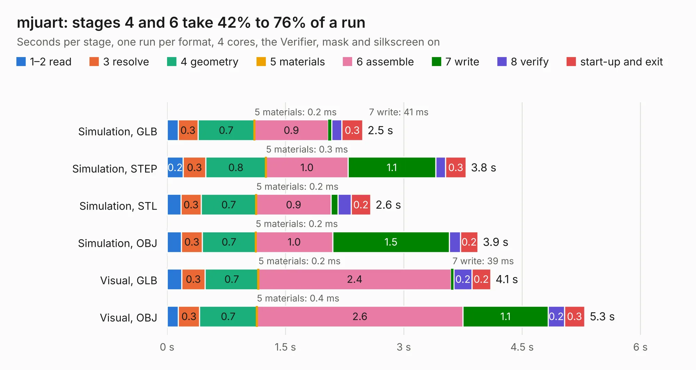

# 1654. mjuart

Board 1,654 of the 3,123 of [Corpus Testing](../Corpus-Testing.md), on [Corpus Page 16](../CorpusTestingPages/Corpus-Testing-16.md#1654-mjuart).

| Mode and format | 1–2 read | 3 resolve | 4 geometry | 5 materials | 6 assemble | 7 write | 8 verify | start-up and exit | Total |
|---|---:|---:|---:|---:|---:|---:|---:|---:|---:|
| Simulation, GLB | 0.1 | 0.3 | 0.7 | 0.2&nbsp;ms | 0.9 | 41&nbsp;ms | 0.1 | 0.3 | 2.5 |
| Simulation, STEP | 0.2 | 0.3 | 0.8 | 0.3&nbsp;ms | 1.0 | 1.1 | 0.1 | 0.3 | 3.8 |
| Simulation, STL | 0.2 | 0.3 | 0.7 | 0.2&nbsp;ms | 0.9 | 91&nbsp;ms | 0.2 | 0.2 | 2.6 |
| Simulation, OBJ | 0.2 | 0.3 | 0.7 | 0.2&nbsp;ms | 1.0 | 1.5 | 0.1 | 0.2 | 3.9 |
| Visual, GLB | 0.2 | 0.3 | 0.7 | 0.2&nbsp;ms | 2.4 | 39&nbsp;ms | 0.2 | 0.2 | 4.1 |
| Visual, OBJ | 0.1 | 0.3 | 0.7 | 0.4&nbsp;ms | 2.6 | 1.1 | 0.2 | 0.3 | 5.3 |

<table align="center"><tr><td valign="top">

| Board | Repo: [mjbots/moteus](https://github.com/mjbots/moteus) Board: `mjuart.kicad_pcb` |
|---|---|
| Folder | hw / mjuart |
| Complexity | 245&nbsp;/&nbsp;1000 (size&nbsp;155, features&nbsp;90) |
| KESE&nbsp;features | through vias, rounded, trapezoid or chamfered pads, filled zones, curved board outline, stack-up, dielectric εr and tanδ, mask and silkscreen colours |
| Tested | 9th November 2026 |
| Copper&nbsp;layers | 4 |
| File&nbsp;format | KiCad 9 (20241229) |
| Parts,&nbsp;tracks,&nbsp;vias | 16, 150, 37 |
| Triangles,&nbsp;simulation | 222,280 in 38 parts |
| Verifier | PASS in all six runs |

</td><td valign="top">

<table>
<tr><th>File type</th><th>File size</th><th>Peak memory used</th></tr>
<tr><th colspan="3" align="left">Simulation</th></tr>
<tr><td>GLB</td><td align="right">7.7&nbsp;MB</td><td align="right">220&nbsp;MB</td></tr>
<tr><td>STEP</td><td align="right">28&nbsp;MB</td><td align="right">232&nbsp;MB</td></tr>
<tr><td>STL</td><td align="right">11&nbsp;MB</td><td align="right">219&nbsp;MB</td></tr>
<tr><td>OBJ</td><td align="right">22&nbsp;MB</td><td align="right">226&nbsp;MB</td></tr>
<tr><th colspan="3" align="left">Visual</th></tr>
<tr><td>GLB</td><td align="right">5.4&nbsp;MB</td><td align="right">209&nbsp;MB</td></tr>
<tr><td>OBJ</td><td align="right">15&nbsp;MB</td><td align="right">212&nbsp;MB</td></tr>
</table>

</td></tr></table>

| Previous | Next |
|:---|---:|
| [1653. moteus_c1](b1653b_moteus_hw-c1-r1-1_moteus-c1.md) | [1655. moteus_x1](b1655b_moteus_moteus-x1.md) |
