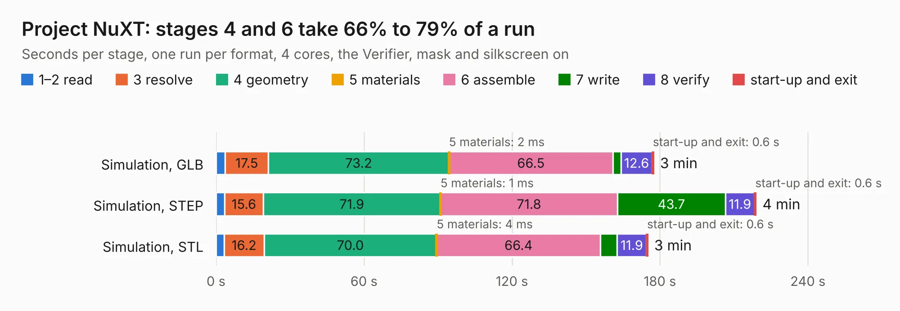

# 1655. Project NuXT

Board 1,655 of the 3,103 of [Corpus Testing](../Corpus-Testing.md), on [Corpus Page 16](../CorpusTestingPages/Corpus-Testing-16.md#1655-project-nuxt).

| Mode and format | 1–2 read | 3 resolve | 4 geometry | 5 materials | 6 assemble | 7 write | 8 verify | start-up and exit | Total |
|---|---:|---:|---:|---:|---:|---:|---:|---:|---:|
| Simulation, GLB | 3.7 | 17.5 | 73.2 | 2&nbsp;ms | 66.5 | 3.3 | 12.6 | 0.6 | 177.4 |
| Simulation, STEP | 3.5 | 15.6 | 71.9 | 1&nbsp;ms | 71.8 | 43.7 | 11.9 | 0.6 | 219.0 |
| Simulation, STL | 3.3 | 16.2 | 70.0 | 4&nbsp;ms | 66.4 | 6.8 | 11.9 | 0.6 | 175.1 |
| Simulation, OBJ | 3.0 | 15.5 | 71.4 | 4&nbsp;ms | 64.2 | 106.1 | 11.9 | 0.6 | 272.6 |
| Visual, GLB | 3.1 | 15.9 | 69.7 | 3&nbsp;ms | 176.1 | 1.8 | 16.1 | 0.5 | 283.3 |
| Visual, OBJ | 3.3 | 19.0 | 73.5 | 3&nbsp;ms | 174.4 | 61.4 | 16.1 | 0.4 | 348.1 |

<table align="center"><tr><td valign="top">

| Board | Repo: [monotech/NuXT](https://github.com/monotech/NuXT) Board: `Project NuXT.kicad_pcb` |
|---|---|
| Complexity | 302&nbsp;/&nbsp;1000 (size&nbsp;237, features&nbsp;65) |
| KESE&nbsp;features | through vias, rounded, trapezoid or chamfered pads, filled zones, copper text, curved board outline |
| Tested | 9th November 2026 |
| Copper&nbsp;layers | 4 |
| File&nbsp;format | KiCad 5 (20171130) |
| Parts,&nbsp;tracks,&nbsp;vias | 221, 6,262, 262 |
| Triangles,&nbsp;simulation | 15,376,478 in 341 parts |
| Verifier | PASS in all six runs |

</td><td valign="top">

<table>
<tr><th>File type</th><th>File size</th><th>Peak memory used</th></tr>
<tr><th colspan="3" align="left">Simulation</th></tr>
<tr><td>GLB</td><td align="right">521&nbsp;MB</td><td align="right">3.5&nbsp;GB</td></tr>
<tr><td>STEP</td><td align="right">2.1&nbsp;GB</td><td align="right">4.7&nbsp;GB</td></tr>
<tr><td>STL</td><td align="right">769&nbsp;MB</td><td align="right">3.5&nbsp;GB</td></tr>
<tr><td>OBJ</td><td align="right">1.7&nbsp;GB</td><td align="right">9.6&nbsp;GB</td></tr>
<tr><th colspan="3" align="left">Visual</th></tr>
<tr><td>GLB</td><td align="right">292&nbsp;MB</td><td align="right">4.5&nbsp;GB</td></tr>
<tr><td>OBJ</td><td align="right">941&nbsp;MB</td><td align="right">5.9&nbsp;GB</td></tr>
</table>

</td></tr></table>

| Previous | Next |
|:---|---:|
| [1654. pcb](b1654b_Lancer_pcb-usb-adapter-board_pcb.md) | [1656. 96boards-robomezzi](b1656b_96boards-robomezzi_96boards-robomezzi.md) |
