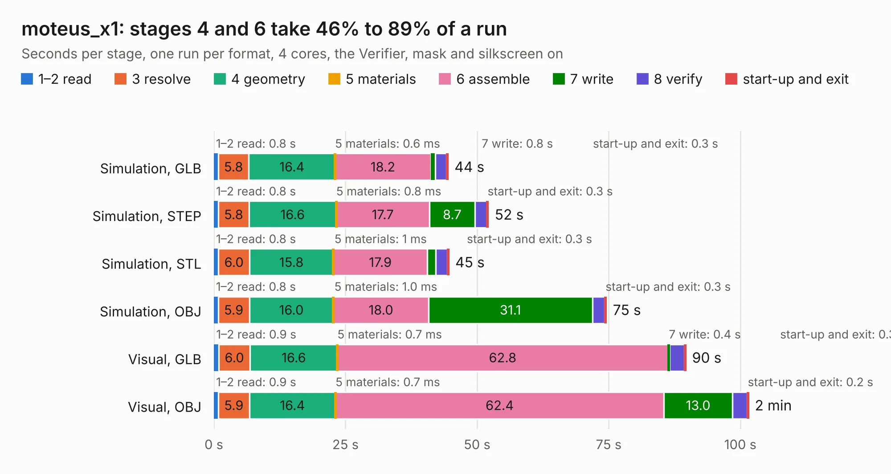

# 1655. moteus_x1

Board 1,655 of the 3,123 of [Corpus Testing](../Corpus-Testing.md), on [Corpus Page 16](../CorpusTestingPages/Corpus-Testing-16.md#1655-moteus_x1).

| Mode and format | 1–2 read | 3 resolve | 4 geometry | 5 materials | 6 assemble | 7 write | 8 verify | start-up and exit | Total |
|---|---:|---:|---:|---:|---:|---:|---:|---:|---:|
| Simulation, GLB | 0.8 | 5.8 | 16.4 | 0.6&nbsp;ms | 18.2 | 0.8 | 2.2 | 0.3 | 44.5 |
| Simulation, STEP | 0.8 | 5.8 | 16.6 | 0.8&nbsp;ms | 17.7 | 8.7 | 2.2 | 0.3 | 52.1 |
| Simulation, STL | 0.8 | 6.0 | 15.8 | 1&nbsp;ms | 17.9 | 1.6 | 2.2 | 0.3 | 44.6 |
| Simulation, OBJ | 0.8 | 5.9 | 16.0 | 1.0&nbsp;ms | 18.0 | 31.1 | 2.3 | 0.3 | 74.6 |
| Visual, GLB | 0.9 | 6.0 | 16.6 | 0.7&nbsp;ms | 62.8 | 0.4 | 2.8 | 0.3 | 89.6 |
| Visual, OBJ | 0.9 | 5.9 | 16.4 | 0.7&nbsp;ms | 62.4 | 13.0 | 2.8 | 0.2 | 101.5 |

<table align="center"><tr><td valign="top">

| Board | Repo: [mjbots/moteus](https://github.com/mjbots/moteus) Board: `moteus_x1.kicad_pcb` |
|---|---|
| Folder | hw / x1 |
| Complexity | 408&nbsp;/&nbsp;1000 (size&nbsp;278, features&nbsp;130) |
| KESE&nbsp;features | through vias, custom pads, rounded, trapezoid or chamfered pads, arc tracks, filled zones, copper drawings, curved board outline, stack-up, dielectric εr and tanδ, mask and silkscreen colours |
| Tested | 9th November 2026 |
| Copper&nbsp;layers | 6 |
| File&nbsp;format | KiCad 8 (20240108) |
| Parts,&nbsp;tracks,&nbsp;vias | 183, 1,473, 1,087 |
| Triangles,&nbsp;simulation | 5,602,952 in 146 parts |
| Verifier | PASS in all six runs |

</td><td valign="top">

<table>
<tr><th>File type</th><th>File size</th><th>Peak memory used</th></tr>
<tr><th colspan="3" align="left">Simulation</th></tr>
<tr><td>GLB</td><td align="right">183&nbsp;MB</td><td align="right">1.2&nbsp;GB</td></tr>
<tr><td>STEP</td><td align="right">471&nbsp;MB</td><td align="right">1.6&nbsp;GB</td></tr>
<tr><td>STL</td><td align="right">280&nbsp;MB</td><td align="right">1.2&nbsp;GB</td></tr>
<tr><td>OBJ</td><td align="right">588&nbsp;MB</td><td align="right">3.5&nbsp;GB</td></tr>
<tr><th colspan="3" align="left">Visual</th></tr>
<tr><td>GLB</td><td align="right">86&nbsp;MB</td><td align="right">1.6&nbsp;GB</td></tr>
<tr><td>OBJ</td><td align="right">275&nbsp;MB</td><td align="right">1.9&nbsp;GB</td></tr>
</table>

</td></tr></table>

| Previous | Next |
|:---|---:|
| [1654. mjuart](b1654b_moteus_mjuart.md) | [1656. amiga-gfxcard-before-pour](b1656b_amiga2000-gfxcard_amiga-gfxcard-before-pour.md) |
