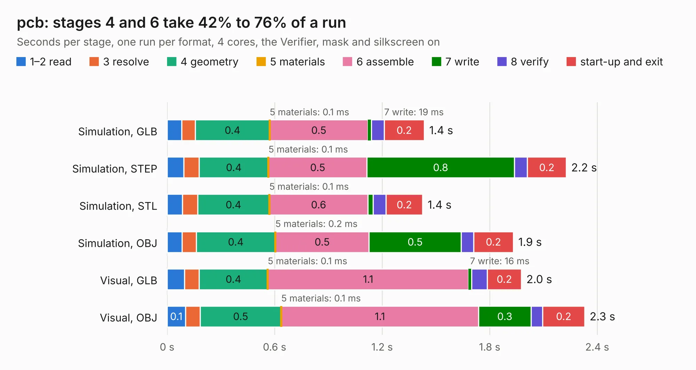

# 1656. pcb

Board 1,656 of the 3,105 of [Corpus Testing](../Corpus-Testing.md), on [Corpus Page 16](../CorpusTestingPages/Corpus-Testing-16.md#1656-pcb).

| Mode and format | 1–2 read | 3 resolve | 4 geometry | 5 materials | 6 assemble | 7 write | 8 verify | start-up and exit | Total |
|---|---:|---:|---:|---:|---:|---:|---:|---:|---:|
| Simulation, GLB | 81&nbsp;ms | 77&nbsp;ms | 0.4 | 0.1&nbsp;ms | 0.5 | 19&nbsp;ms | 72&nbsp;ms | 0.2 | 1.4 |
| Simulation, STEP | 93&nbsp;ms | 86&nbsp;ms | 0.4 | 0.1&nbsp;ms | 0.5 | 0.8 | 73&nbsp;ms | 0.2 | 2.2 |
| Simulation, STL | 85&nbsp;ms | 86&nbsp;ms | 0.4 | 0.1&nbsp;ms | 0.6 | 28&nbsp;ms | 73&nbsp;ms | 0.2 | 1.4 |
| Simulation, OBJ | 84&nbsp;ms | 79&nbsp;ms | 0.4 | 0.2&nbsp;ms | 0.5 | 0.5 | 69&nbsp;ms | 0.2 | 1.9 |
| Visual, GLB | 98&nbsp;ms | 82&nbsp;ms | 0.4 | 0.1&nbsp;ms | 1.1 | 16&nbsp;ms | 88&nbsp;ms | 0.2 | 2.0 |
| Visual, OBJ | 0.1 | 81&nbsp;ms | 0.5 | 0.1&nbsp;ms | 1.1 | 0.3 | 65&nbsp;ms | 0.2 | 2.3 |

<table align="center"><tr><td valign="top">

| Board | Repo: [Modos-Labs/Lancer](https://github.com/Modos-Labs/Lancer) Board: `pcb.kicad_pcb` |
|---|---|
| Folder | pcb / usb_adapter_board |
| Complexity | 148&nbsp;/&nbsp;1000 (size&nbsp;93, features&nbsp;55) |
| KESE&nbsp;features | filled zones, stack-up, dielectric εr and tanδ, mask and silkscreen colours |
| Tested | 9th November 2026 |
| Copper&nbsp;layers | 2 |
| File&nbsp;format | KiCad 6 (20210824) |
| Parts,&nbsp;tracks,&nbsp;vias | 3, 40, 0 |
| Triangles,&nbsp;simulation | 109,756 in 17 parts |
| Verifier | PASS in all six runs |

</td><td valign="top">

<table>
<tr><th>File type</th><th>File size</th><th>Peak memory used</th></tr>
<tr><th colspan="3" align="left">Simulation</th></tr>
<tr><td>GLB</td><td align="right">3.6&nbsp;MB</td><td align="right">186&nbsp;MB</td></tr>
<tr><td>STEP</td><td align="right">16&nbsp;MB</td><td align="right">191&nbsp;MB</td></tr>
<tr><td>STL</td><td align="right">5.5&nbsp;MB</td><td align="right">188&nbsp;MB</td></tr>
<tr><td>OBJ</td><td align="right">10&nbsp;MB</td><td align="right">180&nbsp;MB</td></tr>
<tr><th colspan="3" align="left">Visual</th></tr>
<tr><td>GLB</td><td align="right">2.1&nbsp;MB</td><td align="right">153&nbsp;MB</td></tr>
<tr><td>OBJ</td><td align="right">5.7&nbsp;MB</td><td align="right">152&nbsp;MB</td></tr>
</table>

</td></tr></table>

| Previous | Next |
|:---|---:|
| [1655. pcb](b1655b_Lancer_pcb-mainboard_pcb.md) | [1657. Project NuXT](b1657b_NuXT_Project-NuXT.md) |
