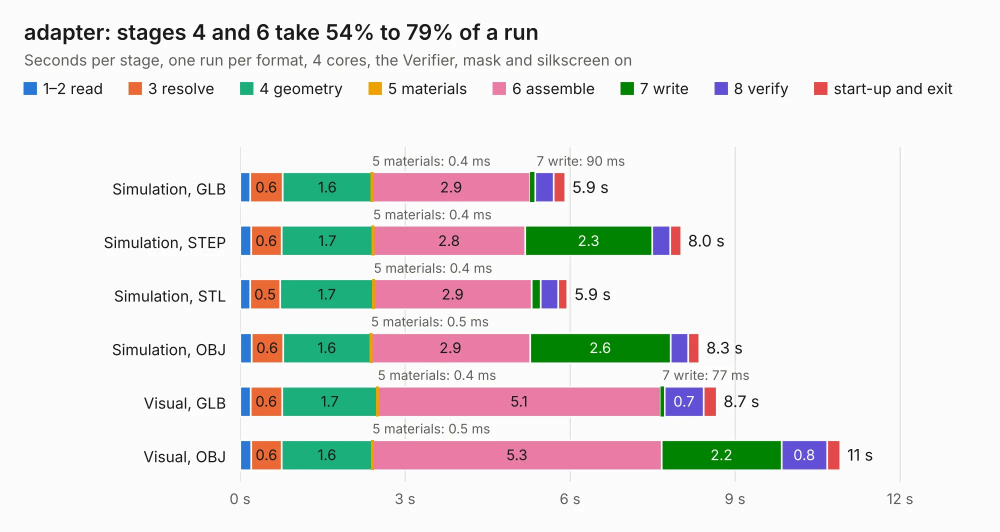

# 1657. adapter

Board 1,657 of the 3,110 of [Corpus Testing](../Corpus-Testing.md), on [Corpus Page 16](../CorpusTestingPages/Corpus-Testing-16.md#1657-adapter).

| Mode and format | 1–2 read | 3 resolve | 4 geometry | 5 materials | 6 assemble | 7 write | 8 verify | start-up and exit | Total |
|---|---:|---:|---:|---:|---:|---:|---:|---:|---:|
| Simulation, GLB | 0.2 | 0.6 | 1.6 | 0.4&nbsp;ms | 2.9 | 90&nbsp;ms | 0.3 | 0.2 | 5.9 |
| Simulation, STEP | 0.2 | 0.6 | 1.7 | 0.4&nbsp;ms | 2.8 | 2.3 | 0.3 | 0.2 | 8.0 |
| Simulation, STL | 0.2 | 0.5 | 1.7 | 0.4&nbsp;ms | 2.9 | 0.2 | 0.3 | 0.2 | 5.9 |
| Simulation, OBJ | 0.2 | 0.6 | 1.6 | 0.5&nbsp;ms | 2.9 | 2.6 | 0.3 | 0.2 | 8.3 |
| Visual, GLB | 0.2 | 0.6 | 1.7 | 0.4&nbsp;ms | 5.1 | 77&nbsp;ms | 0.7 | 0.2 | 8.7 |
| Visual, OBJ | 0.2 | 0.6 | 1.6 | 0.5&nbsp;ms | 5.3 | 2.2 | 0.8 | 0.2 | 10.9 |

<table align="center"><tr><td valign="top">

| Board | Repo: [Modos-Labs/Glider](https://github.com/Modos-Labs/Glider) Board: `adapter.kicad_pcb` |
|---|---|
| Folder | pcb / mega_adapter |
| Complexity | 261&nbsp;/&nbsp;1000 (size&nbsp;171, features&nbsp;90) |
| KESE&nbsp;features | through vias, rounded, trapezoid or chamfered pads, filled zones, knockout text, stack-up, dielectric εr and tanδ |
| Tested | 9th November 2026 |
| Copper&nbsp;layers | 2 |
| File&nbsp;format | KiCad 8 (20240108) |
| Parts,&nbsp;tracks,&nbsp;vias | 16, 1,300, 195 |
| Triangles,&nbsp;simulation | 655,760 in 108 parts |
| Verifier | PASS in all six runs |

</td><td valign="top">

<table>
<tr><th>File type</th><th>File size</th><th>Peak memory used</th></tr>
<tr><th colspan="3" align="left">Simulation</th></tr>
<tr><td>GLB</td><td align="right">23&nbsp;MB</td><td align="right">400&nbsp;MB</td></tr>
<tr><td>STEP</td><td align="right">117&nbsp;MB</td><td align="right">446&nbsp;MB</td></tr>
<tr><td>STL</td><td align="right">33&nbsp;MB</td><td align="right">403&nbsp;MB</td></tr>
<tr><td>OBJ</td><td align="right">66&nbsp;MB</td><td align="right">477&nbsp;MB</td></tr>
<tr><th colspan="3" align="left">Visual</th></tr>
<tr><td>GLB</td><td align="right">19&nbsp;MB</td><td align="right">428&nbsp;MB</td></tr>
<tr><td>OBJ</td><td align="right">57&nbsp;MB</td><td align="right">514&nbsp;MB</td></tr>
</table>

</td></tr></table>

| Previous | Next |
|:---|---:|
| [1656. pcb](b1656b_Glider_pcb.md) | [1658. adapter](b1658b_Glider_pcb-u133-adapter_adapter.md) |
