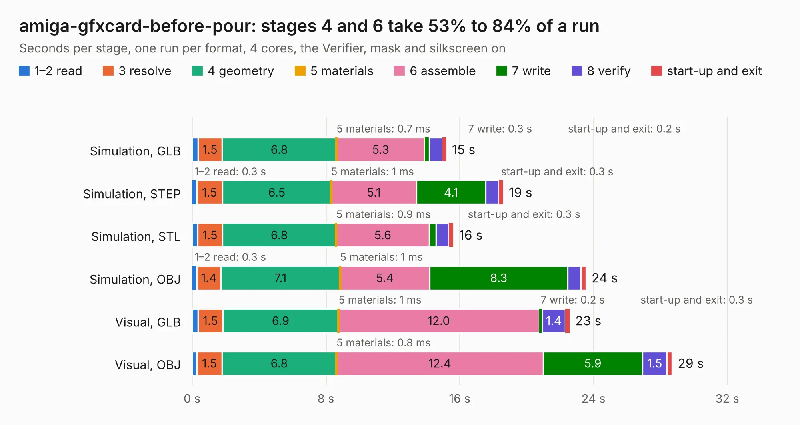

# 1657. amiga-gfxcard-before-pour

Board 1,657 of the 3,125 of [Corpus Testing](../Corpus-Testing.md), on [Corpus Page 16](../CorpusTestingPages/Corpus-Testing-16.md#1657-amiga-gfxcard-before-pour).

| Mode and format | 1–2 read | 3 resolve | 4 geometry | 5 materials | 6 assemble | 7 write | 8 verify | start-up and exit | Total |
|---|---:|---:|---:|---:|---:|---:|---:|---:|---:|
| Simulation, GLB | 0.3 | 1.5 | 6.8 | 0.7&nbsp;ms | 5.3 | 0.3 | 0.8 | 0.2 | 15.2 |
| Simulation, STEP | 0.3 | 1.5 | 6.5 | 1&nbsp;ms | 5.1 | 4.1 | 0.8 | 0.3 | 18.6 |
| Simulation, STL | 0.3 | 1.5 | 6.8 | 0.9&nbsp;ms | 5.6 | 0.4 | 0.8 | 0.3 | 15.6 |
| Simulation, OBJ | 0.3 | 1.4 | 7.1 | 1&nbsp;ms | 5.4 | 8.3 | 0.8 | 0.3 | 23.5 |
| Visual, GLB | 0.4 | 1.5 | 6.9 | 1&nbsp;ms | 12.0 | 0.2 | 1.4 | 0.3 | 22.6 |
| Visual, OBJ | 0.3 | 1.5 | 6.8 | 0.8&nbsp;ms | 12.4 | 5.9 | 1.5 | 0.3 | 28.7 |

<table align="center"><tr><td valign="top">

| Board | Repo: [mntmn/amiga2000-gfxcard](https://github.com/mntmn/amiga2000-gfxcard) Board: `amiga-gfxcard-before-pour.kicad_pcb` |
|---|---|
| Folder | kicad |
| Complexity | 245&nbsp;/&nbsp;1000 (size&nbsp;230, features&nbsp;15) |
| KESE&nbsp;features | through vias |
| Tested | 9th November 2026 |
| Copper&nbsp;layers | 2 |
| File&nbsp;format | KiCad 4 (4) |
| Parts,&nbsp;tracks,&nbsp;vias | 21, 1,740, 290 |
| Triangles,&nbsp;simulation | 1,270,194 in 237 parts |
| Verifier | PASS in all six runs |

</td><td valign="top">

<table>
<tr><th>File type</th><th>File size</th><th>Peak memory used</th></tr>
<tr><th colspan="3" align="left">Simulation</th></tr>
<tr><td>GLB</td><td align="right">44&nbsp;MB</td><td align="right">525&nbsp;MB</td></tr>
<tr><td>STEP</td><td align="right">204&nbsp;MB</td><td align="right">645&nbsp;MB</td></tr>
<tr><td>STL</td><td align="right">64&nbsp;MB</td><td align="right">522&nbsp;MB</td></tr>
<tr><td>OBJ</td><td align="right">132&nbsp;MB</td><td align="right">881&nbsp;MB</td></tr>
<tr><th colspan="3" align="left">Visual</th></tr>
<tr><td>GLB</td><td align="right">33&nbsp;MB</td><td align="right">684&nbsp;MB</td></tr>
<tr><td>OBJ</td><td align="right">101&nbsp;MB</td><td align="right">768&nbsp;MB</td></tr>
</table>

</td></tr></table>

| Previous | Next |
|:---|---:|
| [1656. moteus_x1](b1656b_moteus_moteus-x1.md) | [1658. amiga-gfxcard](b1658b_amiga2000-gfxcard_amiga-gfxcard.md) |
