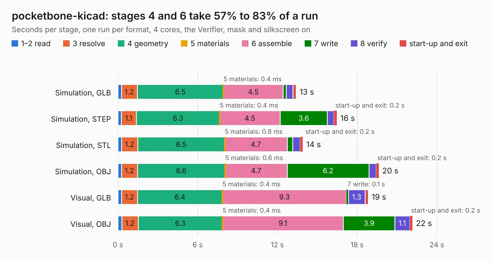

# 1657. pocketbone-kicad

Board 1,657 of the 3,100 of [Corpus Testing](../Corpus-Testing.md), on [Corpus Page 16](../CorpusTestingPages/Corpus-Testing-16.md#1657-pocketbone-kicad).

| Mode and format | 1–2 read | 3 resolve | 4 geometry | 5 materials | 6 assemble | 7 write | 8 verify | start-up and exit | Total |
|---|---:|---:|---:|---:|---:|---:|---:|---:|---:|
| Simulation, GLB | 0.3 | 1.2 | 6.5 | 0.4&nbsp;ms | 4.5 | 0.2 | 0.5 | 0.2 | 13.4 |
| Simulation, STEP | 0.3 | 1.1 | 6.3 | 0.4&nbsp;ms | 4.5 | 3.6 | 0.5 | 0.2 | 16.5 |
| Simulation, STL | 0.3 | 1.2 | 6.5 | 0.8&nbsp;ms | 4.7 | 0.4 | 0.6 | 0.2 | 13.9 |
| Simulation, OBJ | 0.3 | 1.2 | 6.6 | 0.6&nbsp;ms | 4.7 | 6.2 | 0.5 | 0.2 | 19.6 |
| Visual, GLB | 0.3 | 1.2 | 6.4 | 0.4&nbsp;ms | 9.3 | 0.1 | 1.3 | 0.2 | 18.8 |
| Visual, OBJ | 0.3 | 1.2 | 6.3 | 0.4&nbsp;ms | 9.1 | 3.9 | 1.1 | 0.2 | 22.2 |

<table align="center"><tr><td valign="top">

| Board | Repo: [mwelling/pocketbone-kicad](https://github.com/mwelling/pocketbone-kicad) Board: `pocketbone-kicad.kicad_pcb` |
|---|---|
| Complexity | 292&nbsp;/&nbsp;1000 (size&nbsp;247, features&nbsp;45) |
| KESE&nbsp;features | through vias, filled zones, curved board outline |
| Tested | 9th November 2026 |
| Copper&nbsp;layers | 4 |
| File&nbsp;format | KiCad 4 (4) |
| Parts,&nbsp;tracks,&nbsp;vias | 56, 891, 151 |
| Triangles,&nbsp;simulation | 1,477,718 in 88 parts |
| Verifier | PASS in all six runs |

</td><td valign="top">

<table>
<tr><th>File type</th><th>File size</th><th>Peak memory used</th></tr>
<tr><th colspan="3" align="left">Simulation</th></tr>
<tr><td>GLB</td><td align="right">52&nbsp;MB</td><td align="right">655&nbsp;MB</td></tr>
<tr><td>STEP</td><td align="right">247&nbsp;MB</td><td align="right">754&nbsp;MB</td></tr>
<tr><td>STL</td><td align="right">74&nbsp;MB</td><td align="right">652&nbsp;MB</td></tr>
<tr><td>OBJ</td><td align="right">155&nbsp;MB</td><td align="right">1.0&nbsp;GB</td></tr>
<tr><th colspan="3" align="left">Visual</th></tr>
<tr><td>GLB</td><td align="right">34&nbsp;MB</td><td align="right">687&nbsp;MB</td></tr>
<tr><td>OBJ</td><td align="right">102&nbsp;MB</td><td align="right">791&nbsp;MB</td></tr>
</table>

</td></tr></table>

| Previous | Next |
|:---|---:|
| [1656. lofive](b1656b_lofive_lofive.md) | [1658. OpenCAPI-to-PCIe_for_MNV303212A_RevA2](b1658b_opencapi-to-pcie-for-mnv303212a-reva2_OpenCAPI-to-PCIe-for-MNV303212A-RevA2.md) |
