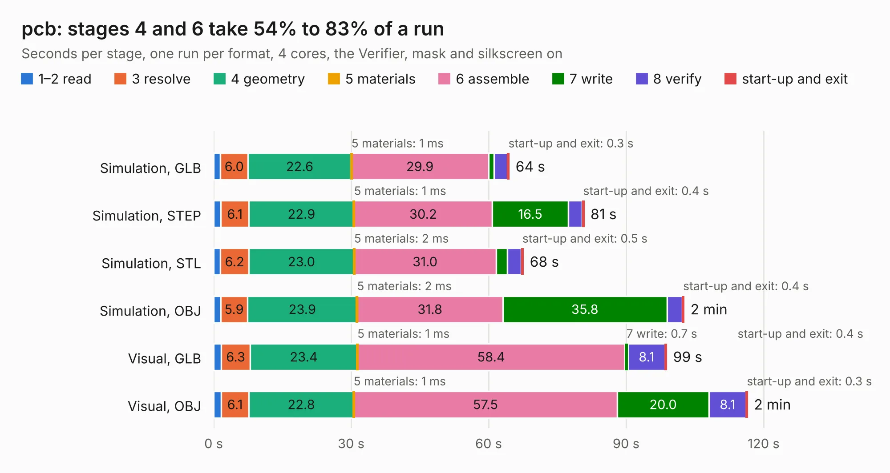

# 1658. pcb

Board 1,658 of the 3,112 of [Corpus Testing](../Corpus-Testing.md), on [Corpus Page 16](../CorpusTestingPages/Corpus-Testing-16.md#1658-pcb).

| Mode and format | 1–2 read | 3 resolve | 4 geometry | 5 materials | 6 assemble | 7 write | 8 verify | start-up and exit | Total |
|---|---:|---:|---:|---:|---:|---:|---:|---:|---:|
| Simulation, GLB | 1.5 | 6.0 | 22.6 | 1&nbsp;ms | 29.9 | 1.2 | 3.0 | 0.3 | 64.5 |
| Simulation, STEP | 1.6 | 6.1 | 22.9 | 1&nbsp;ms | 30.2 | 16.5 | 3.1 | 0.4 | 80.8 |
| Simulation, STL | 1.5 | 6.2 | 23.0 | 2&nbsp;ms | 31.0 | 2.4 | 3.1 | 0.5 | 67.6 |
| Simulation, OBJ | 1.5 | 5.9 | 23.9 | 2&nbsp;ms | 31.8 | 35.8 | 3.3 | 0.4 | 102.7 |
| Visual, GLB | 1.7 | 6.3 | 23.4 | 1&nbsp;ms | 58.4 | 0.7 | 8.1 | 0.4 | 98.9 |
| Visual, OBJ | 1.6 | 6.1 | 22.8 | 1&nbsp;ms | 57.5 | 20.0 | 8.1 | 0.3 | 116.5 |

<table align="center"><tr><td valign="top">

| Board | Repo: [Modos-Labs/Glider](https://github.com/Modos-Labs/Glider) Board: `pcb.kicad_pcb` |
|---|---|
| Folder | pcb / mainboard |
| Complexity | 464&nbsp;/&nbsp;1000 (size&nbsp;309, features&nbsp;155) |
| KESE&nbsp;features | through vias, slotted holes, custom pads, rounded, trapezoid or chamfered pads, filled zones, copper drawings, curved board outline, knockout text, stack-up, dielectric εr and tanδ, copper finish, mask and silkscreen colours |
| Tested | 9th November 2026 |
| Copper&nbsp;layers | 4 |
| File&nbsp;format | KiCad 8 (20240108) |
| Parts,&nbsp;tracks,&nbsp;vias | 375, 8,883, 900 |
| Triangles,&nbsp;simulation | 5,797,268 in 472 parts |
| Verifier | PASS in all six runs |

</td><td valign="top">

<table>
<tr><th>File type</th><th>File size</th><th>Peak memory used</th></tr>
<tr><th colspan="3" align="left">Simulation</th></tr>
<tr><td>GLB</td><td align="right">199&nbsp;MB</td><td align="right">1.7&nbsp;GB</td></tr>
<tr><td>STEP</td><td align="right">870&nbsp;MB</td><td align="right">2.2&nbsp;GB</td></tr>
<tr><td>STL</td><td align="right">290&nbsp;MB</td><td align="right">1.7&nbsp;GB</td></tr>
<tr><td>OBJ</td><td align="right">626&nbsp;MB</td><td align="right">3.7&nbsp;GB</td></tr>
<tr><th colspan="3" align="left">Visual</th></tr>
<tr><td>GLB</td><td align="right">127&nbsp;MB</td><td align="right">2.1&nbsp;GB</td></tr>
<tr><td>OBJ</td><td align="right">413&nbsp;MB</td><td align="right">2.6&nbsp;GB</td></tr>
</table>

</td></tr></table>

| Previous | Next |
|:---|---:|
| [1657. adapter](b1657b_Glider_pcb-50p-adapter-c_adapter.md) | [1659. adapter](b1659b_Glider_pcb-mega-adapter_adapter.md) |
