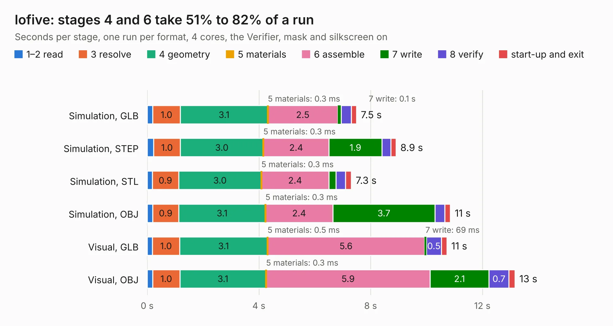

# 1660. lofive

Board 1,660 of the 3,104 of [Corpus Testing](../Corpus-Testing.md), on [Corpus Page 16](../CorpusTestingPages/Corpus-Testing-16.md#1660-lofive).

| Mode and format | 1–2 read | 3 resolve | 4 geometry | 5 materials | 6 assemble | 7 write | 8 verify | start-up and exit | Total |
|---|---:|---:|---:|---:|---:|---:|---:|---:|---:|
| Simulation, GLB | 0.2 | 1.0 | 3.1 | 0.3&nbsp;ms | 2.5 | 0.1 | 0.4 | 0.2 | 7.5 |
| Simulation, STEP | 0.2 | 1.0 | 3.0 | 0.3&nbsp;ms | 2.4 | 1.9 | 0.3 | 0.2 | 8.9 |
| Simulation, STL | 0.2 | 0.9 | 3.0 | 0.3&nbsp;ms | 2.4 | 0.3 | 0.3 | 0.2 | 7.3 |
| Simulation, OBJ | 0.2 | 0.9 | 3.1 | 0.3&nbsp;ms | 2.4 | 3.7 | 0.3 | 0.2 | 10.9 |
| Visual, GLB | 0.2 | 1.0 | 3.1 | 0.5&nbsp;ms | 5.6 | 69&nbsp;ms | 0.5 | 0.2 | 10.7 |
| Visual, OBJ | 0.2 | 1.0 | 3.1 | 0.3&nbsp;ms | 5.9 | 2.1 | 0.7 | 0.2 | 13.2 |

<table align="center"><tr><td valign="top">

| Board | Repo: [mwelling/lofive](https://github.com/mwelling/lofive) Board: `lofive.kicad_pcb` |
|---|---|
| Complexity | 264&nbsp;/&nbsp;1000 (size&nbsp;219, features&nbsp;45) |
| KESE&nbsp;features | through vias, rounded, trapezoid or chamfered pads, filled zones |
| Tested | 9th November 2026 |
| Copper&nbsp;layers | 4 |
| File&nbsp;format | KiCad 9 (20241229) |
| Parts,&nbsp;tracks,&nbsp;vias | 33, 445, 83 |
| Triangles,&nbsp;simulation | 899,502 in 64 parts |
| Verifier | PASS in all six runs |

</td><td valign="top">

<table>
<tr><th>File type</th><th>File size</th><th>Peak memory used</th></tr>
<tr><th colspan="3" align="left">Simulation</th></tr>
<tr><td>GLB</td><td align="right">31&nbsp;MB</td><td align="right">419&nbsp;MB</td></tr>
<tr><td>STEP</td><td align="right">149&nbsp;MB</td><td align="right">452&nbsp;MB</td></tr>
<tr><td>STL</td><td align="right">45&nbsp;MB</td><td align="right">407&nbsp;MB</td></tr>
<tr><td>OBJ</td><td align="right">93&nbsp;MB</td><td align="right">646&nbsp;MB</td></tr>
<tr><th colspan="3" align="left">Visual</th></tr>
<tr><td>GLB</td><td align="right">19&nbsp;MB</td><td align="right">464&nbsp;MB</td></tr>
<tr><td>OBJ</td><td align="right">56&nbsp;MB</td><td align="right">464&nbsp;MB</td></tr>
</table>

</td></tr></table>

| Previous | Next |
|:---|---:|
| [1659. icebreaker++](b1659b_icecrusher_icebreaker.md) | [1661. pocketbone-kicad](b1661b_pocketbone-kicad_pocketbone-kicad.md) |
