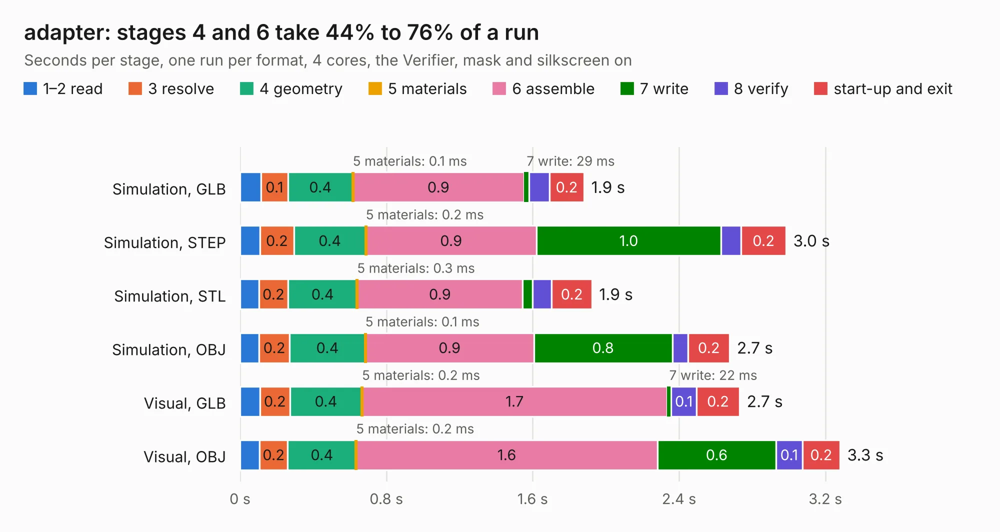

# 1661. adapter

Board 1,661 of the 3,122 of [Corpus Testing](../Corpus-Testing.md), on [Corpus Page 16](../CorpusTestingPages/Corpus-Testing-16.md#1661-adapter).

| Mode and format | 1–2 read | 3 resolve | 4 geometry | 5 materials | 6 assemble | 7 write | 8 verify | start-up and exit | Total |
|---|---:|---:|---:|---:|---:|---:|---:|---:|---:|
| Simulation, GLB | 0.1 | 0.1 | 0.4 | 0.1&nbsp;ms | 0.9 | 29&nbsp;ms | 0.1 | 0.2 | 1.9 |
| Simulation, STEP | 0.1 | 0.2 | 0.4 | 0.2&nbsp;ms | 0.9 | 1.0 | 0.1 | 0.2 | 3.0 |
| Simulation, STL | 0.1 | 0.2 | 0.4 | 0.3&nbsp;ms | 0.9 | 53&nbsp;ms | 0.1 | 0.2 | 1.9 |
| Simulation, OBJ | 0.1 | 0.2 | 0.4 | 0.1&nbsp;ms | 0.9 | 0.8 | 86&nbsp;ms | 0.2 | 2.7 |
| Visual, GLB | 0.1 | 0.2 | 0.4 | 0.2&nbsp;ms | 1.7 | 22&nbsp;ms | 0.1 | 0.2 | 2.7 |
| Visual, OBJ | 0.1 | 0.2 | 0.4 | 0.2&nbsp;ms | 1.6 | 0.6 | 0.1 | 0.2 | 3.3 |

<table align="center"><tr><td valign="top">

| Board | Repo: [Modos-Labs/Glider](https://github.com/Modos-Labs/Glider) Board: `adapter.kicad_pcb` |
|---|---|
| Folder | pcb / 39p-adapter-b |
| Complexity | 191&nbsp;/&nbsp;1000 (size&nbsp;126, features&nbsp;65) |
| KESE&nbsp;features | through vias, filled zones, stack-up, dielectric εr and tanδ |
| Tested | 9th November 2026 |
| Copper&nbsp;layers | 2 |
| File&nbsp;format | KiCad 8 (20240108) |
| Parts,&nbsp;tracks,&nbsp;vias | 2, 264, 42 |
| Triangles,&nbsp;simulation | 141,810 in 48 parts |
| Verifier | PASS in all six runs |

</td><td valign="top">

<table>
<tr><th>File type</th><th>File size</th><th>Peak memory used</th></tr>
<tr><th colspan="3" align="left">Simulation</th></tr>
<tr><td>GLB</td><td align="right">4.9&nbsp;MB</td><td align="right">216&nbsp;MB</td></tr>
<tr><td>STEP</td><td align="right">24&nbsp;MB</td><td align="right">216&nbsp;MB</td></tr>
<tr><td>STL</td><td align="right">7.1&nbsp;MB</td><td align="right">218&nbsp;MB</td></tr>
<tr><td>OBJ</td><td align="right">14&nbsp;MB</td><td align="right">217&nbsp;MB</td></tr>
<tr><th colspan="3" align="left">Visual</th></tr>
<tr><td>GLB</td><td align="right">3.9&nbsp;MB</td><td align="right">188&nbsp;MB</td></tr>
<tr><td>OBJ</td><td align="right">11&nbsp;MB</td><td align="right">186&nbsp;MB</td></tr>
</table>

</td></tr></table>

| Previous | Next |
|:---|---:|
| [1660. adapter](b1660b_Glider_pcb-35p-adapter-a_adapter.md) | [1662. adapter](b1662b_Glider_pcb-39p-adapter-c_adapter.md) |
