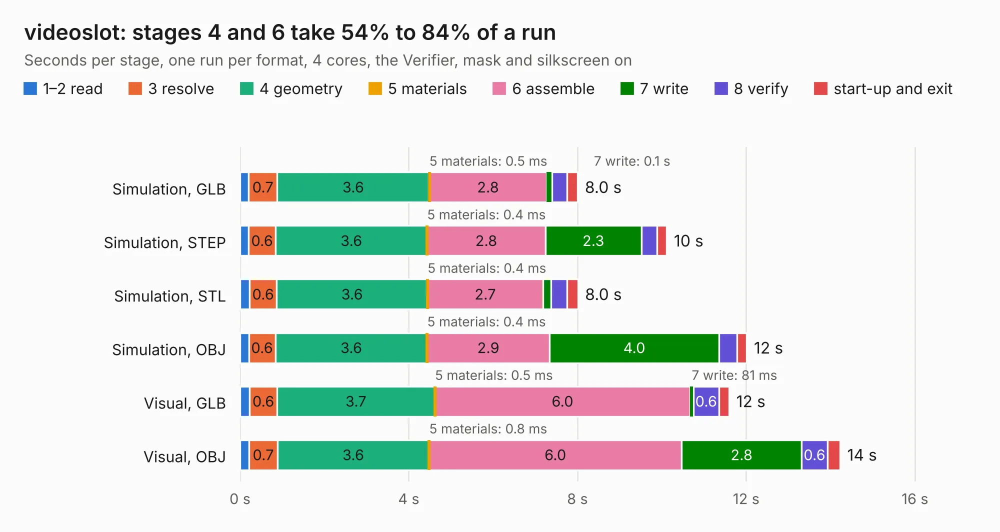

# 1663. videoslot

Board 1,663 of the 3,131 of [Corpus Testing](../Corpus-Testing.md), on [Corpus Page 16](../CorpusTestingPages/Corpus-Testing-16.md#1663-videoslot).

| Mode and format | 1–2 read | 3 resolve | 4 geometry | 5 materials | 6 assemble | 7 write | 8 verify | start-up and exit | Total |
|---|---:|---:|---:|---:|---:|---:|---:|---:|---:|
| Simulation, GLB | 0.2 | 0.7 | 3.6 | 0.5&nbsp;ms | 2.8 | 0.1 | 0.4 | 0.3 | 8.0 |
| Simulation, STEP | 0.2 | 0.6 | 3.6 | 0.4&nbsp;ms | 2.8 | 2.3 | 0.4 | 0.2 | 10.1 |
| Simulation, STL | 0.2 | 0.6 | 3.6 | 0.4&nbsp;ms | 2.7 | 0.2 | 0.4 | 0.3 | 8.0 |
| Simulation, OBJ | 0.2 | 0.6 | 3.6 | 0.4&nbsp;ms | 2.9 | 4.0 | 0.4 | 0.2 | 12.0 |
| Visual, GLB | 0.2 | 0.6 | 3.7 | 0.5&nbsp;ms | 6.0 | 81&nbsp;ms | 0.6 | 0.2 | 11.6 |
| Visual, OBJ | 0.2 | 0.7 | 3.6 | 0.8&nbsp;ms | 6.0 | 2.8 | 0.6 | 0.3 | 14.2 |

<table align="center"><tr><td valign="top">

| Board | Repo: [mntmn/amiga2000-gfxcard](https://github.com/mntmn/amiga2000-gfxcard) Board: `videoslot.kicad_pcb` |
|---|---|
| Folder | videoslot |
| Complexity | 184&nbsp;/&nbsp;1000 (size&nbsp;149, features&nbsp;35) |
| KESE&nbsp;features | through vias, filled zones |
| Tested | 9th November 2026 |
| Copper&nbsp;layers | 2 |
| File&nbsp;format | KiCad 5 (20160815) |
| Parts,&nbsp;tracks,&nbsp;vias | 13, 425, 49 |
| Triangles,&nbsp;simulation | 689,736 in 107 parts |
| Verifier | PASS in all six runs |

</td><td valign="top">

<table>
<tr><th>File type</th><th>File size</th><th>Peak memory used</th></tr>
<tr><th colspan="3" align="left">Simulation</th></tr>
<tr><td>GLB</td><td align="right">24&nbsp;MB</td><td align="right">343&nbsp;MB</td></tr>
<tr><td>STEP</td><td align="right">121&nbsp;MB</td><td align="right">403&nbsp;MB</td></tr>
<tr><td>STL</td><td align="right">34&nbsp;MB</td><td align="right">339&nbsp;MB</td></tr>
<tr><td>OBJ</td><td align="right">70&nbsp;MB</td><td align="right">495&nbsp;MB</td></tr>
<tr><th colspan="3" align="left">Visual</th></tr>
<tr><td>GLB</td><td align="right">16&nbsp;MB</td><td align="right">419&nbsp;MB</td></tr>
<tr><td>OBJ</td><td align="right">49&nbsp;MB</td><td align="right">420&nbsp;MB</td></tr>
</table>

</td></tr></table>

| Previous | Next |
|:---|---:|
| [1662. amiga-gfxcard](b1662b_amiga2000-gfxcard_amiga-gfxcard.md) | [1664. adapter](b1664b_Glider_pcb-34p-adapter-a_adapter.md) |
