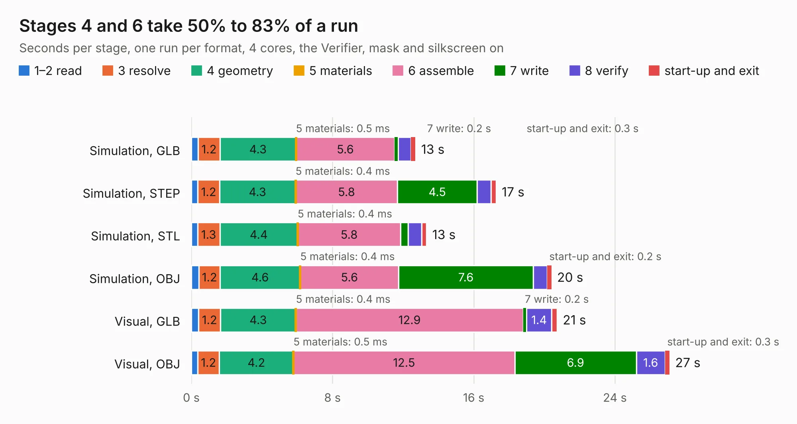

# 1663. OpenCAPI-to-PCIe_for_MNV303212A_RevA2

Board 1,663 of the 3,105 of [Corpus Testing](../Corpus-Testing.md), on [Corpus Page 16](../CorpusTestingPages/Corpus-Testing-16.md#1663-opencapi-to-pcie_for_mnv303212a_reva2).

| Mode and format | 1–2 read | 3 resolve | 4 geometry | 5 materials | 6 assemble | 7 write | 8 verify | start-up and exit | Total |
|---|---:|---:|---:|---:|---:|---:|---:|---:|---:|
| Simulation, GLB | 0.4 | 1.2 | 4.3 | 0.5&nbsp;ms | 5.6 | 0.2 | 0.7 | 0.3 | 12.7 |
| Simulation, STEP | 0.4 | 1.2 | 4.3 | 0.4&nbsp;ms | 5.8 | 4.5 | 0.8 | 0.3 | 17.3 |
| Simulation, STL | 0.4 | 1.3 | 4.4 | 0.4&nbsp;ms | 5.8 | 0.4 | 0.8 | 0.3 | 13.3 |
| Simulation, OBJ | 0.4 | 1.2 | 4.6 | 0.4&nbsp;ms | 5.6 | 7.6 | 0.8 | 0.2 | 20.4 |
| Visual, GLB | 0.4 | 1.2 | 4.3 | 0.4&nbsp;ms | 12.9 | 0.2 | 1.4 | 0.3 | 20.7 |
| Visual, OBJ | 0.4 | 1.2 | 4.2 | 0.5&nbsp;ms | 12.5 | 6.9 | 1.6 | 0.3 | 27.1 |

<table align="center"><tr><td valign="top">

| Board | Repo: [mwrnd/opencapi-to-pcie_for_mnv303212a_reva2](https://github.com/mwrnd/opencapi-to-pcie_for_mnv303212a_reva2) Board: `OpenCAPI-to-PCIe_for_MNV303212A_RevA2.kicad_pcb` |
|---|---|
| Complexity | 284&nbsp;/&nbsp;1000 (size&nbsp;184, features&nbsp;100) |
| KESE&nbsp;features | through vias, rounded, trapezoid or chamfered pads, arc tracks, filled zones, copper text, stack-up, dielectric εr and tanδ |
| Tested | 9th November 2026 |
| Copper&nbsp;layers | 4 |
| File&nbsp;format | KiCad 9 (20241229) |
| Parts,&nbsp;tracks,&nbsp;vias | 5, 2,398, 175 |
| Triangles,&nbsp;simulation | 1,358,418 in 85 parts |
| Verifier | PASS in all six runs |

</td><td valign="top">

<table>
<tr><th>File type</th><th>File size</th><th>Peak memory used</th></tr>
<tr><th colspan="3" align="left">Simulation</th></tr>
<tr><td>GLB</td><td align="right">46&nbsp;MB</td><td align="right">650&nbsp;MB</td></tr>
<tr><td>STEP</td><td align="right">212&nbsp;MB</td><td align="right">780&nbsp;MB</td></tr>
<tr><td>STL</td><td align="right">68&nbsp;MB</td><td align="right">645&nbsp;MB</td></tr>
<tr><td>OBJ</td><td align="right">139&nbsp;MB</td><td align="right">897&nbsp;MB</td></tr>
<tr><th colspan="3" align="left">Visual</th></tr>
<tr><td>GLB</td><td align="right">37&nbsp;MB</td><td align="right">720&nbsp;MB</td></tr>
<tr><td>OBJ</td><td align="right">112&nbsp;MB</td><td align="right">828&nbsp;MB</td></tr>
</table>

</td></tr></table>

| Previous | Next |
|:---|---:|
| [1662. pocketbone-kicad](b1662b_pocketbone-kicad_pocketbone-kicad.md) | [1664. AnalogComputer](b1664b_embeddedbakery_AnalogComputer.md) |
