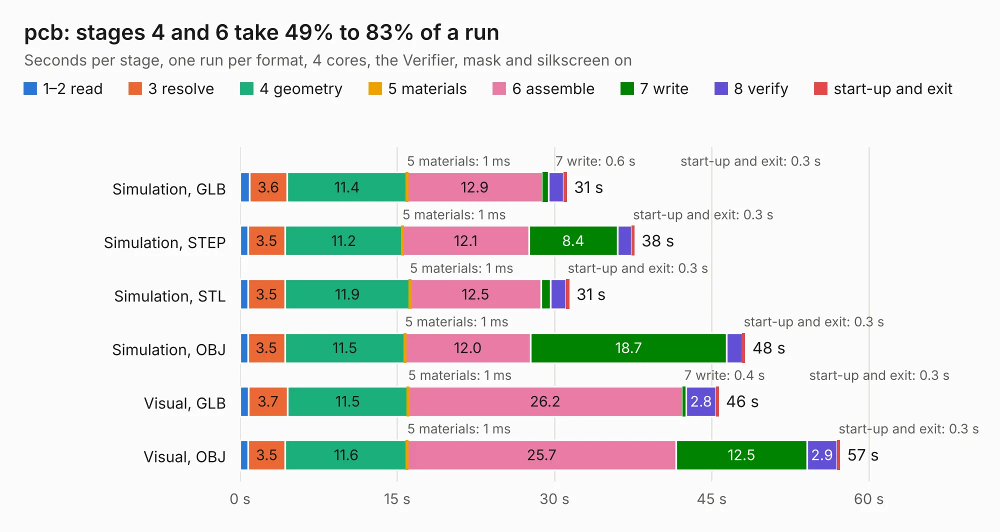

# 1666. pcb

Board 1,666 of the 3,118 of [Corpus Testing](../Corpus-Testing.md), on [Corpus Page 16](../CorpusTestingPages/Corpus-Testing-16.md#1666-pcb).

| Mode and format | 1–2 read | 3 resolve | 4 geometry | 5 materials | 6 assemble | 7 write | 8 verify | start-up and exit | Total |
|---|---:|---:|---:|---:|---:|---:|---:|---:|---:|
| Simulation, GLB | 0.9 | 3.6 | 11.4 | 1&nbsp;ms | 12.9 | 0.6 | 1.4 | 0.3 | 31.2 |
| Simulation, STEP | 0.8 | 3.5 | 11.2 | 1&nbsp;ms | 12.1 | 8.4 | 1.3 | 0.3 | 37.6 |
| Simulation, STL | 0.8 | 3.5 | 11.9 | 1&nbsp;ms | 12.5 | 0.9 | 1.5 | 0.3 | 31.4 |
| Simulation, OBJ | 0.7 | 3.5 | 11.5 | 1&nbsp;ms | 12.0 | 18.7 | 1.5 | 0.3 | 48.2 |
| Visual, GLB | 0.8 | 3.7 | 11.5 | 1&nbsp;ms | 26.2 | 0.4 | 2.8 | 0.3 | 45.7 |
| Visual, OBJ | 0.8 | 3.5 | 11.6 | 1&nbsp;ms | 25.7 | 12.5 | 2.9 | 0.3 | 57.2 |

<table align="center"><tr><td valign="top">

| Board | Repo: [Modos-Labs/Lancer](https://github.com/Modos-Labs/Lancer) Board: `pcb.kicad_pcb` |
|---|---|
| Folder | pcb / epdc_poc_board |
| Complexity | 390&nbsp;/&nbsp;1000 (size&nbsp;285, features&nbsp;105) |
| KESE&nbsp;features | through vias, custom pads, rounded, trapezoid or chamfered pads, filled zones, copper drawings, stack-up, dielectric εr and tanδ, mask and silkscreen colours |
| Tested | 9th November 2026 |
| Copper&nbsp;layers | 4 |
| File&nbsp;format | KiCad 6 (20210824) |
| Parts,&nbsp;tracks,&nbsp;vias | 152, 2,972, 478 |
| Triangles,&nbsp;simulation | 2,984,120 in 302 parts |
| Verifier | PASS in all six runs |

</td><td valign="top">

<table>
<tr><th>File type</th><th>File size</th><th>Peak memory used</th></tr>
<tr><th colspan="3" align="left">Simulation</th></tr>
<tr><td>GLB</td><td align="right">103&nbsp;MB</td><td align="right">941&nbsp;MB</td></tr>
<tr><td>STEP</td><td align="right">437&nbsp;MB</td><td align="right">1.2&nbsp;GB</td></tr>
<tr><td>STL</td><td align="right">149&nbsp;MB</td><td align="right">929&nbsp;MB</td></tr>
<tr><td>OBJ</td><td align="right">315&nbsp;MB</td><td align="right">2.0&nbsp;GB</td></tr>
<tr><th colspan="3" align="left">Visual</th></tr>
<tr><td>GLB</td><td align="right">71&nbsp;MB</td><td align="right">1.2&nbsp;GB</td></tr>
<tr><td>OBJ</td><td align="right">225&nbsp;MB</td><td align="right">1.5&nbsp;GB</td></tr>
</table>

</td></tr></table>

| Previous | Next |
|:---|---:|
| [1665. adapter](b1665b_Glider_pcb-u133-adapter_adapter.md) | [1667. pcb](b1667b_Lancer_pcb-mainboard_pcb.md) |
