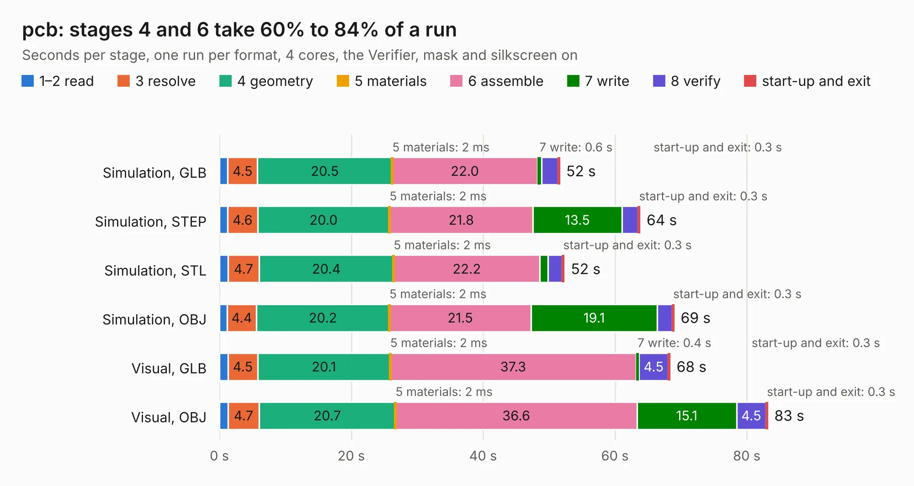

# 1666. pcb

Board 1,666 of the 3,117 of [Corpus Testing](../Corpus-Testing.md), on [Corpus Page 16](../CorpusTestingPages/Corpus-Testing-16.md#1666-pcb).

| Mode and format | 1–2 read | 3 resolve | 4 geometry | 5 materials | 6 assemble | 7 write | 8 verify | start-up and exit | Total |
|---|---:|---:|---:|---:|---:|---:|---:|---:|---:|
| Simulation, GLB | 1.3 | 4.5 | 20.5 | 2&nbsp;ms | 22.0 | 0.6 | 2.5 | 0.3 | 51.6 |
| Simulation, STEP | 1.2 | 4.6 | 20.0 | 2&nbsp;ms | 21.8 | 13.5 | 2.5 | 0.3 | 63.8 |
| Simulation, STL | 1.3 | 4.7 | 20.4 | 2&nbsp;ms | 22.2 | 1.2 | 2.2 | 0.3 | 52.3 |
| Simulation, OBJ | 1.2 | 4.4 | 20.2 | 2&nbsp;ms | 21.5 | 19.1 | 2.3 | 0.3 | 69.0 |
| Visual, GLB | 1.3 | 4.5 | 20.1 | 2&nbsp;ms | 37.3 | 0.4 | 4.5 | 0.3 | 68.4 |
| Visual, OBJ | 1.3 | 4.7 | 20.7 | 2&nbsp;ms | 36.6 | 15.1 | 4.5 | 0.3 | 83.2 |

<table align="center"><tr><td valign="top">

| Board | Repo: [Modos-Labs/Lancer](https://github.com/Modos-Labs/Lancer) Board: `pcb.kicad_pcb` |
|---|---|
| Folder | pcb / mainboard |
| Complexity | 385&nbsp;/&nbsp;1000 (size&nbsp;270, features&nbsp;115) |
| KESE&nbsp;features | through vias, slotted holes, custom pads, rounded, trapezoid or chamfered pads, filled zones, copper drawings, stack-up, dielectric εr and tanδ, mask and silkscreen colours |
| Tested | 9th November 2026 |
| Copper&nbsp;layers | 2 |
| File&nbsp;format | KiCad 6 (20210824) |
| Parts,&nbsp;tracks,&nbsp;vias | 252, 3,168, 656 |
| Triangles,&nbsp;simulation | 3,434,270 in 443 parts |
| Verifier | PASS in all six runs |

</td><td valign="top">

<table>
<tr><th>File type</th><th>File size</th><th>Peak memory used</th></tr>
<tr><th colspan="3" align="left">Simulation</th></tr>
<tr><td>GLB</td><td align="right">119&nbsp;MB</td><td align="right">1.3&nbsp;GB</td></tr>
<tr><td>STEP</td><td align="right">679&nbsp;MB</td><td align="right">1.7&nbsp;GB</td></tr>
<tr><td>STL</td><td align="right">172&nbsp;MB</td><td align="right">1.3&nbsp;GB</td></tr>
<tr><td>OBJ</td><td align="right">368&nbsp;MB</td><td align="right">2.3&nbsp;GB</td></tr>
<tr><th colspan="3" align="left">Visual</th></tr>
<tr><td>GLB</td><td align="right">90&nbsp;MB</td><td align="right">1.7&nbsp;GB</td></tr>
<tr><td>OBJ</td><td align="right">282&nbsp;MB</td><td align="right">1.9&nbsp;GB</td></tr>
</table>

</td></tr></table>

| Previous | Next |
|:---|---:|
| [1665. pcb](b1665b_Lancer_pcb-epdc-poc-board_pcb.md) | [1667. pcb](b1667b_Lancer_pcb-usb-adapter-board_pcb.md) |
