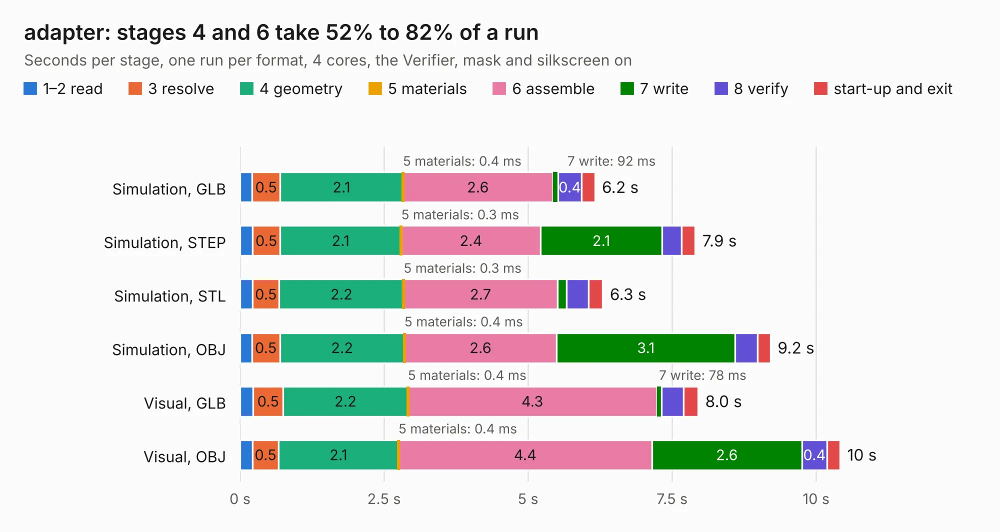

# 1667. adapter

Board 1,667 of the 3,124 of [Corpus Testing](../Corpus-Testing.md), on [Corpus Page 16](../CorpusTestingPages/Corpus-Testing-16.md#1667-adapter).

| Mode and format | 1–2 read | 3 resolve | 4 geometry | 5 materials | 6 assemble | 7 write | 8 verify | start-up and exit | Total |
|---|---:|---:|---:|---:|---:|---:|---:|---:|---:|
| Simulation, GLB | 0.2 | 0.5 | 2.1 | 0.4&nbsp;ms | 2.6 | 92&nbsp;ms | 0.4 | 0.2 | 6.2 |
| Simulation, STEP | 0.2 | 0.5 | 2.1 | 0.3&nbsp;ms | 2.4 | 2.1 | 0.3 | 0.2 | 7.9 |
| Simulation, STL | 0.2 | 0.5 | 2.2 | 0.3&nbsp;ms | 2.7 | 0.2 | 0.4 | 0.2 | 6.3 |
| Simulation, OBJ | 0.2 | 0.5 | 2.2 | 0.4&nbsp;ms | 2.6 | 3.1 | 0.4 | 0.2 | 9.2 |
| Visual, GLB | 0.2 | 0.5 | 2.2 | 0.4&nbsp;ms | 4.3 | 78&nbsp;ms | 0.4 | 0.3 | 8.0 |
| Visual, OBJ | 0.2 | 0.5 | 2.1 | 0.4&nbsp;ms | 4.4 | 2.6 | 0.4 | 0.2 | 10.4 |

<table align="center"><tr><td valign="top">

| Board | Repo: [Modos-Labs/Glider](https://github.com/Modos-Labs/Glider) Board: `adapter.kicad_pcb` |
|---|---|
| Folder | pcb / 50p-adapter-c |
| Complexity | 244&nbsp;/&nbsp;1000 (size&nbsp;169, features&nbsp;75) |
| KESE&nbsp;features | through vias, rounded, trapezoid or chamfered pads, filled zones, stack-up, dielectric εr and tanδ |
| Tested | 9th November 2026 |
| Copper&nbsp;layers | 2 |
| File&nbsp;format | KiCad 6 (20211014) |
| Parts,&nbsp;tracks,&nbsp;vias | 26, 982, 90 |
| Triangles,&nbsp;simulation | 554,128 in 87 parts |
| Verifier | PASS in all six runs |

</td><td valign="top">

<table>
<tr><th>File type</th><th>File size</th><th>Peak memory used</th></tr>
<tr><th colspan="3" align="left">Simulation</th></tr>
<tr><td>GLB</td><td align="right">19&nbsp;MB</td><td align="right">328&nbsp;MB</td></tr>
<tr><td>STEP</td><td align="right">100&nbsp;MB</td><td align="right">395&nbsp;MB</td></tr>
<tr><td>STL</td><td align="right">28&nbsp;MB</td><td align="right">332&nbsp;MB</td></tr>
<tr><td>OBJ</td><td align="right">56&nbsp;MB</td><td align="right">424&nbsp;MB</td></tr>
<tr><th colspan="3" align="left">Visual</th></tr>
<tr><td>GLB</td><td align="right">16&nbsp;MB</td><td align="right">405&nbsp;MB</td></tr>
<tr><td>OBJ</td><td align="right">46&nbsp;MB</td><td align="right">464&nbsp;MB</td></tr>
</table>

</td></tr></table>

| Previous | Next |
|:---|---:|
| [1666. adapter](b1666b_Glider_pcb-50p-adapter-b_adapter.md) | [1668. pcb](b1668b_Glider_pcb.md) |
