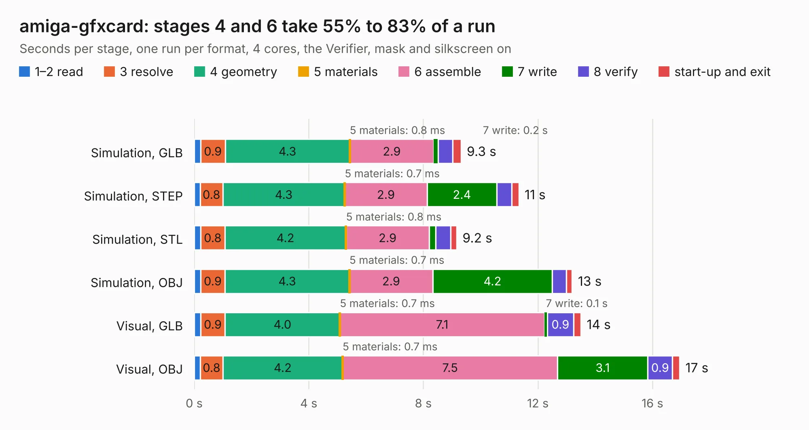

# 1667 amiga-gfxcard

Board 1,667 of the 3,138 of [Corpus Testing](../Corpus-Testing.md), on [Corpus Page 16](../CorpusTestingPages/Corpus-Testing-16.md#1667-amiga-gfxcard).

| Mode and format | 1–2 read | 3 resolve | 4 geometry | 5 materials | 6 assemble | 7 write | 8 verify | start-up and exit | Total |
|---|---:|---:|---:|---:|---:|---:|---:|---:|---:|
| Simulation, GLB | 0.2 | 0.9 | 4.3 | 0.8&nbsp;ms | 2.9 | 0.2 | 0.5 | 0.3 | 9.3 |
| Simulation, STEP | 0.2 | 0.8 | 4.3 | 0.7&nbsp;ms | 2.9 | 2.4 | 0.5 | 0.3 | 11.3 |
| Simulation, STL | 0.2 | 0.8 | 4.2 | 0.8&nbsp;ms | 2.9 | 0.2 | 0.5 | 0.2 | 9.2 |
| Simulation, OBJ | 0.2 | 0.9 | 4.3 | 0.7&nbsp;ms | 2.9 | 4.2 | 0.5 | 0.2 | 13.2 |
| Visual, GLB | 0.2 | 0.9 | 4.0 | 0.7&nbsp;ms | 7.1 | 0.1 | 0.9 | 0.3 | 13.5 |
| Visual, OBJ | 0.2 | 0.8 | 4.2 | 0.7&nbsp;ms | 7.5 | 3.1 | 0.9 | 0.2 | 16.9 |

<table align="center"><tr><td valign="top">

| Board | Repo: [mntmn/amiga2000-gfxcard](https://github.com/mntmn/amiga2000-gfxcard) Board: `amiga-gfxcard.kicad_pcb` |
|---|---|
| Folder | kicad |
| Complexity | 206&nbsp;/&nbsp;1000 (size&nbsp;171, features&nbsp;35) |
| KESE&nbsp;features | through vias, filled zones |
| Tested | 9th November 2026 |
| Copper&nbsp;layers | 2 |
| File&nbsp;format | KiCad 4 (4) |
| Parts,&nbsp;tracks,&nbsp;vias | 32, 871, 112 |
| Triangles,&nbsp;simulation | 842,260 in 159 parts |
| Verifier | PASS in all six runs |

</td><td valign="top">

<table>
<tr><th>File type</th><th>File size</th><th>Peak memory used</th></tr>
<tr><th colspan="3" align="left">Simulation</th></tr>
<tr><td>GLB</td><td align="right">30&nbsp;MB</td><td align="right">401&nbsp;MB</td></tr>
<tr><td>STEP</td><td align="right">147&nbsp;MB</td><td align="right">472&nbsp;MB</td></tr>
<tr><td>STL</td><td align="right">42&nbsp;MB</td><td align="right">423&nbsp;MB</td></tr>
<tr><td>OBJ</td><td align="right">87&nbsp;MB</td><td align="right">621&nbsp;MB</td></tr>
<tr><th colspan="3" align="left">Visual</th></tr>
<tr><td>GLB</td><td align="right">21&nbsp;MB</td><td align="right">538&nbsp;MB</td></tr>
<tr><td>OBJ</td><td align="right">65&nbsp;MB</td><td align="right">524&nbsp;MB</td></tr>
</table>

</td></tr></table>

| Previous | Next |
|:---|---:|
| [1666 amiga-gfxcard-before-pour](b1666b_amiga2000-gfxcard_amiga-gfxcard-before-pour.md) | [1668 videoslot](b1668b_amiga2000-gfxcard_videoslot.md) |
